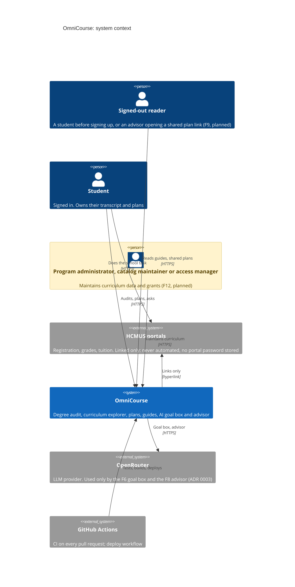
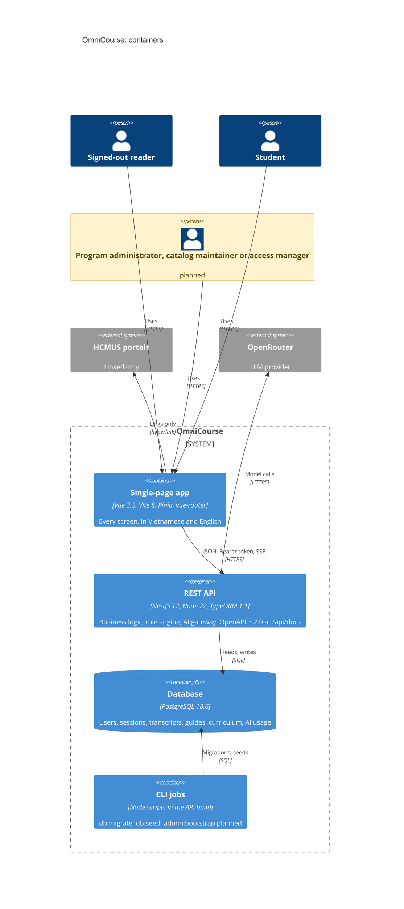
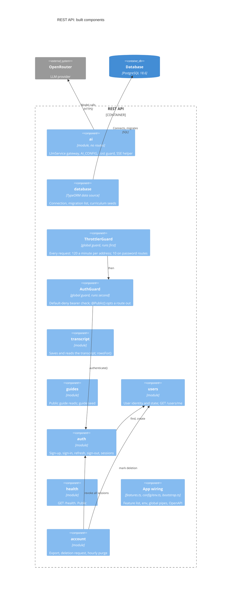
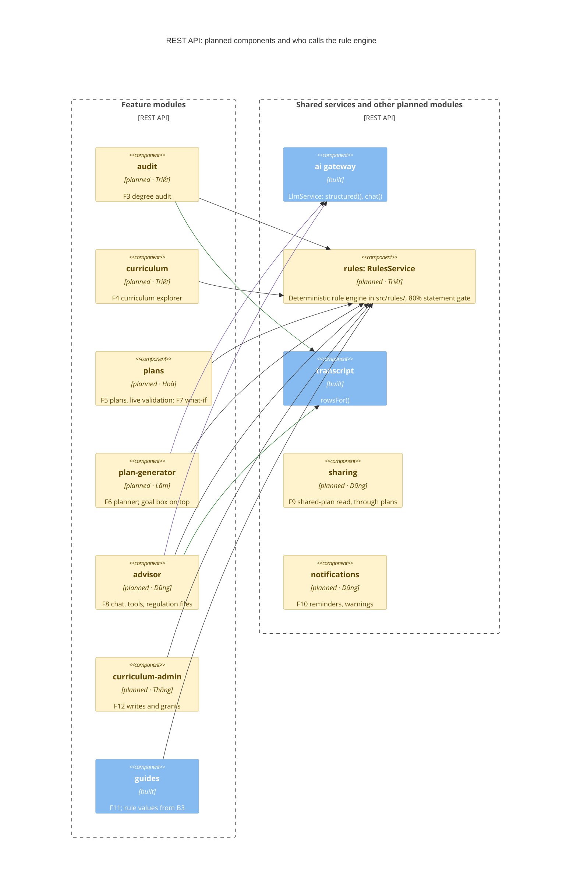
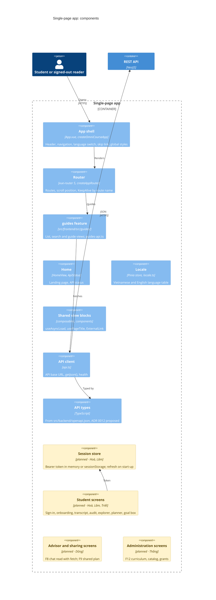

# Software Architecture Document

- Status: draft for review, due 15 Nov 2026 (SDP v2 §2.3)
- Owner: Triết (Backend Lead; the SDP gives him the architecture document). This version was written at Lâm's request.
- Reviewers: Triết (backend, rule engine), Hoà (frontend), Lâm (authentication, AI gateway, deployment)
- Code described: `main` at `a8bd0c9`, plus the untangle refactor (see [Revisions in this version](#revisions-in-this-version))

## 1. Purpose and scope

This document describes how OmniCourse is built: the people and systems around it, the deployable parts, the components inside each part, and the rules that cut across all of them. It is the architecture view the RUP process asks for. The requirements behind it are in the Vision (F1–F12 and the NFRs, `report/assignments/PA2/Vision.tex`), the use cases in [`docs/requirements/`](../requirements/), and the decisions in the [ADRs](adr/). Words such as *degree audit*, *rule engine*, *plan*, *term* and *guide* have the meanings in [GLOSSARY.md](../../GLOSSARY.md).

Scope: everything in `src/` today, and the modules the Vision, the ADRs and the SDP plan for the coming sprints. Planned parts are drawn in amber and labelled **planned**, with their owner; grey boxes are external systems. A planned part is a commitment to a boundary, not to a design: its own ADR or PR decides the details.

### How to read this

The diagrams follow the [C4 model](https://c4model.com). Each level zooms into one box of the level above.

| Level | Question it answers | Section |
| --- | --- | --- |
| L1 System context | Who uses OmniCourse, and which outside systems does it touch? | [§2](#2-l1-system-context) |
| L2 Containers | Which separately running parts make up OmniCourse, and how do they talk? | [§3](#3-l2-containers) |
| L3 Components | Which modules sit inside the API and the single-page app? | [§4](#4-l3-components-of-the-api), [§5](#5-l3-components-of-the-single-page-app) |

Code is the fourth C4 level; it lives in `src/` and is not drawn here. Cross-cutting rules ([§6](#6-cross-cutting-concerns)), deployment ([§7](#7-deployment-view)), the map from ADRs to components ([§8](#8-architecture-decisions)) and open questions ([§9](#9-open-questions-and-risks)) follow. The diagrams are Mermaid C4 blocks, which GitHub renders; a box's second line names its technology or, for planned parts, `planned · <owner>`.

## 2. L1 System context

**People.** One person plays several roles over time ([GLOSSARY: User](../../GLOSSARY.md)).

- A **signed-out reader** can read guides ([ADR 0010](adr/0010-public-pages-and-guide-content.md)) and, once F9 ships, open a shared plan. An advisor needs no account.
- A **student** signs in for everything that uses their own data: transcript, degree audit, plans, the goal box and the advisor.
- A **program administrator**, **catalog maintainer** or **access manager** maintains curriculum data and grants through F12. These are separate grants, denied by default ([ADR 0011](adr/0011-curriculum-administration.md), proposed). Until F12 ships, curriculum data enters only through reviewed seed files.

**External systems.**

- **HCMUS portals.** OmniCourse only links to them. It never stores a portal password and never automates a registration (AGENTS.md hard rule 2). A [guide](../requirements/guides-plan.md) gives the link, the steps and the account the portal needs; the student does the task on the portal.
- **OpenRouter** is the language-model provider, reached only through the AI gateway and only by F6's goal box and F8's advisor ([ADR 0003](adr/0003-language-model-scope.md)). Training opt-out and a monthly credit limit are set on the OpenRouter account. The model receives no name, email or student ID.
- **GitHub Actions** runs CI on every pull request (typecheck, unit and e2e tests against PostgreSQL 18.6, browser tests, build, the OpenAPI export, and the signed-commit, Conventional Commits and changeset checks). The deploy workflow builds the artifacts and tags builds B0–B3; pushing them to a host waits for the staging host ([§7](#7-deployment-view)).

## 3. L2 Containers

| Container | Code | Talks to | Notes |
| --- | --- | --- | --- |
| Single-page app | `src/frontend` | REST API | Built by Vite into static files. Reads the API address from `VITE_API_URL` at build time. |
| REST API | `src/backend` | Database, OpenRouter | Every route is under `/api`. Swagger UI is at `/api/docs`, the document at `/api/docs-json`. |
| Database | `compose.yaml` locally | | One schema. Changed only by migrations; `synchronize` is off ([ADR 0001](adr/0001-technology-stack.md)). |
| CLI jobs | `src/backend/src/database/{migrate,seed}.ts` | Database | Run by an operator or CI, never by a request. Seeding is insert-only and idempotent. |

**Protocols.**

- **SPA → API:** JSON over HTTPS. A signed-in request carries `Authorization: Bearer <token>`, where the token is 32 random bytes the server stores only as a SHA-256 hash ([ADR 0002](adr/0002-authentication-and-sessions.md)). Bearer, not cookies, so no CSRF defence is needed while the SPA and API sit on different origins; CORS allows only `CORS_ORIGIN`.
- **F8 advisor stream:** `POST` answered with `text/event-stream`. The SPA reads it with `fetch`, because `EventSource` cannot send the bearer header ([ADR 0003](adr/0003-language-model-scope.md)). The helper `streamChat` in `ai/sse.ts` already exists.
- **API → OpenRouter:** HTTPS through the `openai` SDK with OpenRouter's `baseURL`.
- **API, CLI → Database:** SQL through `pg`; the API uses TypeORM repositories and transactions.

## 4. L3 Components of the API

One Nest module per feature folder (`src/backend/src/<feature>/`). The API is drawn twice: the components that exist, and the planned ones with their calls into the rule engine.

### 4.1 Built components

Every request from the single-page app passes the throttler guard, then the auth guard, then reaches the controller of the matching module. Every module reaches the database through its own TypeORM repositories; those arrows are left out.

| Component | Folder | Responsibility | Exposes to other modules |
| --- | --- | --- | --- |
| Throttler guard | `auth/rate-limits.ts` | `@nestjs/throttler` 6.7.1. Defines the throttler config and `PASSWORD_LIMIT` from one constant: 120 requests a minute per address everywhere, 10 on sign-up, sign-in and account deletion. Registered first. | `PASSWORD_LIMIT` |
| Auth guard | `auth/auth.guard.ts` | Registered second, as `APP_GUARD`. Reads the bearer token, looks up the session, sets the request's user. Every route needs a signed-in user unless marked `@Public()`. | `@Public()`, `@CurrentUser()`, `@CurrentSession()`, `Authenticated()` |
| health | `health/` | `GET /api/health`: API up, database reachable, PostgreSQL version. Public. | |
| users | `users/` | The `users` table: identity only (email, `password_hash`, `google_sub`, consent, deletion state). `create`, find, `cancelDeletion`, "is deletion pending", and `markDeletionRequestedWithin(manager, …)`. `GET /api/users/me`. | `UsersService` |
| auth | `auth/` | F1 sign-up, sign-in, refresh with rotation, sign-out, list and revoke sessions; argon2id passwords; the `sessions` table ([ADR 0002](adr/0002-authentication-and-sessions.md)). Sign-in before the purge deadline cancels a pending deletion. | `AuthService` (incl. `revokeAllWithin(manager, userId)`), `AuthGuard` |
| account | `account/` | `GET /api/users/me/export` and `DELETE /api/users/me`. Owns the deletion flows: request, find accounts past their deadline, purge one account at a time, hourly ([ADR 0004](adr/0004-account-export-and-deletion.md)). Scheduling a deletion and revoking every session commit in one transaction, through the `…Within(manager)` methods of `users` and `auth`; `account` never writes the `sessions` table itself. | |
| transcript | `transcript/` | F2 storage: `GET` and `PUT /api/users/me/transcript`, whole-set replace under a row lock ([ADR 0007](adr/0007-transcript.md)). The F2 PDF parser is planned (Lâm, 22 Nov). | `TranscriptService.rowsFor(userId)` returning `TranscriptEntry[]` |
| guides | `guides/` | F11: `GET /api/guides` and `GET /api/guides/:id`, public and read-only ([ADR 0010](adr/0010-public-pages-and-guide-content.md)). Owns its records: `guide-file.ts` holds the ID rule and the mapping between content files and rows, and the guides seed loads them. | `seed(dataSource, options)` for the CLI |
| ai | `ai/` | The AI gateway ([ADR 0003](adr/0003-language-model-scope.md)). No routes. `LlmService.structured()` and `chat()` with a tool loop; `AI_CONFIG`, a provider read once at boot from `config/env.ts`; one `preflight()` (model and key) before the cost guard reserves a call; the OpenRouter client built once; `streamChat` for SSE. Every failure is `AiUnavailableError` → 503 `ai_unavailable`. | `LlmService`, `streamChat`, `FakeLlmService` for tests |
| App wiring | `features.ts`, `config/`, `bootstrap.ts`, `app.module.ts` | `FEATURE_MODULES` is the one list of feature modules; `app.module.ts` and the OpenAPI generator `openapi.ts` both spread it, so the contract always lists every route. Each module registers its own entities (`autoLoadEntities`). `config/env.ts` holds `loadEnvFiles()` and typed getters (port, CORS origin, database URL, session lifetime, deletion grace period, AI settings); `main.ts` and the CLI jobs call it. `configureApp()` sets the `/api` prefix, the validation pipe, CORS and Swagger for the server and the e2e tests alike. | |
| database | `database/` | `data-source.ts` (connection options and migrations only), `migrations/index.ts` (the ordered list of migration classes), the curriculum schema (programs, curricula, requirement groups, courses; [ADR 0005](adr/0005-curriculum-cohort-and-course-catalog.md)) and the APCS and CLC curriculum seeds. | `seed()` for the curriculum data |

`terms/` is not a module: it holds the shared `Term` interface and `TermDto` that every module uses for a term ([ADR 0009](adr/0009-term-encoding.md)).

**CLI jobs.** Both load the environment through `config/env.ts`.

- `npm run db:migrate -w src/backend` applies pending migrations from `migrations/index.ts`, each in its own transaction.
- `npm run db:seed -w src/backend` calls each feature's `seed(dataSource, options)` in order: curriculum data first, then guides. It inserts only what is missing. `--guide-fixtures` adds the synthetic test guides and is refused when `NODE_ENV=production`.
- `npm run admin:bootstrap` (planned, [ADR 0011](adr/0011-curriculum-administration.md)) grants the first access manager from a trusted shell; it is never an HTTP route.

### 4.2 Planned components and the rule engine

Black lines are calls into the rule engine, purple lines calls to the AI gateway, green lines reads of the transcript through `rowsFor()`. `sharing` reads plans through one read-only method of `plans`, and `notifications` warns when a saved transcript changes; those two links are left out of the drawing.

| Planned component | Feature | Owner | Due (SDP v2) | Source |
| --- | --- | --- | --- | --- |
| `rules` (`RulesService`) | rule engine | Triết | validation endpoint 16 Nov; planner functions 29 Nov | Vision objective 2; [ADR 0006](https://github.com/LLaammTTeerr/omnicourses/pull/27) (proposed, PR #27) |
| `audit` | F3 degree audit | Triết | B1, 15 Nov | Vision F3, UC-03 |
| `curriculum` (explorer) | F4 curriculum explorer | Triết | B1, 15 Nov | Vision F4, UC-04 |
| `plans` | F5 planner, F7 what-if | Hoà | API 8 Nov; planner B2; what-if B3 | Vision F5, F7; UC-05, UC-06 |
| `plan-generator` | F6 plan generator and goal box | Lâm | B3 | [ADR 0003](adr/0003-language-model-scope.md); ADR 0006 (proposed) |
| `advisor` | F8 advisor chat | Dũng | B3 | [ADR 0003](adr/0003-language-model-scope.md), UC-08 |
| `sharing` | F9 export and sharing | Dũng | B2 | [ADR 0010](adr/0010-public-pages-and-guide-content.md), UC-09 |
| `notifications` | F10 notifications | Dũng | B2 | Vision F10, UC-12; delivery contract open |
| `curriculum-admin` | F12 curriculum administration | Thắng | B2 | [ADR 0011](adr/0011-curriculum-administration.md) (proposed) |

**The rule engine is the only authority on academic rules** (AGENTS.md hard rule 1). Prerequisites, offering terms, credit caps (14–25 in a main term, 12 in summer), requirement coverage and graduation status are computed only in `src/rules/`. The folder name matters: `vitest.config.mts` already holds `src/rules/**` to 80 % statement coverage (Vision NFR), so engine code placed anywhere else escapes the gate. The engine is deterministic, has no side effects and imports neither `ai` nor any feature that calls it.

Seven components call the engine, all as readers of its answers:

- `audit` computes graduation status from `TranscriptService.rowsFor()` and the curriculum.
- `curriculum` shows prerequisites and what each course unlocks.
- `plans` validates every change to a plan live (performance NFR: under 300 ms).
- `plan-generator` places courses term by term and asks the engine whether each placement is allowed (ADR 0006, proposed). It holds no rule of its own.
- `advisor`'s tool handlers ask the engine to check a rule for the student.
- `curriculum-admin` asks for final-state validation before a write commits ([ADR 0011](adr/0011-curriculum-administration.md)).
- `guides` fills rule values, such as the student's credit cap, into a guide from B3 (UC-10 A3).

**The AI gateway never decides a rule.** In the goal box, the model only turns a sentence into the planning-goal form; the student reviews it, and the planner then works over the engine. In the advisor, the gateway runs the tool loop: a tool handler, written by the `advisor` owner, calls the engine and returns its answer for the model to explain. Nothing the model returns is written back as a rule, a placement or a status.

**Transcript and curriculum data are never read by a model.** F2 uses a deterministic parser; F12 data is entered by people or by CSV through the same validated services ([ADR 0003](adr/0003-language-model-scope.md), [ADR 0011](adr/0011-curriculum-administration.md)).

## 5. L3 Components of the single-page app

| Component | Code | Responsibility |
| --- | --- | --- |
| App shell | `App.vue`, `main.ts`, `styles.css` | `createOmniCourseApp()` builds the app with Pinia and the router; `main.ts` mounts it, and the tests use the same factory. The shell holds the header, navigation, language switch and skip link, and the global stylesheet (screen-reader class, card and button rules, colour token). |
| Router | `router.ts` | `createAppRouter()`: `/` (home), `/guides`, `/guides/:id`. Back restores the scroll position; the guide list is kept alive by route name so Back finds the same search. |
| Locale | `locale.ts` | Pinia store for the screen language. One table maps each language to its `Intl` tag, date format, own name and the other language. Defaults to Vietnamese; remembered in `localStorage`. The UI language type is separate from a guide's content language. |
| Shared view blocks | composables and components | `useAsyncLoad` (loading, failure, retry, ignoring a stale response), `usePageTitle` (tab title, aware of KeepAlive), `ExternalLink.vue` (new tab with safe `rel`), used by every view. |
| API client | `api.ts` | `API_URL` from `VITE_API_URL`; one `getJson(path)`; `fetchHealth()`. Feature modules build their calls on it. Components never call `fetch` directly (AGENTS.md). |
| API types | generated | Request and response types come from the committed contract `src/backend/openapi.json`, through `openapi-typescript`. If that tool refuses OpenAPI 3.2.0, a frontend test instead checks the hand-written types' enums and property names against the same file (ADR 0012, proposed with the frontend refactor). A backend test fails when `npm run openapi` output differs from the committed file, so the contract cannot drift. |
| guides feature | `src/frontend/src/guides/` | F11 screens: `guides-api.ts` (`fetchGuides`, `fetchGuide` with its not-found error), the list and guide views, diacritic-insensitive search, language fallback (`pick-text`), content links. `GUIDE_GROUPS` stays a frontend array for display order, checked at compile time against the contract's group enum. |
| Home | `views/HomeView.vue`, `components/ApiStatus.vue` | Landing page and API health. |
| Planned screens | | Sign-in and sign-up (Hoà), onboarding and transcript import with its review table (Lâm), degree audit and explorer (Triết), planner and what-if (Hoà), goal box (Lâm), advisor chat and shared-plan page (Dũng), administration (Thắng). Each feature gets its own folder like `guides/`. |

## 6. Cross-cutting concerns

| Concern | Rule | Where it lives | Decided in |
| --- | --- | --- | --- |
| Authentication and sessions | Opaque 32-byte bearer token stored as SHA-256; 7-day expiry (`SESSION_TTL_DAYS`); rotation on refresh; revocation per device; argon2id passwords; same answer and timing for an unknown email and a wrong password. Every route needs a signed-in user by default. Feature modules use `@CurrentUser()` and never add their own guard. | `auth/`, global `AuthGuard` | [ADR 0002](adr/0002-authentication-and-sessions.md) |
| Account export and deletion | Every table holding a student's data has `user_id uuid NOT NULL REFERENCES users(id) ON DELETE CASCADE`. Export reads every such table from the PostgreSQL catalog in one `REPEATABLE READ` snapshot, only the rows the student owns, and never selects columns named `*_hash`, `*_token`, `*_secret`, `*_key`, `*_password` or `*_sub`. Deletion asks for the password, revokes every session at once, and purges after 30 days (`ACCOUNT_DELETION_GRACE_DAYS`) unless the student signs in again. A key to `users` in another column is `ON DELETE SET NULL` (preferred) or `CASCADE`. An e2e test reads the catalog and fails on any table that breaks these rules. | `account/`, `test/user-table-rules.ts` | [ADR 0004](adr/0004-account-export-and-deletion.md) |
| AI gateway limits | Only F6's goal box and F8. Per-user daily cap (`AI_DAILY_CALLS_PER_USER`, default 20); a call counts once it reaches the model. Monthly credit limit and training opt-out on the OpenRouter account. One failure type, 503 `ai_unavailable`, and every AI screen keeps a manual path. Usage rows hold no content. CI uses `FakeLlmService` and never calls OpenRouter. | `ai/` | [ADR 0003](adr/0003-language-model-scope.md) |
| Public routes allow-list | Public today: health, sign-up, sign-in, the two guide reads, and the API docs pages. Planned: the shared-plan read. Only sign-up and sign-in write. `public-routes.e2e-spec.ts` calls every route in the OpenAPI document without a token and fails on any unexpected non-401, on a public write, and on a served route the document lacks. A new public route needs an ADR 0010 change. | `@Public()`, `test/public-routes.e2e-spec.ts` | [ADR 0010](adr/0010-public-pages-and-guide-content.md) |
| Term encoding | A term is `{ year, number }`: `year` is the first calendar year of the academic year, `number` is 1 or 2 for main terms and 3 for summer. SQL: `term_year smallint`, `term_number smallint CHECK (1, 2, 3)`. | `terms/term.ts`, `terms/term.dto.ts` | [ADR 0009](adr/0009-term-encoding.md) |
| Logging | Never log a prompt, a reply, tool arguments, a provider error message, a transcript row or any identity field (hard rule 3). AI errors are logged by name or status code only, through one helper. The purge logs counts, not accounts. Test data and seeds are synthetic. | `ai/` logging helper, `account/` | [ADR 0003](adr/0003-language-model-scope.md), AGENTS.md hard rule 3 |
| Rate limits | `@nestjs/throttler`, per client address: 120 requests a minute by default, 10 a minute on sign-up, sign-in and account deletion. Runs before authentication, so unauthenticated floods are cut first. Behind a proxy, Express `trust proxy` must be set or every visitor shares one address. | `auth/rate-limits.ts`, `app.module.ts` | [ADR 0002](adr/0002-authentication-and-sessions.md), [ADR 0010](adr/0010-public-pages-and-guide-content.md) |
| OpenAPI contract | The API publishes OpenAPI 3.2.0. DTOs carry `@ApiProperty`, so the document is complete. The generated document is committed as `src/backend/openapi.json`; a backend test fails when it drifts, and the SPA takes its API types from it. CI also uploads it on every run. | `bootstrap.ts`, `openapi.ts`, `src/backend/openapi.json` | [ADR 0001](adr/0001-technology-stack.md); ADR 0012 (proposed) |
| Configuration | Environment variables only, loaded once by `config/env.ts` from `.env` or `../../.env`. Blank or invalid numbers fall back to their defaults. A missing AI key is not a start-up error: the app boots and AI routes answer 503. | `config/env.ts`, `.env.example` | [ADR 0003](adr/0003-language-model-scope.md), [ADR 0004](adr/0004-account-export-and-deletion.md) |
| Schema changes | TypeORM migrations, listed as imported classes in `migrations/index.ts`; applied migrations are never edited. A decision that outlives one PR (new table family, new module boundary) needs an ADR. | `database/migrations/` | [ADR 0001](adr/0001-technology-stack.md), [ADR 0002](adr/0002-authentication-and-sessions.md) |
| Languages | Every screen in Vietnamese and English. Guides are stored per language; the reader's language is chosen in the SPA. | `locale.ts`, guide content files | Vision §6 Usability |

## 7. Deployment view

**Pending: the staging host is not chosen yet ([issue #24](https://github.com/LLaammTTeerr/omnicourses/issues/24)); due 12 Nov 2026.** If no host exists by then, B1 is tested locally with the network throttle profile and its results are labelled provisional ([test plan §4](../test/test-plan.md)).

What is fixed already, whichever host is chosen:

| Item | Requirement | Source |
| --- | --- | --- |
| Build | The deploy workflow, run by hand from `main`, builds `src/backend/dist` and `src/frontend/dist`, uploads them, and can tag B0–B3. Pushing to a host is the missing step. | `.github/workflows/deploy.yml` |
| Database | Managed PostgreSQL 18.6. `db:migrate` runs before the new API starts. | ADR 0001; SDP risk R2 |
| Environment | `NODE_ENV=production` on staging, so `db:seed --guide-fixtures` is refused. `DATABASE_URL`, `CORS_ORIGIN` (the SPA's origin), `SESSION_TTL_DAYS`, `ACCOUNT_DELETION_GRACE_DAYS`, `OPENROUTER_API_KEY`, `AI_MODEL_STRUCTURED`, `AI_MODEL_CHAT` are set as host secrets. `VITE_API_URL` is set when the SPA is built. | `.env.example`, `guides/` seed |
| Proxy | Set Express `trust proxy` for the host's proxy, or the rate limit treats every visitor as one address. | ADR 0002 (Deferred), ADR 0010 |
| Instances | One API instance is enough. The hourly purge is safe with more, because each purge is an idempotent `DELETE`. | ADR 0004 |
| Backups | Nightly backup kept 7 days; a restore rehearsed once before B3. Not set up yet. Purged accounts stay in backups until they rotate out; the privacy notice must say so. | Vision NFR Recovery; ADR 0004 |
| HTTPS | SPA and API served over HTTPS. If they end up on one origin, revisit bearer versus cookie. | ADR 0002 |

This section gets a C4 deployment diagram once the host is chosen.

## 8. Architecture decisions

| ADR | Status | Shapes |
| --- | --- | --- |
| [0001 Technology stack](adr/0001-technology-stack.md) | accepted | All containers; exact version pins; Vitest with SWC; TypeORM migrations; OpenAPI 3.2.0; npm workspaces; CI's PostgreSQL service |
| [0002 Authentication and sessions](adr/0002-authentication-and-sessions.md) | accepted | `auth`, `users`, `AuthGuard`, throttler; SPA → API bearer protocol; SPA session store (planned) |
| [0003 Where a language model is used](adr/0003-language-model-scope.md) | accepted | `ai` gateway, OpenRouter; goal box in `plan-generator`, `advisor`; SSE protocol; F2 and F12 stay deterministic |
| [0004 Account export and deletion](adr/0004-account-export-and-deletion.md) | accepted | `account`, `users`; the `user_id` rule for every table of every module; the purge |
| [0005 Curriculum cohorting and course catalog](adr/0005-curriculum-cohort-and-course-catalog.md) | proposed | `database` curriculum schema and seeds; `curriculum`, `curriculum-admin`, `rules` read it |
| 0006 How the plan generator builds a plan ([PR #27](https://github.com/LLaammTTeerr/omnicourses/pull/27)) | proposed, not merged | `plan-generator`; the planner's interface to `RulesService` |
| [0007 Storing the transcript](adr/0007-transcript.md) | proposed | `transcript`; its `rowsFor()` contract to `audit` and `advisor` |
| [0008 Real-browser test provider](adr/0008-browser-testing.md) | proposed | SPA browser tests (Vitest browser mode, Playwright Chromium); CI frontend job |
| [0009 Term encoding](adr/0009-term-encoding.md) | proposed | `terms/`; `transcript`, `plans`, offering terms, `plan-generator` |
| [0010 Public pages and guide content](adr/0010-public-pages-and-guide-content.md) | accepted | `guides`, `sharing`; the public routes allow-list and its e2e test; guides as content files plus seed |
| [0011 Curriculum administration](adr/0011-curriculum-administration.md) | proposed; not authorization to implement | `curriculum-admin`; grant tables; `admin:bootstrap` CLI; administration screens |
| 0012 API types from the OpenAPI contract | proposed with the frontend refactor | Committed `src/backend/openapi.json`; SPA API types; drift test |

There is no ADR 0006 on `main` yet; the number is held by PR #27.

### Revisions in this version

This is the first version of the document. It describes the backend and frontend after the untangle refactor, which changes internal layout only: routes, JSON fields, tables, env var names, error codes and the OpenAPI document stay the same. The refactor lands as three PRs, from the branches `refactor/untangle-backend-core`, `refactor/untangle-backend-features` and `refactor/untangle-frontend`.

1. **One feature list.** `features.ts` exports `FEATURE_MODULES`, used by both the app and the OpenAPI generator. Before, `openapi.ts` kept its own copy, and a module missing from it would have dropped its routes from the contract. Each module registers its own entities, and migrations are listed in `migrations/index.ts`.
2. **One env module.** `config/env.ts` loads `.env` and gives typed getters. Before, three entry points each looked up `.env` themselves, and `@nestjs/config` was a fourth path. It also fixes a blank `SESSION_TTL_DAYS` expiring every session at once (issue #37) and a blank `PORT` picking a random port.
3. **Account owns the deletion flows.** Finding due accounts, purging and requesting deletion move from `users` to `account`, their only caller. The "schedule deletion and revoke every session" transaction stays atomic, through explicit `…Within(manager)` methods, and `account` no longer reaches into `auth`'s table ([ADR 0004](adr/0004-account-export-and-deletion.md)).
4. **AI configuration as a provider.** `AI_CONFIG` is read once at boot and injected, with one `preflight()` check before a call is reserved and one logging helper for hard rule 3 ([ADR 0003](adr/0003-language-model-scope.md)).
5. **Rate limits and auth decorators in one place.** Throttler names and limits are defined together; one `Authenticated()` decorator replaces the copied OpenAPI pair on each controller ([ADR 0002](adr/0002-authentication-and-sessions.md)).
6. **Features own their seeds.** `database/seed.ts` only loads env and calls each feature's `seed()`; guides own their file-to-row mapping ([ADR 0010](adr/0010-public-pages-and-guide-content.md)).
7. **Frontend feature folder and contract types.** The guides API module and views move into `src/frontend/src/guides/`; API types come from the committed OpenAPI document (ADR 0012); shared view blocks, one language table and a global stylesheet replace copies across views.

## 9. Open questions and risks

| # | Question or risk | Owner | Source |
| --- | --- | --- | --- |
| 1 | ADR 0011 is proposed and gated. Its narrowing of "administrator rights per school and per program" to per-program grants needs Lâm's and Hoà's acceptance. | Lâm, Hoà | ADR 0011; Vision §6 Security |
| 2 | Audit trail for curriculum and catalog changes: decide before those writes are built whether B2 needs a change log or defers it. | Lâm, Triết | ADR 0011 |
| 3 | No staging host (risk R2, exposure 16); `trust proxy`, nightly backups and restore rehearsal follow from it. | Lâm | Issue #24; SDP R2; ADR 0002 |
| 4 | The `RulesService` interface is not merged, and seven planned components depend on it. A late change ripples to every caller (risk R9). | Triết | SDP R1, R9; ADR 0006 |
| 5 | ADRs 0005, 0007, 0008 and 0009 are still proposed, and ADR 0006 is unmerged; the components they shape are built on unaccepted decisions. | ADR owners | §8 |
| 6 | The curriculum seeds live in `database/`. Moving them into a curriculum module is a new module boundary and belongs with ADR 0011's work. | Thắng, Triết | ADR 0011 |
| 7 | F10's delivery channel, schedule and trigger contract are undefined, so the notifications component has no interface yet. | Dũng | Test plan §8 |
| 8 | ADR 0012's gate: whether `openapi-typescript` accepts OpenAPI 3.2.0, or the frontend falls back to a test against the committed contract. | Hoà | Frontend refactor PR |
| 9 | Whether the portal transcript PDF has a text layer and a fixed layout, and numbers the summer term 3. Manual entry works either way. | Lâm | ADR 0003, 0007, 0009; SDP R7 |
| 10 | The SPA keeps a bearer token, so XSS exposure must be limited with a strict Content Security Policy when sign-in screens ship. | Hoà, Lâm | ADR 0002 |
| 11 | Google sign-in and email verification are deferred; Google-only accounts cannot confirm deletion until then. | Lâm | ADR 0002, ADR 0004 |
| 12 | Personal data reaching an AI tool, a log or a fixture (risk R8). Mitigated by the logging rule above and synthetic test data. | Lâm | SDP R8; hard rule 3 |
