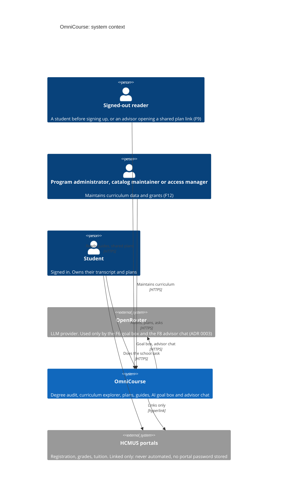
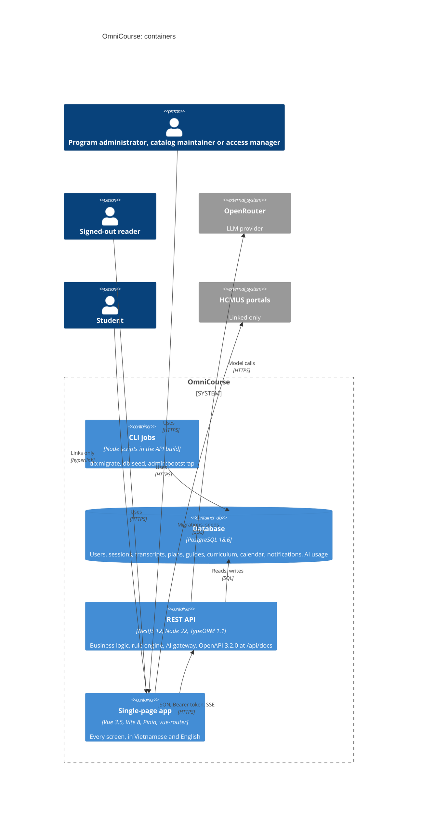
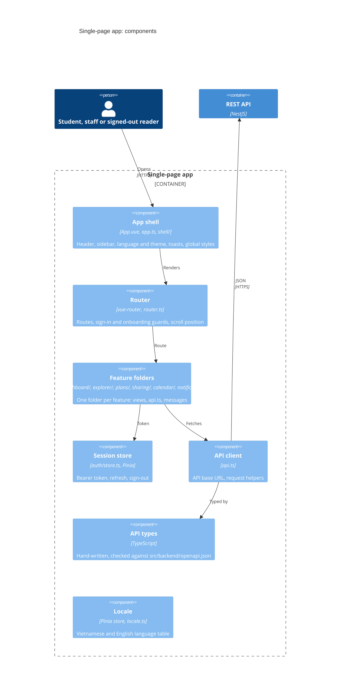

# Software Architecture Document

- Status: living document. It describes the modules on `main`. What each feature has built is in the [README feature table](../../README.md#what-is-built), not here.
- Owner: Triết (Backend Lead; the SDP gives him the architecture document). This version was written at Lâm's request.
- Reviewers: Triết (backend, rule engine), Hoà (frontend), Lâm (authentication, AI gateway, deployment)
- First written for `main` at `a7dd2c5` (9 November 2026); the module table in §4 was matched to `src/backend/src/features.ts` on 26 November 2026

## 1. Purpose and scope

This document describes how OmniCourse is built: the people and systems around it, the deployable parts, the components inside each part, and the rules that cut across all of them. It is the architecture view the RUP process asks for. The requirements behind it are in the Vision (F1–F12 and the NFRs, `report/assignments/PA2/Vision.tex`), the use cases in [`docs/requirements/`](../requirements/), and the decisions in the [ADRs](adr/). Words such as *degree audit*, *rule engine*, *plan*, *term* and *guide* have the meanings in [GLOSSARY.md](../../GLOSSARY.md).

Scope: the modules in `src/`. Grey boxes are external systems. This document does not track build status, owners or due dates: the build status is in the [README feature table](../../README.md#what-is-built), and the delivery plan is in the Software Development Plan.

### How to read this

The diagrams follow the [C4 model](https://c4model.com). Each level zooms into one box of the level above.

| Level | Question it answers | Section |
| --- | --- | --- |
| L1 System context | Who uses OmniCourse, and which outside systems does it touch? | [§2](#2-l1-system-context) |
| L2 Containers | Which separately running parts make up OmniCourse, and how do they talk? | [§3](#3-l2-containers) |
| L3 Components | Which modules sit inside the API and the single-page app? | [§4](#4-l3-components-of-the-api), [§5](#5-l3-components-of-the-single-page-app) |

Code is the fourth C4 level; it lives in `src/` and is not drawn here. Cross-cutting rules ([§6](#6-cross-cutting-concerns)), deployment ([§7](#7-deployment-view)), the map from ADRs to components ([§8](#8-architecture-decisions)) and open questions ([§9](#9-open-questions-and-risks)) follow. The diagrams are Mermaid C4 blocks, which GitHub renders; a box's second line names its technology.

## 2. L1 System context

**People.** One person plays several roles over time ([GLOSSARY: User](../../GLOSSARY.md)).

- A **signed-out reader** can read guides and open a shared plan ([ADR 0010](adr/0010-public-pages-and-guide-content.md)). An advisor needs no account.
- A **student** signs in for everything that uses their own data: transcript, degree audit, plans, the goal box and the advisor chat.
- A **program administrator**, **catalog maintainer** or **access manager** maintains curriculum data and grants through F12. These are separate grants, denied by default ([ADR 0011](adr/0011-curriculum-administration.md), accepted).

**External systems.**

- **HCMUS portals.** OmniCourse only links to them. It never stores a portal password and never automates a registration (AGENTS.md hard rule 2). A [guide](../requirements/guides-plan.md) gives the link, the steps and the account the portal needs; the student does the task on the portal.
- **OpenRouter** is the language-model provider, reached only through the AI gateway and only by F6's goal box and F8's advisor chat ([ADR 0003](adr/0003-language-model-scope.md)). Training opt-out and a monthly credit limit are set on the OpenRouter account. The model receives no name, email or student ID.
- **GitHub Actions** runs CI on every pull request (typecheck, lint via `npm run lint`, unit and e2e tests against PostgreSQL 18.6, browser tests, build, the OpenAPI export, and the signed-commit, Conventional Commits and changeset checks). The deploy workflow deploys `main` to production once CI passes and the `staging` branch to staging, and can tag builds B0–B3. It is not drawn in the context diagram because it builds and deploys OmniCourse rather than running with it ([§7](#7-deployment-view)).

## 3. L2 Containers

| Container | Code | Talks to | Notes |
| --- | --- | --- | --- |
| Single-page app | `src/frontend` | REST API | Built by Vite into static files. Reads the API address from `VITE_API_URL` at build time. |
| REST API | `src/backend` | Database, OpenRouter | Every route is under `/api`. Swagger UI is at `/api/docs`, the document at `/api/docs-json`; both are off when `NODE_ENV=production` unless `API_DOCS=true` (staging sets it, production does not). |
| Database | `compose.yaml` locally; Docker on the host in production and staging (§7) | | One schema. Changed only by migrations; `synchronize` is off ([ADR 0001](adr/0001-technology-stack.md)). |
| CLI jobs | `src/backend/src/database/{migrate,seed}.ts`, `src/backend/src/curriculum-admin/bootstrap-cli.ts` | Database | Run by an operator or CI, never by a request. Seeding is insert-only and idempotent. |

**Protocols.**

- **SPA → API:** JSON over HTTPS. A signed-in request carries `Authorization: Bearer <token>`, where the token is 32 random bytes the server stores only as a SHA-256 hash ([ADR 0002](adr/0002-authentication-and-sessions.md)). Bearer, not cookies, so no CSRF defence is needed while the SPA and API sit on different origins; CORS allows only `CORS_ORIGIN`.
- **F8 advisor chat stream:** `POST` answered with `text/event-stream`. The SPA reads it with `fetch`, because `EventSource` cannot send the bearer header ([ADR 0003](adr/0003-language-model-scope.md)). The helper is `streamChat` in `ai/sse.ts`.
- **API → OpenRouter:** HTTPS through the `openai` SDK with OpenRouter's `baseURL`.
- **API, CLI → Database:** SQL through `pg`; the API uses TypeORM repositories and transactions.

## 4. L3 Components of the API

One Nest module per feature folder (`src/backend/src/<feature>/`). The table has one row per module in `FEATURE_MODULES` (`src/backend/src/features.ts`). The list is alphabetical and its order has no effect. The app and the OpenAPI contract both load that list, so a module that is not in it has no routes. Which module may import which is the `backendEdges` list in `scripts/layers.mjs`, enforced by `npm run lint`; the "Used by other modules" column names what a module offers. The routes and their fields are in the contract, [`src/backend/openapi.json`](../../src/backend/openapi.json); this table names only the route prefixes.

Every request from the single-page app passes two global guards before it reaches a controller:

- **Throttler guard** (`auth/rate-limits.ts`, registered first): 120 requests a minute per route from one address, 10 on sign-up, sign-in and account deletion, plus per-(IP, email) attempt reservation on sign-in before Argon2 runs so parallel bursts from one client address cannot bypass the 10/minute limit and another network cannot lock out a student's email.
- **Auth guard** (`auth/auth.guard.ts`, registered second as `APP_GUARD`): reads the bearer token, looks up the session (enforcing both the 7-day idle expiry and the 30-day maximum session lifetime cap) and sets the request's user. Every route needs a signed-in user unless it is marked `@Public()`.

Every module reaches the database through its own TypeORM repositories and registers its own entities with `TypeOrmModule.forFeature`.

| Module | Folder | Feature | Routes and responsibility | Used by other modules |
| --- | --- | --- | --- | --- |
| health | `health/` |  | `GET /api/health`: 200 `{ status: 'ok', database: 'up' }` when the API is up and PostgreSQL answers, 503 `{ status: 'degraded', database: 'down' }` when the database is unreachable; never the PostgreSQL version (found in #28, fixed in #63). Public. |  |
| users | `users/` | F1 | The `users` table: identity only (email, `password_hash`, `google_sub`, consent, deletion state, and the optional student ID and class name the student types, [ADR 0019](adr/0019-student-id-and-class-name.md)). `create`, find, `updateProfile`, `cancelDeletion`, `markDeletionRequestedWithin(manager, …)`, and the purge reads `findDueForPurge` and `purgeIfDue`. `GET` and `PATCH /api/users/me`. `users` is the only module that names the `deletion_requested_at` column (`identifierHomes` in `scripts/layers.mjs`). | `UsersService`; `account-state.ts` (the deletion-pending helpers, the one owner of "an account waiting for deletion"): `isWaitingForDeletion`, `noDeletionWaitingSql`, the row locks `lockAccountRow` and `lockAccountStates` (`ROW_LOCK`) that a per-student write takes, and `deletionStateOf` |
| auth | `auth/` | F1 | F1 sign-up, sign-in (with per-IP and per-email rate limiting), refresh with rotation (7-day sliding TTL, hard 30-day max session cap from creation), sign-out, list and revoke sessions; argon2id passwords; the `sessions` table ([ADR 0002](adr/0002-authentication-and-sessions.md)). Sign-in before the purge deadline cancels a pending deletion. | `AuthService` (incl. `revokeAllWithin(manager, userId)`), `AuthGuard`, `@Public()`, `@CurrentUser()`, `@CurrentSession()`, `Authenticated()`, `PASSWORD_LIMIT` |
| ai | `ai/` | F6 goal box, F8 | The AI gateway ([ADR 0003](adr/0003-language-model-scope.md)). No routes. `LlmService.structured()` and `chat()` with a tool loop; `AI_CONFIG`, a provider read once at boot from `config/env.ts`; one `preflight()` (model and key) before the cost guard reserves a call; the OpenRouter client built once; `streamChat` for SSE. Every failure is `AiUnavailableError` → 503 `ai_unavailable`. | `LlmService`, `streamChat`, `FakeLlmService` for tests |
| transcript | `transcript/` | F2 | F2 storage: `GET` and `PUT /api/users/me/transcript`, whole-set replace under a row lock ([ADR 0007](adr/0007-transcript.md)). The rows are entered by the student; nothing reads a file. | `TranscriptService.rowsFor(userId)` returning `TranscriptEntry[]` |
| guides | `guides/` | F11 | F11: `GET /api/guides` and `GET /api/guides/:id`, public and read-only ([ADR 0010](adr/0010-public-pages-and-guide-content.md)). Owns its records: `guide-file.ts` holds the ID rule and the mapping between content files and rows, and the guides seed loads them. The out-of-date warning is computed in `guides/out-of-date.ts`. | `seed(dataSource, options)` for the CLI |
| curriculum | `curriculum/` | F4, and the data under F3, F5, F12 | The read side of the curriculum data: `GET /api/programs`, `GET /api/programs/:program/curricula/:cohort` and `GET /api/courses/:code`, signed-in and read-only. Owns the curriculum entities, prerequisites and offering terms, stored per curriculum ([ADR 0005](adr/0005-curriculum-cohort-and-course-catalog.md), [ADR 0011](adr/0011-curriculum-administration.md)). An e2e test diffs the entities against the migrated schema. Its seed (`seed-curricula.ts`) loads the data of `curriculum/seeds/`. | `CurriculumService`, `CurriculumRulesReader`, `seed(dataSource, options)` for the CLI |
| onboarding | `onboarding/` | F1 | `GET` and `PUT /api/users/me/onboarding`: the program, cohort and planning goal. `onboarding-options.ts` lists the cohorts students may choose. | `OnboardingService` (incl. `offers`) |
| audit | `audit/` | F3, F4 standing | `GET /api/users/me/audit`: the degree audit, computed by the rule engine from the transcript and the curriculum ([ADR 0013](adr/0013-rule-engine-and-degree-audit.md)). `GET /api/programs/:program/curricula/:cohort/standing`: per-course transcript status and prerequisite readiness computed by the rule engine for the curriculum explorer (F4). |  |
| plans | `plans/` | F5 | `/api/plans`: list, create, read, rename, copy, delete, save placements, and the rule engine's issues for a plan and for a drag preview ([ADR 0014](adr/0014-plan-model.md)). | `PlansService` (two read-only methods, `get` and `find`, for `sharing`) |
| admin-access | `admin-access/` | F12 | Who may write: `AdminWriteService` (the write lock, the deletion-state check and the grant check), the grant reader and the `AdminErrors` response decorator, and the two grant entities, `program_admin_grants` and `global_admin_grants`. It takes the write lock (`lockAdminWrite`) with the key `SINGLE_KEY_LOCKS.adminWrite` from `common/advisory-locks.ts`; the curriculum seed (`curriculum/seed-curricula.ts`) takes the same lock. No routes ([ADR 0011](adr/0011-curriculum-administration.md)). | `AdminWriteService`, `lockAdminWrite`, `grantsOf`, `missingPermission`, `Need`, `GLOBAL_PERMISSIONS`, `AdminErrors`; used by `curriculum-admin` and `academic-calendar` |
| curriculum-admin | `curriculum-admin/` | F12 | `/api/admin/...`: programs, cohorts, requirement groups, course links, prerequisites, offering terms, catalog courses, CSV import and access grants, all behind grants that are denied by default and one write lock ([ADR 0011](adr/0011-curriculum-administration.md)). Also the `admin:bootstrap` CLI. Imports `admin-access`. `references.ts` builds the sentences of the 409 `references` list, which the admin client parses (`admin/errors.ts`). |  |
| academic-calendar | `academic-calendar/` | F10 school dates | `GET /api/academic-calendar` for students; `POST`, `PATCH` and `DELETE` on `/api/admin/programs/:programId/calendar-events` under the F12 program grant ([ADR 0017](adr/0017-academic-calendar.md)). | `AcademicCalendarService` |
| sharing | `sharing/` | F9 | The owner's routes `GET`, `PUT` and `DELETE /api/plans/:id/share`, and the public read `GET /api/shared-plans/:token` ([ADR 0010](adr/0010-public-pages-and-guide-content.md), amendment of 25 November 2026). | `SharingService` (the account deletion stops every link) |
| notifications | `notifications/` | F10 inbox | `/api/notifications`: list, unread count, mark one read, mark all read. Creates the notifications that school dates and transcript changes cause ([ADR 0018](adr/0018-notification-inbox.md)). |  |
| account | `account/` | F1, privacy NFR | `GET /api/users/me/export` and `DELETE /api/users/me`. Owns the deletion flows: request, find accounts past their deadline, purge one account at a time, hourly ([ADR 0004](adr/0004-account-export-and-deletion.md)). Scheduling a deletion and revoking every session commit in one transaction, through the `…Within(manager)` methods of `users` and `auth`; `account` never writes the `sessions` table itself. |  |

- 2026-11-26: guides: `OUT_OF_DATE_MONTHS` in `guides/out-of-date.ts` sets the 6 months after which a guide shows as out of date. The frontend wording in `src/frontend/src/guides/messages.ts` repeats the number, so a change must update both.

Other folders under `src/backend/src/` are not feature modules:

- `rules/`: the rule engine. `RulesModule` has no routes, so it is not in `FEATURE_MODULES`; `audit`, `plans` and `sharing` import it (the only callers in `backendEdges`).
- `terms/`: the shared `Term` interface and the year limits ([ADR 0009](adr/0009-term-encoding.md)). Its request and response class, `TermDto`, is in `terms/term.dto.ts`.
- `common/`: validators and helpers that several modules share.
- `advisor/`: the regulation files and course descriptions for F8. It has no module yet.
- 2026-11-26: `advisor/course-descriptions/` holds the APCS course-description booklet in the same layout as `advisor/regulations/`: the `pdftotext -layout` output of the PDF, a hand-written `sources/<id>.source.json` with the sha256 of the PDF and of the text, and `<id>.json` with the courses. The wording is exact: only line wraps are joined, and the letterhead and page number that every page repeats are dropped. "Course goals" and "Course content" are split into one item per bullet; text before the first bullet is one item. `course-descriptions.spec.ts` checks every field of every course against the text of its pages. When it fails, fix the data, not the test.
- `config/`, `database/`, `bootstrap.ts`, `app.module.ts`, `features.ts`: the app wiring. `app.module.ts` and `openapi-document.ts` (the document `npm run openapi` writes and the drift test compares) both build their imports with `platformImports()` from `features.ts` (TypeORM root, `ClockModule` and `FEATURE_MODULES`), so the contract always lists every route. `config/env.ts` holds `loadEnvFiles()` and typed getters; `configureApp()` sets the `/api` prefix, the validation pipe, CORS and Swagger for the server and the e2e tests alike. `database/` holds the data source, `migrations/index.ts` (the ordered list of migrations) and `seed.ts`, the ordered list of feature seeders. Each feature owns its seed data: the curriculum data is in `curriculum/seeds/` and the guide texts in `guides/content/`. Every advisory-lock key is in `common/advisory-locks.ts`, in two tables (`SINGLE_KEY_LOCKS`, `NAMESPACED_LOCKS`); the module that takes a lock imports its key from there.

**CLI jobs.** All three load the environment through `config/env.ts`.

- `npm run db:migrate -w src/backend` applies pending migrations from `migrations/index.ts`, each in its own transaction.
- `npm run db:seed -w src/backend` calls each feature's `seed(dataSource, options)` in order, with the `SeedOptions` that `database/seed-options.ts` parses from the command line once (`common/seeder.ts` holds the `SeedOptions` and `Seeder` types): guides first, so a refused `--guide-fixtures` run stops before anything is written, then curriculum data. It inserts only what is missing. `--guide-fixtures` adds the synthetic test guides and is refused when `NODE_ENV=production`.
- `npm run admin:bootstrap -w src/backend` grants the first access manager from a trusted shell ([ADR 0011](adr/0011-curriculum-administration.md)); it is never an HTTP route.
- 2026-11-26: `db:seed` runs the seed of each feature in its own transaction. Run `db:migrate` first.
- 2026-11-26: The guides seed first locks the `guide_texts` table, so a second seed that runs at the same time waits until the first one ends.

### The rule engine

**The rule engine is the only authority on academic rules** (AGENTS.md hard rule 1). Prerequisites, offering terms, credit caps (by the program's training type, [ADR 0012](adr/0012-credit-caps-by-training-type.md)), requirement coverage and graduation status are computed only in `src/backend/src/rules/`. The folder name matters: `src/backend/vitest.config.mts` holds `src/rules/**` to 80 % statement coverage (Vision NFR), so engine code placed anywhere else escapes the gate. The engine is deterministic, has no side effects and imports neither `ai` nor any feature that calls it.

A module that needs an academic answer calls `RulesService` and only reads its answer. Today `audit`, `plans` and `sharing` do. F6's planner and F8's tool handlers must do the same ([ADR 0006](adr/0006-plan-generator.md), [ADR 0003](adr/0003-language-model-scope.md)).

**The AI gateway never decides a rule.** In the goal box, the model only turns a sentence into the planning-goal form; the student reviews it, and the planner then works over the engine. In the advisor chat, the gateway runs the tool loop: a tool handler calls the engine and returns its answer for the model to explain. Nothing the model returns is written back as a rule, a placement or a status.

**Transcript and curriculum data are never read by a model.** F2 rows are typed or pasted by the student and parsed deterministically in the browser ([ADR 0007, amendments of 15 and 27 November 2026](adr/0007-transcript.md#amendment-27-november-2026-deterministic-paste-parser-and-pre-save-diff)); F12 data is entered by people or by CSV through the same validated services ([ADR 0003](adr/0003-language-model-scope.md), [ADR 0011](adr/0011-curriculum-administration.md)).

## 5. L3 Components of the single-page app

Which frontend files may import which is in `scripts/layers.mjs` (`frontendKernel`, `frontendComposition`, `frontendFeatureEdges`), enforced by `npm run lint`: a kernel file imports only kernel files, no feature file imports a composition file, and a feature imports another feature only through a listed edge. Each feature folder holds its route records in `routes.ts`; `src/frontend/src/router.ts` spreads them in menu order and is the list of screens. Each feature folder holds its views, its `api.ts` and its `messages.ts` in Vietnamese and English.

| Component | Code | Responsibility |
| --- | --- | --- |
| App shell | `App.vue`, `app.ts`, `main.ts`, `shell/`, `styles.css` | `createOmniCourseApp()` builds the app with Pinia and the router; `main.ts` mounts it, and the tests use the same factory. The shell holds the public header, the app sidebar, the mobile bars, the language and theme buttons, toasts and the global stylesheet. |
| Router | `router.ts` | `createAppRouter()`. Each route names its layout (`public`: the header for visitors; `app`: the sidebar; `bare`: none, for sign-in, sign-up and onboarding; `auto`: the sidebar when signed in, the header when not), whether it needs a signed-in user (`required`) or a visitor (`guest`), whether `App.vue` keeps the page alive while another is open (`keepAlive`), and its menu entry (`menu`). A signed-in student whose onboarding is unfinished goes to `/onboarding` first. Back restores the scroll position. |
| Session store | `auth/store.ts` | Holds the bearer token, refreshes it and signs out ([ADR 0002](adr/0002-authentication-and-sessions.md)). Feature modules call the API through it. |
| Locale | `locale.ts` | Pinia store for the screen language. One table maps each language to its `Intl` tag, date format, own name and the other language. Defaults to Vietnamese; remembered in `localStorage`. The UI language type is separate from a guide's content language. |
| Shared view blocks | `async-load.ts`, `page-title.ts`, `components/` | `useAsyncLoad` (loading, failure, retry, ignoring a stale response), `useAttempt` and `reportFailure` (run a user action, stay silent on 401, report anything else), `usePageTitle` (tab title, aware of KeepAlive), `ExternalLink.vue` (new tab with safe `rel`), `ModalDialog.vue`, `SelectMenu.vue`. |
| API client | `api.ts` | `API_URL` from `VITE_API_URL` and the request helpers. Each feature's `api.ts` builds its calls on it. Components never call `fetch` directly (AGENTS.md). |
| Feature folders | `auth/`, `onboarding/`, `transcript/`, `audit/`, `dashboard/`, `explorer/`, `curriculum/`, `plans/`, `sharing/`, `calendar/`, `notifications/`, `guides/`, `account/`, `privacy/`, `admin/` | One folder per feature. Which feature has a screen is in the [README feature table](../../README.md#what-is-built). |
| API types | each feature's `api.ts`, `testing/contract.ts` | Request and response types are written by hand beside each API module. Specs check them against the committed contract `src/backend/openapi.json` through `testing/contract.ts`, so a renamed or missing field, a field that becomes nullable, or a schema with no check (`contract-coverage.spec.ts`) fails a test, and the test API mock (`mockApi`) refuses a route that is not in `openapi.json`. `openapi-typescript` is not used: it requires TypeScript 5 and the repo pins 6.0.3 (decided 9 November 2026; revisit when it supports TypeScript 6). A backend test fails when `npm run openapi` output differs from the committed file, so the contract cannot drift. Specs that discover files (`messages.spec.ts`, `contract-coverage.spec.ts`) do so at run time with `node:fs` (`testing/files.ts`), because Vitest caches transformed modules and `import.meta.glob` would freeze the file list. |
| Home | `views/HomeView.vue`, `components/ApiStatus.vue` | Landing page and API health. |

### Browser behaviour the screens rely on

The code does these things; this list says why.

- 2026-11-26: **Busy dialogs.** `ModalDialog.vue` uses the native `<dialog>`. After the user confirms an action, the dialog is busy until the server answers. While it is busy, the dialog sets `closedby="none"`, so Escape cannot close it. Chrome lets a page prevent only one `cancel` event for each user activation (HTML close watchers). In a browser without `closedby`, a later Escape closes the dialog, so the component shows it again at once. `closedby` does not stop the Android back gesture, which goes back in history. So a screen with a busy dialog refuses to leave its route until the server answers. A 401 signs the user out, and the user may then leave. `showModal()` runs after the render, so it finds the content and focuses its first control. The browser queues the `close` event as a task, so the parent can open the dialog again before the event arrives; the component then ignores that event.
- 2026-11-26: **Focus.** Not every browser focuses a button when it is clicked. So when a screen opens a dialog from a click, it keeps a reference to the button that was clicked, and gives the focus back to that button when the dialog closes. It does not read `document.activeElement`, which can be the page body.
- 2026-11-26: **Downloads.** The export link is clicked, and its object URL is revoked only after the click has been handled. Some browsers cancel the download when the URL is revoked at once.
- 2026-11-26: **Copy.** `navigator.clipboard` needs a permission and a page served over HTTPS. Without them, the screen selects the text, so one key press copies it.
- 2026-11-26: **Browser storage.** The app keeps these keys in the student's browser:
  - `sessionStorage`: `omnicourse.session` (the session token).
  - `localStorage`: `omnicourse.lang` (screen language), `omnicourse.theme` (light or dark), `omnicourse.sidebar` (sidebar wide or narrow), `oc-planner-rail` (planner side panel open or closed), `oc-last-plan` (the plan opened last) and `oc-plan-locks` (the plans locked in the editor).

  Sign-out, and a session that ends (a 401), remove `omnicourse.session`, `oc-last-plan` and `oc-plan-locks`. The account-scoped `localStorage` keys are listed in `src/frontend/src/account-storage.ts`; a new one goes there, and sign-out forgets it with no other edit. The other keys are display choices of the browser, not of an account, and stay. A new key name forgets every saved value of the old key: for `omnicourse.session`, it signs everyone out once. When the browser blocks storage (private mode, site data off), nothing is kept, and the screen language starts in Vietnamese.
- 2026-11-26: **Text length.** `String.length` and the HTML `maxlength` attribute count UTF-16 units, so an emoji counts twice. The API counts code points (#179). The forms count code points too, and use no `maxlength`.
- 2026-11-26: **Path segments.** A path segment of only dots is read by the browser as "this folder" or "the folder above". `segment()` in `api.ts` adds an encoded space to it, so the request stays at its address and the API refuses the value.
- 2026-11-26: **Links to a part of a page.** vue-router decodes the hash before the page gets it; decoding it again throws on a stray `%`. The router scrolls before the data has loaded, so the audit page scrolls to the target itself once it is drawn.
- 2026-11-26: **Return after sign-in.** The `redirect` in the address is used only when it is a path in the app. Another site, `//host`, `/\host` or a list is ignored, so a crafted link cannot send a student away.
- 2026-11-26: **First paint.** `index.html` applies the saved theme before the first paint, so a dark page never flashes white; `shell/theme.ts` owns the theme after that. The fonts are Be Vietnam Pro for text and JetBrains Mono for course codes, both with the Vietnamese subset.
- 2026-11-26: **One account at a time.** At sign-out, and when a session ends, the app removes the session token, the plan opened last and the plan locks from the browser (`clear()` in `auth/store.ts`). The onboarding answers and the administration grants are kept in memory per user ID (`useAccountCache`): the app shows a cached value only to the user it was loaded for, and the cache starts again when the signed-in user changes. So nothing of one account shows to the next account on the same tab.
- 2026-11-26: **Server messages in English.** For a refused field, the API sends English messages and no code per field (ADR 0011). The screen shows them under the field as the API wrote them, marked `lang="en"`, so a screen reader reads them in English. The text around them, in the screen language, says that nothing was saved. The administration notes carry the API's error code in `data-code` for test scripts.
- 2026-11-26: **Dates.** A `YYYY-MM-DD` date is a calendar date, not an instant, so it is formatted in UTC and no time zone moves it.
- 2026-11-26: **Select menus.** `SelectMenu.vue` follows the WAI-ARIA "select-only combobox" pattern. Its list is fixed to the viewport, so a table or a scrolling card never clips it.
- 2026-11-26: **Accessibility.** Colour is never the only cue: each status, refusal and requirement group is also given in words or a glyph. A page has one `main` landmark, the one in `App.vue`, so a view uses a `div`. On a narrow screen, each row of an administration table becomes a card. The column heads are hidden from view but stay in the page, so screen readers still read them. Each value shows its column's name from its `data-label` attribute. A live region is in the page from the start, so its text is announced when it appears. When an action removes the control that had the focus, the focus goes to a control that is still there, or to the title of the page or dialog. The privacy link on sign-up is outside the consent label, so a click opens the notice and does not tick the box.

### App shell and navigation

The code does these things; this list says why.

- 2026-11-26: **Menu.** A route lists itself in the menu through `meta.menu` on its record in the feature's `routes.ts`; `shell/nav.ts` reads the sidebar, the phone bar and the public header from it, in route order. A screen gets a menu entry only once its API exists and the screen works end to end, so no link leads to a mock-up or invented data. `section` puts an entry under the brand (`main`) or under "Account" (`account`). `group` colours the current page's icon.
- 2026-11-26: **Phone bar.** Below 960 px the sidebar gives way to a top bar and a tab bar. All entries do not fit at 400 px in English, so the bar holds four tabs (`phoneTab` 1 to 4) and "More", a sheet with the rest. "More" shows as the current tab, in that page's colour, when the open page is in it. `tab` is a shorter label for a tab whose `label` does not fit on one line: the audit is "Xét tốt nghiệp / Degree audit" in the sidebar (GLOSSARY) and "Tốt nghiệp / Audit" as a tab. The bar takes the UI prototypes' look (`ui-prototypes/assets/shell.js`), not their list of tabs.
- 2026-11-26: **The "More" sheet.** It is a native `<dialog>`: it traps focus, makes the page behind it inert, closes on Escape and gives focus back to "More". A link in it, or going back, closes it. A tap on the backdrop lands on the dialog itself, and so does the click of a drag that starts inside and ends on the backdrop (the click goes to the common ancestor). So the sheet closes only when the press both began and ended on the dialog. The sheet's content fills the dialog: the dialog has no padding, and the space around the links is the content's own padding. So a tap in the sheet's margin lands on the content, not on the dialog, and the sheet stays open; the browser test taps at `SHEET_MARGIN_X`, inside that padding, to check it. Escape reaches the dialog as a `cancel` event; `ModalDialog.vue` stops the browser from closing it and asks the sheet to close instead. When the open page is in the More list, the "More" button carries `aria-current="page"`, so a screen reader says that the current page is under it.
- 2026-11-26: **Administration link.** It is listed only for a user who holds a grant (ADR 0011). `useGrantsFollowSession` (`admin/access.ts`, called by `App.vue`) asks the API (`GET /admin/grants`) once per sign-in. A failed load leaves the link out; the next page the user opens asks again, up to `MAX_FAILED_LOADS` failures in a row, and so does the administration page. The API checks every request, so the hidden link is a convenience, never the protection: `/admin` opens for any signed-in user and says when they hold no grant. Onboarding is optional there, since an administrator need not be a student of an offered program. Its sections are child routes built from the entries of `admin/sections.ts` (id, path, lazy screen, permissions), so the menu link stays marked in each; `/admin` itself opens the first section the user holds.
- 2026-11-26: **Planner routes.** `/plans` is a parent route, so the Plans link stays marked while a plan is open. `/plans` opens a plan (the last one open, or a new default plan); the list is `/plans/all`.
- 2026-11-26: **Pages read signed out.** The guides (ADR 0010) and the privacy notice, which sign-up links beside the consent box (UC-01 step 2), use the `auto` layout. The guide list stays alive while a guide is open, so Back finds the same search and scroll position.
- 2026-11-26: **Onboarding first.** A signed-in student whose onboarding is unfinished goes to it before any other private page (UC-01 A5, A8); once finished, `/onboarding` opens no more (step 9). Settings opens anyway (`onboarding: 'optional'`), so account controls stay reachable when the student's program is not offered yet (A7). When the onboarding answers fail to load, the page opens, so the student is never caught in a loop; a 401 has already signed them out. A router used before Pinia is installed (some tests) has nobody signed in.
- 2026-11-26: **Session end and restore.** When the session ends while a private page is open (revoked on another device, expired), a toast says so and the app goes to sign-in, then back to the page. When signing in cancels a pending account deletion, a toast says so (ADR 0004).
- 2026-11-26: **Sidebar.** It narrows to icons with the button at its foot or the `[` key (no modifier, and not while typing). The choice is kept per browser. In the narrow rail each label stays in the accessibility tree and shows as a tooltip.
- 2026-11-26: **Tooltips.** One tooltip host replaces the browser's: any element with a `title` shows it after a short hover, or at once on keyboard focus (a click that focuses waits for the hover). While it shows, the title moves to a data attribute, so the browser does not show its own as well, and the element is described by the tooltip. Nothing shows while a course is dragged (`body.dragging`). It is white with black words in both themes, with an outline that sets it apart from a white page.
- 2026-11-26: **Language and theme buttons.** The language button names the language it switches to, in that language ("English" on a Vietnamese screen, "Tiếng Việt" on an English one); its short form shows only the code, and the accessible name stays the full name. The theme button names the theme it switches to. With `iconOnly` it shows only the icon, and the same name becomes its accessible name (`aria-label`) and its tooltip (`title`). With no saved choice, the theme follows the system. `index.html` repeats the theme key and default (see First paint).
- 2026-11-26: **Icons.** `shell/icons.ts` holds the subset of the UI prototypes' stroke icons the screens use. `Icon.vue` renders their paths as HTML; they are constants, never user content. An icon is decorative: the text beside it, or the button's label, names it.
- 2026-11-26: **Stylesheet.** `styles.css` is the design system ported from the UI prototypes (`ui-prototypes/assets/style.css`): calm surfaces, one colour per requirement group (`groups.ts` names the groups and pairs each with a glyph). It holds only what the shipped screens use; a screen ported later brings its own styles. Each group class sets `--c` (the colour), `--on` (text on it) and `--c-soft` (a tint for backgrounds). The accent for primary actions and selected states is a clear blue, never black. `--accent` stays for the guide pages, written before the design system. Dark surfaces are set apart by a lighter edge and a faint top highlight, not shadows. A pressed button keeps the keyboard focus ring. On a phone the public header keeps the brand, Guides, theme, language and one way in; sign-up is one tap away on sign-in.
- 2026-11-26: **Regulation link.** The shell links the school's training regulation (QĐ 1175/QĐ-KHTN), as the UI prototypes do.

## 6. Cross-cutting concerns

| Concern | Rule | Where it lives | Decided in |
| --- | --- | --- | --- |
| Authentication and sessions | Opaque 32-byte bearer token stored as SHA-256 in `sessionStorage` + memory; 7-day sliding idle expiry (`SESSION_TTL_DAYS`) capped by a hard 30-day maximum session lifetime from creation; rotation on refresh; revocation per device; argon2id passwords; same answer and timing for an unknown email and a wrong password. Every route needs a signed-in user by default. Feature modules use `@CurrentUser()` and never add their own guard. | `auth/`, global `AuthGuard` | [ADR 0002](adr/0002-authentication-and-sessions.md) |
| Account export and deletion | Every table holding a student's data has `user_id uuid NOT NULL REFERENCES users(id) ON DELETE CASCADE`. Export reads every such table from the PostgreSQL catalog in one `REPEATABLE READ` snapshot, only the rows the student owns, and never selects columns named `*_hash`, `*_token`, `*_secret`, `*_key`, `*_password`, `*_sub`, `*_salt` or `*_seed` (snake_case or camelCase). Deletion asks for the password, revokes every session and deletes every shared plan's link at once ([ADR 0010](adr/0010-public-pages-and-guide-content.md), amendment of 25 November 2026), and purges after 30 days (`ACCOUNT_DELETION_GRACE_DAYS`) unless the student signs in again. A key to `users` in another column is `ON DELETE SET NULL` (preferred) or `CASCADE`. An e2e test reads the catalog and fails on any table that breaks these rules. | `account/`, `test/user-table-rules.ts` | [ADR 0004](adr/0004-account-export-and-deletion.md) |
| AI gateway limits | Only F6's goal box and F8. Per-user daily cap (`AI_DAILY_CALLS_PER_USER`, default 20); a call counts once it reaches the model. Monthly credit limit and training opt-out on the OpenRouter account. One failure type, 503 `ai_unavailable`, and every AI screen keeps a manual path. Usage rows hold no content. CI uses `FakeLlmService` and never calls OpenRouter. | `ai/` | [ADR 0003](adr/0003-language-model-scope.md) |
| Public routes allow-list | Public today: health, sign-up, sign-in, the two guide reads, the shared-plan read (`GET /api/shared-plans/{token}`), and the API docs pages where they are served (not in production). Only sign-up and sign-in write. `public-routes.e2e-spec.ts` calls every route in the OpenAPI document without a token and fails on any unexpected non-401, on a public write, and on a served route the document lacks. A new public route needs an ADR 0010 change. | `@Public()`, `test/public-routes.e2e-spec.ts` | [ADR 0010](adr/0010-public-pages-and-guide-content.md) |
| Term encoding | A term is `{ year, number }`: `year` is the first calendar year of the academic year, `number` is 1, 2 or 3 in the order of the academic year: 3 is a third main term in a Tiên tiến, Liên kết or Chất lượng cao program such as APCS, and the summer term only in a đại trà program. SQL: `term_year smallint`, `term_number smallint CHECK (1, 2, 3)`. | `terms/term.ts`, `terms/term.dto.ts` (`TermDto`) | [ADR 0009](adr/0009-term-encoding.md), amended by [ADR 0012](adr/0012-credit-caps-by-training-type.md) |
| Logging | Never log a prompt, a reply, tool arguments, a provider error message, a transcript row or any identity field (hard rule 3). AI errors are logged by name or status code only, through one helper. The purge logs counts, not accounts. Test data and seeds are synthetic. | `ai/` logging helper, `account/` | [ADR 0003](adr/0003-language-model-scope.md), AGENTS.md hard rule 3 |
| Rate limits | `@nestjs/throttler`, per route and client address: 120 requests a minute by default, 10 a minute on sign-up, sign-in and account deletion, plus per-(IP, email) pre-verification attempt reservation on sign-in. Runs before authentication, so unauthenticated floods are cut first. Behind a proxy, Express `trust proxy` must be set (`TRUST_PROXY`, `loopback` on the host) or every visitor shares one address. | `auth/rate-limits.ts`, `auth/`, `app.module.ts` | [ADR 0002](adr/0002-authentication-and-sessions.md), [ADR 0010](adr/0010-public-pages-and-guide-content.md) |
| Security headers | Strict `Content-Security-Policy` (`script-src 'self'` plus the SHA-256 hash of `index.html`'s theme bootstrap script, disallowing arbitrary inline/remote scripts to protect the `sessionStorage` bearer token against XSS; `style-src 'self' 'unsafe-inline'` for Vue's scoped runtime styles), `Strict-Transport-Security` (`HSTS` over HTTPS), `X-Content-Type-Options: nosniff`, `X-Frame-Options: DENY`, `Referrer-Policy: strict-origin-when-cross-origin`, and `X-Powered-By` disabled. | `bootstrap.ts`, `deploy/server/nginx-site.conf`, `scripts/lint.mjs` | [ADR 0002](adr/0002-authentication-and-sessions.md), Vision §6 Security |
| Linting and typecheck | `npm run lint` and `npm run typecheck` run across both workspaces locally and in CI alongside Vitest unit, browser and e2e suites. `npm run verify` runs lint, typecheck, tests and build in one go. | `package.json`, `.github/workflows/` | [ADR 0001](adr/0001-technology-stack.md), Vision §6 Testability |
| OpenAPI contract | The API publishes OpenAPI 3.2.0. DTOs carry `@ApiProperty`, so the document is complete. The generated document is committed as `src/backend/openapi.json`; a backend test (`openapi-document.spec.ts`) fails when it drifts. The SPA's API types are written by hand, and frontend tests (`api.spec.ts`, `guides/api.spec.ts`, through `testing/contract.ts`) check them against the same file. CI also uploads it on every run. | `bootstrap.ts`, `openapi.ts`, `src/backend/openapi.json`, `src/frontend/src/testing/contract.ts` | [ADR 0001](adr/0001-technology-stack.md) |
| Configuration | Environment variables only, loaded once by `config/env.ts` from `.env` or `../../.env`. Blank or invalid numbers fall back to their defaults. A missing AI key is not a start-up error: the app boots and AI routes answer 503. | `config/env.ts`, `.env.example` | [ADR 0003](adr/0003-language-model-scope.md), [ADR 0004](adr/0004-account-export-and-deletion.md) |
| Schema changes | TypeORM migrations, listed as imported classes in `migrations/index.ts`; applied migrations are never edited. A decision that outlives one PR (new table family, new module boundary) needs an ADR. | `database/migrations/` | [ADR 0001](adr/0001-technology-stack.md), [ADR 0002](adr/0002-authentication-and-sessions.md) |
| Structure rules | The layer and dependency tables (which backend folders may import which, the frontend kernel, feature and composition layers, and the allowed imports between frontend feature folders) live in `scripts/layers.mjs`, and `npm run lint` enforces them. A new cross-folder import fails lint until its edge is added on purpose; an edge that no longer exists fails too, so the lists only shrink deliberately. | `scripts/layers.mjs`, `scripts/lint.mjs` | [ADR 0001](adr/0001-technology-stack.md) |
| Languages | Every screen in Vietnamese and English. Guides are stored per language; the reader's language is chosen in the SPA. | `locale.ts`, guide content files | Vision §6 Usability |

- 2026-11-26: Dates: a PostgreSQL `date` column reaches the app as its `YYYY-MM-DD` text, never as a JavaScript Date. By default node-postgres reads a `date` as local midnight, so a server at UTC+7 moved the day back by one (issue #174). `database/data-source.ts` sets the parser for every connection. TypeORM also gives a `date` entity column as a string.
- 2026-11-26: Logging: outside the AI gateway, a log line names a failure by its error class and, for a database error, its SQLSTATE. It never holds the error message, the statement or its parameters, because a database error message can quote row values. For a failure that is not a database error, the log also holds the "at …" lines of the stack, without the first line, because that line repeats the message.
- 2026-11-26: Configuration: a variable already set in the environment (shell, CI) wins over both files, and `.env` wins over `../../.env`.
- 2026-11-26: OpenAPI contract: the security scheme is named `bearer`, because `@ApiBearerAuth()` uses that name by default. `openapi-document.ts` sorts the paths, schemas and tags by name, and the operations of a path in the order of the OpenAPI specification. The properties inside a schema keep the order the code declares. So the document does not depend on the order in which Nest meets the modules, and the list in `features.ts` can have any order.
- 2026-11-26: Term encoding: the current term comes from the Vietnam date by month: term 1 from September, term 2 from January, term 3 from June. These months are an assumption from the UI prototype (`ui-prototypes/assets/data.js`), not from the regulation or the academic calendar. The weeks between two terms count as the earlier term.
- 2026-11-26: Concurrent saves: onboarding answers are saved with one `INSERT … ON CONFLICT DO UPDATE` statement, so two saves at the same time do not interleave and do not fail on the primary key.
- 2026-11-26: Security headers: the API turns off the `X-Powered-By: Express` header that Express sends by default, so an answer does not name the server software (`bootstrap.ts`, found in #28), and `CSP`, `HSTS`, `X-Content-Type-Options`, `X-Frame-Options` and `Referrer-Policy` harden both SPA and API responses.
- 2026-11-26: Rate limits: the throttler is a guard, and Nest runs guards before validation, so a request with an invalid body still counts toward the rate limit. Without `TRUST_PROXY`, the API ignores `X-Forwarded-For`, so a client cannot escape the rate limit with invented addresses.

## 7. Deployment view

Two environments run on one self-hosted Linux server behind Cloudflare. [`deploy/README.md`](../../deploy/README.md) is the operator's guide; this section states what the architecture depends on.

| Environment | Address | Branch | Deploys when |
| --- | --- | --- | --- |
| production | https://omnicourses.lamter.cc | `main` | CI passes on a merge to `main` |
| staging | https://stag-omnicourses.lamter.cc | `staging` | anything is pushed or merged to `staging`; reset to `main` every other day |

| Item | Requirement | Source |
| --- | --- | --- |
| Deploy | `deploy.yml` reaches the host over SSH with one forced-command key per environment, which only deploys commits already on that environment's branch. The host builds once (`npm ci`, `npm run build`), dumps the database, runs `db:migrate` and `db:seed`, switches to the new release, restarts and checks `/api/health`; an unhealthy release is switched back and fails the job. A manual run can tag the deployed commit B0–B3. | `.github/workflows/deploy.yml`, `deploy/server/omnicourse-deploy` |
| Processes | One systemd unit per environment (`omnicourse@prod`, `omnicourse@stag`), each one API instance limited to 1 GB of memory and two cores. nginx accepts only Cloudflare, serves the SPA's static files and proxies `/api`. Other sites share the host, so OmniCourse stays inside these limits. | `deploy/server/setup.sh`, `deploy/server/nginx-site.conf` |
| Database | Self-hosted PostgreSQL 18.6 in Docker on the host, bound to localhost, one database and role per environment. `db:migrate` runs before the new API starts. | ADR 0001, `deploy/server/setup.sh` |
| Environment | `/etc/omnicourse/<env>.env` on the host; generated passwords never leave it. `NODE_ENV=production` in both environments, so `db:seed --guide-fixtures` is refused and the API docs pages are off; staging sets `API_DOCS=true` for testers. `CORS_ORIGIN` is the environment's own address, and the SPA is built with `VITE_API_URL=/api`. | `deploy/server/setup.sh`, `deploy/server/omnicourse-deploy`, `config/env.ts` |
| Proxy | `TRUST_PROXY=loopback`, so the rate limit sees each visitor's address through nginx. | `config/env.ts`, `bootstrap.ts`, ADR 0002 |
| Instances | One API instance per environment is enough. The hourly purge would also be safe with more, because each purge is an idempotent `DELETE`. | ADR 0004 |
| Backups | A `pg_dump` before every deploy (14 kept in `/var/backups/omnicourse`) plus nightly backups driven by `omnicourse-backup.timer` (`omnicourse-backup.service`), kept for 7 days (Vision NFR Recovery). A deploy rollback restores code, not data. Purged accounts stay in backups until they rotate out; the privacy notice (`/privacy`) states both retention windows. | `deploy/server/setup.sh`, `deploy/server/omnicourse-root`, `deploy/README.md`; Vision NFR Recovery; ADR 0004 |
| HTTPS | Cloudflare in front, a certificate on the host from certbot, and `HSTS` + `CSP` headers on responses. SPA and API share one origin per environment, the case in which ADR 0002 keeps bearer tokens in `sessionStorage` under strict CSP. | `deploy/server/nginx-site.conf`, `deploy/README.md`, ADR 0002 |

- 2026-11-26: Listen address: with `LISTEN_HOST=127.0.0.1`, the API accepts connections only from nginx on the same host. When `LISTEN_HOST` is not set, it listens on every interface.

## 8. Architecture decisions

Each ADR file states its own status; this table does not copy it. Number 0016 is not used: it was kept for the advisor harness in PR #77, which is still open.

| ADR | Shapes |
| --- | --- |
| [0001 Technology stack](adr/0001-technology-stack.md) | All containers; exact version pins; Vitest with SWC; TypeORM migrations; OpenAPI 3.2.0; npm workspaces; CI's PostgreSQL service |
| [0002 Authentication and sessions](adr/0002-authentication-and-sessions.md) | `auth`, `users`, `AuthGuard`, throttler; SPA → API bearer protocol; SPA session store |
| [0003 Where a language model is used](adr/0003-language-model-scope.md) | `ai` gateway, OpenRouter; goal box in `plan-generator`, `advisor`; SSE protocol; F2 and F12 stay deterministic |
| [0004 Account export and deletion](adr/0004-account-export-and-deletion.md) | `account`, `users`; the `user_id` rule for every table of every module; the purge |
| [0005 Curriculum cohorting and course catalog](adr/0005-curriculum-cohort-and-course-catalog.md) | `database` curriculum schema and seeds; `curriculum`, `curriculum-admin`, `rules` read it |
| [0006 How the plan generator builds a plan](adr/0006-plan-generator.md) | `plan-generator`; the planner's interface to `RulesService` |
| [0007 Storing the transcript](adr/0007-transcript.md) | `transcript`; its `rowsFor()` contract to `audit` and `advisor` |
| [0008 Real-browser test provider](adr/0008-browser-testing.md) | SPA browser tests (Vitest browser mode, Playwright Chromium); CI frontend job |
| [0009 Term encoding](adr/0009-term-encoding.md) | `terms/`; `transcript`, `plans`, offering terms, `plan-generator` |
| [0010 Public pages and guide content](adr/0010-public-pages-and-guide-content.md) | `guides`, `sharing`; the public routes allow-list and its e2e test; guides as content files plus seed |
| [0011 Curriculum administration and program-scoped permissions](adr/0011-curriculum-administration.md) | `curriculum-admin`; grant tables; `admin:bootstrap` CLI; administration screens |
| [0012 Credit caps by training type](adr/0012-credit-caps-by-training-type.md) | `rules` (caps per training type, a training-type column on `programs`), `terms/`, `plans`, `plan-generator` |
| [0013 Rule engine and degree audit](adr/0013-rule-engine-and-degree-audit.md) | `rules`, `audit`; how the degree audit reads the transcript and the curriculum |
| [0014 The plan model](adr/0014-plan-model.md) | `plans`; placements, slots, the plan copy a what-if starts from |
| [0015 The rule engine in the browser for the drag preview](adr/0015-rule-engine-in-the-browser.md) | Where the plan check runs (the browser or the API) |
| [0017 Academic calendar](adr/0017-academic-calendar.md) | `academic-calendar`; the calendar page |
| [0018 Notification inbox](adr/0018-notification-inbox.md) | `notifications`; the inbox and what creates a notification |
| [0019 Storing the student ID and the class name](adr/0019-student-id-and-class-name.md) | `users`; the Settings profile form; the dashboard header |

### Revisions in this version

This is the first version of the document. It describes the backend and frontend after the untangle refactor, which changes internal layout only: routes, JSON fields, tables, env var names, error codes and the OpenAPI document stay the same. The refactor landed on 9 November 2026 as three PRs: #56 (backend core), #58 (backend features) and #57 (frontend).

1. **One feature list.** `features.ts` exports `FEATURE_MODULES`, used by both the app and the OpenAPI generator. Before, `openapi.ts` kept its own copy, and a module missing from it would have dropped its routes from the contract. Each module registers its own entities, and migrations are listed in `migrations/index.ts`.
2. **One env module.** `config/env.ts` loads `.env` and gives typed getters. Before, three entry points each looked up `.env` themselves, and `@nestjs/config` was a fourth path. It also fixes a blank `SESSION_TTL_DAYS` expiring every session at once (issue #37) and a blank `PORT` picking a random port.
3. **Account owns the deletion flows.** Finding due accounts, purging and requesting deletion move from `users` to `account`, their only caller. The "schedule deletion and revoke every session" transaction stays atomic, through explicit `…Within(manager)` methods, and `account` no longer reaches into `auth`'s table ([ADR 0004](adr/0004-account-export-and-deletion.md)).
4. **AI configuration as a provider.** `AI_CONFIG` is read once at boot and injected, with one `preflight()` check before a call is reserved and one logging helper for hard rule 3 ([ADR 0003](adr/0003-language-model-scope.md)).
5. **Rate limits and auth decorators in one place.** Throttler names and limits are defined together; one `Authenticated()` decorator replaces the copied OpenAPI pair on each controller ([ADR 0002](adr/0002-authentication-and-sessions.md)).
6. **Features own their seeds.** `database/seed.ts` only loads env and calls each feature's `seed()`; guides own their file-to-row mapping ([ADR 0010](adr/0010-public-pages-and-guide-content.md)).
7. **Frontend feature folder and contract types.** The guides API module and views move into `src/frontend/src/guides/`; a test checks the hand-written API types against the committed OpenAPI document; shared view blocks, one language table and a global stylesheet replace copies across views.

## 9. Open questions and risks

| # | Question or risk | Owner | Source |
| --- | --- | --- | --- |
| 1 | Resolved 12 Nov 2026: Lâm accepted ADR 0011. Its per-program grants replace "administrator rights per school and per program" as a deliberate exception to the Vision. | Lâm, Hoà | ADR 0011; Vision §6 Security |
| 2 | Resolved 12 Nov 2026 (Lâm): the curriculum and catalog change log is deferred to B3. B2 has no change-history log. Whether B3 builds one is not decided; Lâm decides when B3 is planned. Nothing may claim an audit trail until a log ships. | Lâm, Triết | ADR 0011 |
| 3 | Production and staging run on one shared host (§7): one machine, no failover. Nightly backups (`omnicourse-backup.timer`, 7 days kept) and pre-deploy dumps (14 kept) run on the host; a restore rehearsal is run before B3. | Lâm | `deploy/README.md`; Vision NFR Recovery |
| 4 | Resolved: `RulesService` is on `main` (`src/backend/src/rules/`). A change to its interface still reaches every caller (risk R9). | Triết | SDP R1, R9; ADR 0006 |
| 5 | Resolved 27 Nov 2026: Lâm accepted ADRs `0005`, `0007`, `0008`, `0009`, `0014`, `0017` and `0018`; ADRs `0006` and `0015` are marked `accepted, not built yet`. | Lâm | §8 |
| 6 | Resolved: the curriculum seeds live in `curriculum/seeds/`, and `database/seed.ts` only lists the feature seeders (#65). | Thắng, Triết | ADR 0011 |
| 7 | Resolved 27 Nov 2026: F10 delivers through the in-app inbox only (Lâm, 12 Nov 2026), Dũng decided the schedule, time zone and repeat rules (25 Nov 2026), Lâm accepted [ADR 0018](adr/0018-notification-inbox.md) (27 Nov 2026), and the `/notifications` inbox and unread bell shipped (#204). | Dũng, Lâm | [ADR 0018](adr/0018-notification-inbox.md); Test plan §8 |
| 8 | Resolved 27 November 2026: F2 reads no file ([ADR 0007, amendment of 15 November 2026](adr/0007-transcript.md#amendment-15-november-2026-paste-or-type-no-file)) and parses pasted TSV/portal grades tables deterministically in the browser with row review and a pre-save diff ([amendment of 27 November 2026](adr/0007-transcript.md#amendment-27-november-2026-deterministic-paste-parser-and-pre-save-diff)). | Lâm | ADR 0007; SDP R7 |
| 9 | Resolved 27 Nov 2026: strict `Content-Security-Policy` (`CSP`) and `Strict-Transport-Security` (`HSTS`) headers harden the SPA and API while keeping bearer tokens in `sessionStorage` + memory. | Hoà, Lâm | ADR 0002 |
| 10 | Google sign-in and email verification are deferred; Google-only accounts cannot confirm deletion until then. | Lâm | ADR 0002, ADR 0004 |
| 11 | Personal data reaching an AI tool, a log or a fixture (risk R8). Mitigated by the logging rule above and synthetic test data. | Lâm | SDP R8; hard rule 3 |
