# Class model

- Drawn from the code on `main` on 15 November 2026 (commit `47e4ba3`), not from the UI prototypes or the use-case specifications. Every class, attribute, relation and method below exists in `src/`; each diagram names its source files. The academic calendar (§1.6, §3.5 and the `calendar/` row of §4) was added from `main` on 17 November 2026 (commit `b6892b7`). The notification inbox (§1.8, §3.6, and the three methods it reads in §3.2 and §3.5) was added on 25 November 2026 with the code of [ADR 0018](adr/0018-notification-inbox.md); it is built in the API only, so §4 has no row for it.
- Where the built code differs from a use-case specification, the code is drawn and the difference is listed in [Design vs. use-case specification differences](design-differences.md).
- Level: this is the fourth C4 level (code) under the [software architecture document](architecture.md). The matching behaviour is in the [sequence diagrams](sequence-diagrams/README.md).

Contents: [1. Persistent domain model](#1-persistent-domain-model) · [2. Rule engine](#2-rule-engine) · [3. Services and controllers](#3-services-and-controllers) · [4. Single-page app modules](#4-single-page-app-modules) · [5. Features and decisions](#5-features-and-decisions)

Notation: the diagrams are Mermaid class diagrams, which GitHub renders. `?` after a type means the value may be null. An arrow from A to B with `1` and `0..*` reads "each A row references one B; a B has any number of A". The word after the colon is the foreign-key column and its delete rule.

## 1. Persistent domain model

Every table is a TypeORM entity; `synchronize` is off and the schema is made by the migrations in `src/backend/src/database/migrations/`. Attribute names are the entity's property names (the column is the same name in snake_case). `createdAt` and `updatedAt` are left out of the drawings: every entity has `createdAt` except `PlanPlacement`, `ProgramAdminGrant`, `GlobalAdminGrant` and `GuideText`, and the tables with `updatedAt` are `users`, `programs`, `curriculums`, `requirement_groups`, `courses`, `combined_minimums`, `course_prerequisite_lists`, `plans`, `onboarding_answers`, `guide_texts` and `academic_calendar`.

### 1.1 Users, sessions and the student record

Sources: `users/user.entity.ts`, `auth/session.entity.ts`, `onboarding/onboarding-answers.entity.ts`, `transcript/transcript-row.entity.ts`, `ai/ai-usage.entity.ts`; migrations `create-users-and-sessions`, `add-users-deletion-requested-at`, `create-onboarding-answers`, `create-transcript-rows`, `create-ai-usage`.

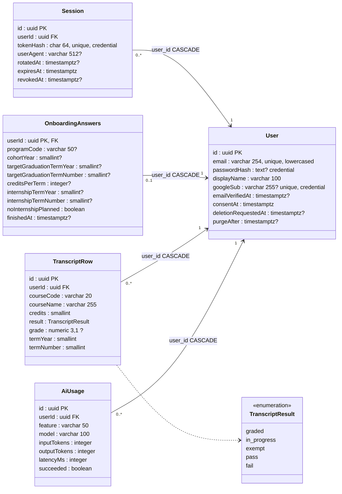

- `users` has a check that `deletion_requested_at` and `purge_after` are set and cleared together (`ck_users_deletion_pending`).
- Credential columns (`passwordHash`, `googleSub`, `tokenHash`) are named here and never read into a response: the account export leaves out every column whose name ends in `_hash`, `_token`, `_secret`, `_key`, `_password`, `_sub`, `_salt` or `_seed`, in snake_case or camelCase (`account/account-export.ts`, `isSecretColumn`). The session token itself is never stored, only its SHA-256.
- `TranscriptRow.courseCode` and `OnboardingAnswers.programCode` are plain values with no foreign key to `courses` or `programs`: a transcript may name a course the catalog does not have ([ADR 0007](adr/0007-transcript.md)).
- `AiUsage` has no `@ManyToOne` in the entity; its foreign key and `ON DELETE CASCADE` are in the `create-ai-usage` migration. Its rows hold no prompt or reply ([ADR 0003](adr/0003-language-model-scope.md)).

### 1.2 Curriculum, course catalog, prerequisites and offering terms

Sources: `curriculum/*.entity.ts`; migrations `create-curriculum-course-schema`, `create-curriculum-admin`, `add-audit-rules-to-curriculum`.

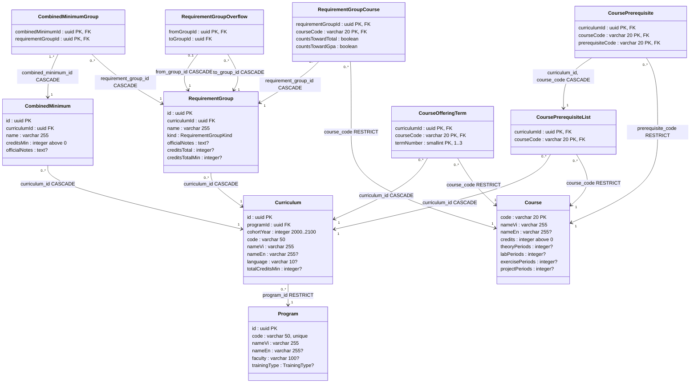

- `TrainingType` is `advanced`, `joint`, `high_quality` or `standard` (`TRAINING_TYPES`, `program.entity.ts`); `RequirementGroupKind` is `compulsory` or `elective` (`REQUIREMENT_GROUP_KINDS`, `requirement-group.entity.ts`). Both are held by check constraints, not PostgreSQL enums.
- Uniqueness: one curriculum per program and cohort (`uq_curriculums_program_cohort`); a requirement group's name and a combined minimum's name are unique in their curriculum.
- The course catalog is shared: a `Course` belongs to no curriculum, and `RequirementGroupCourse` links it into each one ([ADR 0005](adr/0005-curriculum-cohort-and-course-catalog.md)). The catalog side of every link is `RESTRICT`, so a course in use cannot be deleted.
- A `CoursePrerequisiteList` row with no `CoursePrerequisite` rows means "recorded as having no prerequisite"; no list row means "not recorded". The rule engine keeps the two apart ([ADR 0011](adr/0011-curriculum-administration.md)). A check forbids a course being its own prerequisite.
- `RequirementGroupOverflow`: a group sends its credits beyond its own minimum to at most one other group (its primary key is `fromGroupId`), never to itself ([ADR 0013](adr/0013-rule-engine-and-degree-audit.md)).
- The multiplicity `1..*` on `CombinedMinimumGroup` is what the seed writes; the schema itself allows zero.
- A curriculum has any number of `CourseOfferingTerm` rows: one per course and term (the primary key is `curriculum_id`, `course_code`, `term_number`), and none until an administrator records them (the seed writes none). The limit of 1 to 3 rows is per course within a curriculum: `term_number` is 1, 2 or 3 (`ck_course_offering_terms_term_number`), and the admin route takes at least one term (`SetOfferingTermsDto`). Neither arrow can show that limit.

### 1.3 Administration grants

Sources: `curriculum-admin/admin-grant.entities.ts`; migration `create-curriculum-admin`.

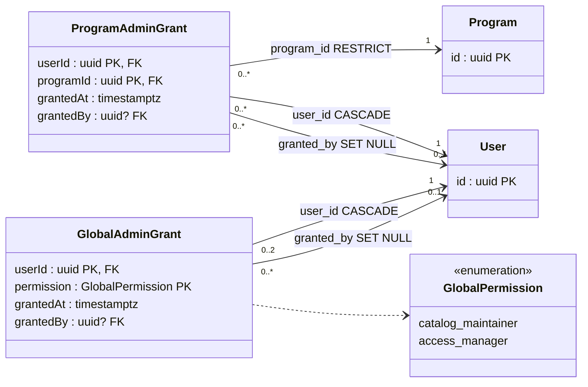

A program administrator is a user with a `ProgramAdminGrant` for that program; a catalog maintainer and an access manager are users with the matching `GlobalAdminGrant`. No grant implies another (`grant-scope.ts`, `missingPermission`). `granted_by` is `SET NULL` because the row belongs to the recipient, not to the granter ([ADR 0004](adr/0004-account-export-and-deletion.md)).

### 1.4 Plans

Sources: `plans/plan.entity.ts`, `plans/plan-placement.entity.ts`; migration `create-plans`. `PlanShare` was added on 25 November 2026 from `sharing/plan-share.entity.ts`; migration `create-plan-shares`.

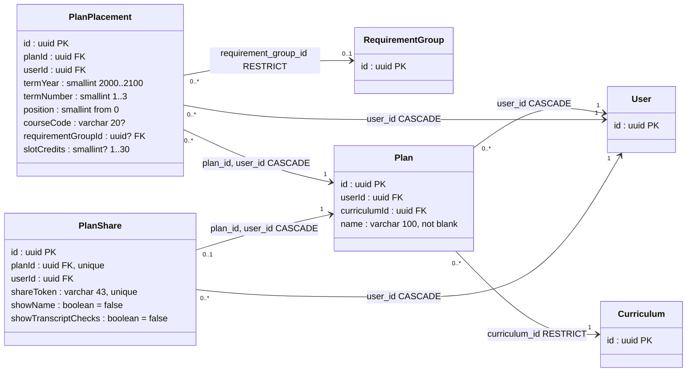

- A placement is either a course (`courseCode` set) or a slot that holds credits for a requirement group until a course is chosen (`requirementGroupId` and `slotCredits` set); checks `ck_plan_placements_course_or_slot` and `ck_plan_placements_slot_credits` allow exactly one of the two.
- `position` is the order inside a term, unique per plan and term; a course is placed at most once in a plan (partial unique index `uq_plan_placements_course`).
- `PlanPlacement` carries its own `userId`, and its key to `plans` is the pair (`plan_id`, `user_id`), so a placement can never belong to another student's plan and the account export finds the rows directly ([ADR 0004](adr/0004-account-export-and-deletion.md), [ADR 0014](adr/0014-plan-model.md)).
- `PlanPlacement.courseCode` has no foreign key to `courses`; `PlansService.checkBoard` checks the code against the catalog on every save.
- `Plan.curriculumId` is `RESTRICT`: a plan keeps the curriculum it was made against.
- `PlanShare` is the live link of a shared plan (UC-09, [ADR 0010](adr/0010-public-pages-and-guide-content.md)): at most one row per plan, and no row means "not shared", because stopping a link deletes its row. Its key to `plans` is the pair (`plan_id`, `user_id`), like a placement's. `shareToken` is 32 random bytes in base64url; its column name ends in `_token`, so the account export never selects it. `showName` and `showTranscriptChecks` are the owner's two choices for the link, both off unless the owner turns them on: the display name, and the checks the rule engine decides from the owner's transcript.

### 1.5 Guides

Sources: `guides/guide.entity.ts`, `guides/guide-text.entity.ts`, `guides/guide-file.ts`; migration `create-guides`.

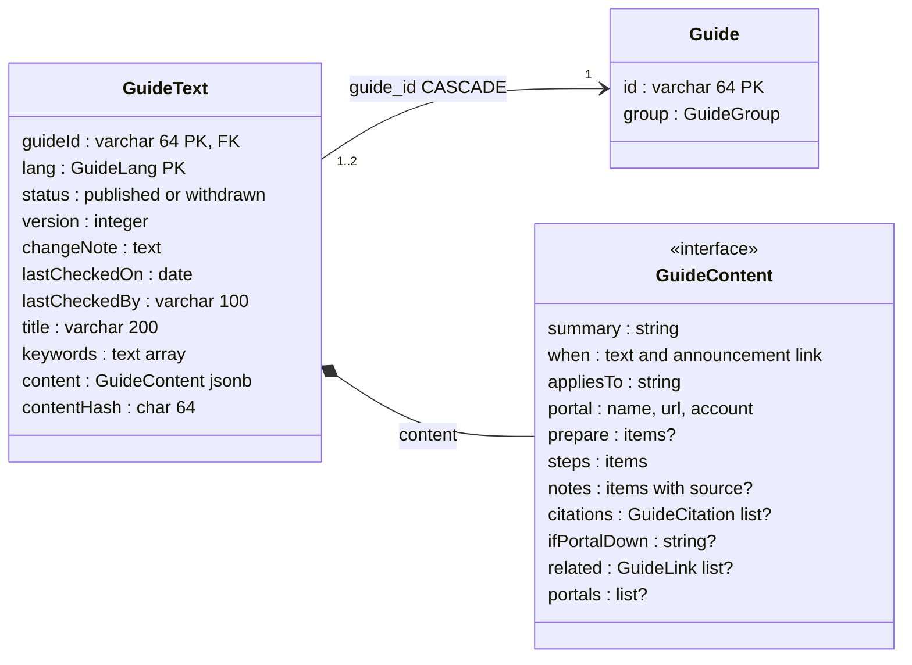

A guide has one text per language (`vi`, `en`). Guide texts are written as files in `guides/content/` and stored by the seed (`seed-guides.ts`); a draft is never stored, so the stored status is `published` or `withdrawn` ([ADR 0010](adr/0010-public-pages-and-guide-content.md)). `contentHash` is a digest of the text for the seed's version check, not a credential. No guide table references `users`.

### 1.6 Academic calendar

Sources: `academic-calendar/academic-calendar-event.entity.ts`; migration `create-academic-calendar` ([ADR 0017](adr/0017-academic-calendar.md)).

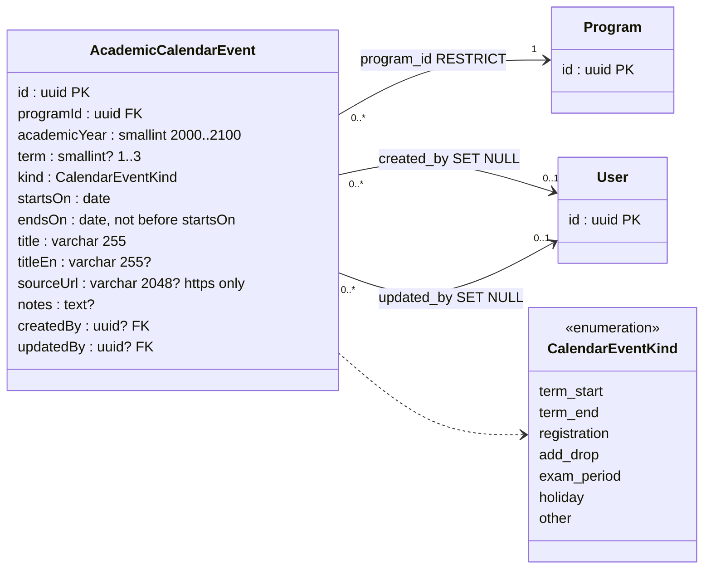

- The table is `academic_calendar`. One row is one school date of one program: a single day (`endsOn` equals `startsOn`) or a window of days, both inclusive. `term` is null for a date of the whole academic year; `academicYear` 2026 is 2026–2027 ([ADR 0009](adr/0009-term-encoding.md)).
- Checks: `ck_academic_calendar_kind` (the seven kinds), `ck_academic_calendar_term` (1, 2 or 3), `ck_academic_calendar_academic_year` (2000 to 2100), `ck_academic_calendar_range` (`ends_on >= starts_on`) and `ck_academic_calendar_source_url` (`source_url LIKE 'https://%'`). The index `ix_academic_calendar_program_starts_on` is on (`program_id`, `starts_on`).
- The dates are shared data of a program, not a student's record, so the table has no `user_id`. `created_by` and `updated_by` name the administrator who wrote the row. They are `ON DELETE SET NULL`, so purging that administrator's account keeps the dates for everyone else, and the account export does not read them ([ADR 0004](adr/0004-account-export-and-deletion.md)). The API never returns them.
- `program_id` is `RESTRICT`, like curricula and program grants: shared academic data is never deleted as a side effect.
- `startsOn` and `endsOn` are `date` columns, read as `YYYY-MM-DD` strings, never as a timestamp.
- Nothing is seeded, and no rule-engine function reads this table.

### 1.7 Delete rules in one table

| When this row is deleted | These rows go with it (`CASCADE`) | The delete is refused while these exist (`RESTRICT`) | These rows stay, with the column cleared (`SET NULL`) |
| --- | --- | --- | --- |
| `User` | `Session`, `OnboardingAnswers`, `TranscriptRow`, `AiUsage`, `Plan`, `PlanPlacement`, `PlanShare`, `Notification`, `ProgramAdminGrant` and `GlobalAdminGrant` the user holds | none | grants the user gave (`granted_by`); `AcademicCalendarEvent` rows the user created or last changed (`created_by`, `updated_by`) |
| `Program` | none | `Curriculum`, `ProgramAdminGrant`, `AcademicCalendarEvent` | none |
| `Curriculum` | `RequirementGroup`, `CombinedMinimum`, `CoursePrerequisiteList`, `CourseOfferingTerm` | `Plan` | none |
| `RequirementGroup` | `RequirementGroupCourse`, `CombinedMinimumGroup`, `RequirementGroupOverflow` | `PlanPlacement` slots | none |
| `Course` | none | `RequirementGroupCourse`, `CoursePrerequisiteList`, `CoursePrerequisite`, `CourseOfferingTerm` | none |
| `Plan` | `PlanPlacement`, `PlanShare` | none | none |
| `Guide` | `GuideText` | none | none |

The account purge relies on the first row: one `DELETE FROM users` removes everything the student owns ([ADR 0004](adr/0004-account-export-and-deletion.md); `src/backend/test/account.e2e-spec.ts`, with the rules in `user-table-rules.ts`, fails on a table that would escape it).

Deleting an `AcademicCalendarEvent` deletes no `Notification` and clears nothing in one: the two tables have no foreign key between them (§1.8).

### 1.8 Notification inbox

Sources: `notifications/notification.entity.ts`, `notifications/notification-kinds.ts`; migration `create-notifications` ([ADR 0018](adr/0018-notification-inbox.md), proposed).

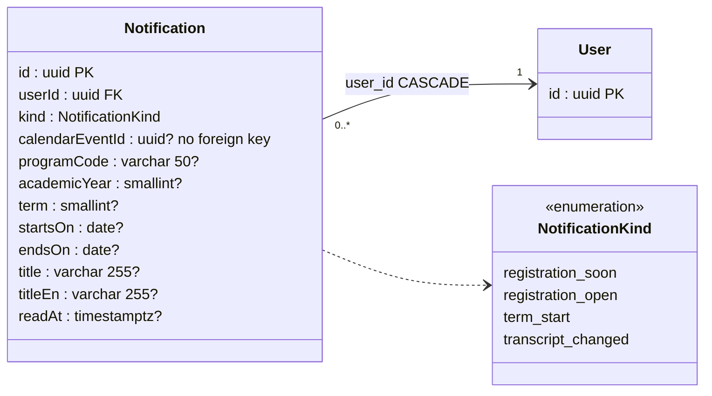

- The table is `notifications`. One row is one notification of one student. `user_id` is `ON DELETE CASCADE`, so the account export reads the rows and the purge deletes them ([ADR 0004](adr/0004-account-export-and-deletion.md)).
- `calendarEventId` holds the ID of the `AcademicCalendarEvent` (§1.6) that the notification announces. It has no foreign key on purpose: the notification stays when an administrator deletes the school date. `programCode`, `academicYear`, `term`, `startsOn`, `endsOn`, `title` and `titleEn` are a copy of that date, taken when the notification is made and never updated.
- `uq_notifications_user_event_kind` is unique on (`user_id`, `calendar_event_id`, `kind`): a student gets each notification of a school date once, also when the date moves. A `transcript_changed` row has no school date, and PostgreSQL treats NULLs as distinct, so the key does not limit it.
- Checks: `ck_notifications_kind` (the four kinds), `ck_notifications_event` (`calendar_event_id` is NULL exactly for `transcript_changed`) and `ck_notifications_snapshot` (the copy is all set, except the optional `term` and `title_en`, with a school date, and all NULL without one). The index `ix_notifications_user_created` is on (`user_id`, `created_at`, `id`).
- A row holds no sentence, no URL, no grade, no course code and no rule value. `createdAt` and `readAt` are written from the injected `Clock`, not from the database's time.

## 2. Rule engine

The rule engine is the set of pure functions in `src/backend/src/rules/` plus `RulesService`, which only loads their inputs ([ADR 0013](adr/0013-rule-engine-and-degree-audit.md)). It reads plain data, never entities, and has no route of its own.

### 2.1 Inputs

Sources: `curriculum/curriculum-rules.reader.ts`, `curriculum/course-rules.service.ts`, `transcript/transcript-entry.ts`, `terms/term.ts`, `plans/plan-board.ts`, `rules/plan-issues.ts`.

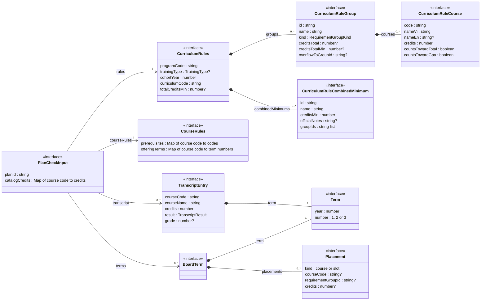

`CurriculumRulesReader.rulesFor(programCode, cohortYear)` builds `CurriculumRules` from the entities of §1.2; `CourseRulesService.rulesFor(curriculumId)` builds `CourseRules`, where a course absent from a map means "not recorded"; `TranscriptService.rowsFor(userId)` returns the `TranscriptEntry` list. `rules/coverage.ts` has its own `Placement` (a curriculum course and the group it counts in); the one drawn here is the plan board's, from `plans/plan-board.ts`.

### 2.2 Degree audit result

Source: `rules/audit-types.ts`, `rules/credit-caps.ts`. The HTTP classes in `audit/audit.dto.ts` (`DegreeAuditDto` and the others) implement these interfaces one to one, so the API contract cannot drift from the engine.

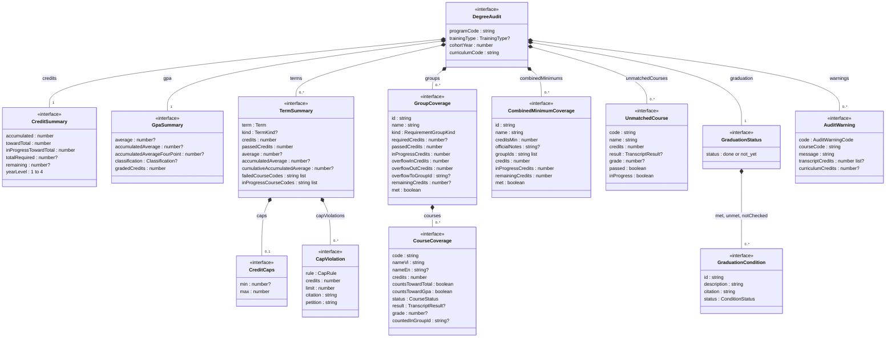

Value sets (each a `const` array in the same files): `CourseStatus` = `passed`, `in_progress`, `failed`, `not_taken`, `counted_in_other_group`; `ConditionStatus` = `met`, `not_met`, `not_checked`; `AuditWarningCode` = `credits_differ`, `same_term_attempts`, `not_in_curriculum`; `TermKind` = `main`, `summer`; `CapRule` = `below_minimum`, `above_maximum`; `Classification` (`rules/grades.ts`) = `excellent`, `very_good`, `good`, `fairly_good`, `average`, `weak`, `poor`.

A `CapViolation` never blocks anything: the regulation allows a load outside the credit caps by petition ([ADR 0012](adr/0012-credit-caps-by-training-type.md)).

### 2.3 Plan issues report

Source: `plans/plan-issues.ts` (the types sit in `plans` so that `plans` does not import `rules`; `RulesService` implements `PlanIssuesProvider`, [ADR 0014](adr/0014-plan-model.md)). `plans/plan-issues.dto.ts` implements them for the API.

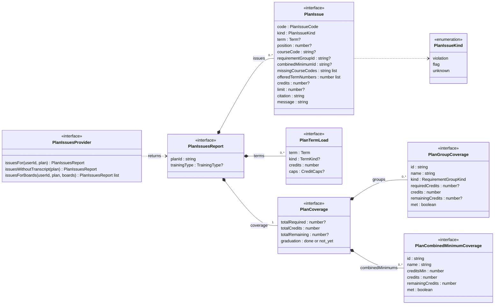

`PlanIssueCode` (`PLAN_ISSUE_CODES`) has fourteen values: `prerequisite_not_met`, `prerequisites_not_recorded`, `not_offered`, `offering_terms_not_recorded`, `load_below_minimum`, `load_above_maximum`, `caps_not_checked`, `load_not_checked`, `placed_twice`, `already_passed`, `already_in_progress`, `not_in_curriculum`, `credits_not_recorded`, `requirement_not_covered`. A `violation` breaks an academic rule, a `flag` is worth the student's attention, and `unknown` means the data to check the rule is not recorded: it is never reported as a pass or a fail. No issue blocks a save.

### 2.4 Functions

Every function below is pure (no database, no clock, no model) and is exported from the file named. `src/rules/**` is held to 80 % statement coverage by `vitest.config.mts`.

| File in `rules/` | Function | Input → output | Rule it decides |
| --- | --- | --- | --- |
| `audit.ts` | `degreeAudit(rules, transcript)` | `CurriculumRules`, `TranscriptEntry[]` → `DegreeAudit` | The whole degree audit; composes the functions below |
| `attempts.ts` | `courseRecords(entries)`, `resolve(code, attempts)`, `recordAsOf(record, term)` | `TranscriptEntry[]` → `Map<string, CourseRecord>` | The official attempt of each course: the last completed one (QĐ 1175 Điều 14) |
| `attempts.ts` | `isCompleted(entry)`, `attemptPasses(entry)` | `TranscriptEntry` → `boolean` | Whether one attempt is finished, and whether it passes |
| `coverage.ts` | `placements(rules)` | `CurriculumRules` → course code → group it counts in | A course linked to several groups counts in exactly one |
| `coverage.ts` | `groupCoverage(rules, records, placed)` | → `GroupCoverage[]` | Credits passed, in progress, overflow and remaining per requirement group |
| `coverage.ts` | `combinedMinimumCoverage(rules, groups)` | → `CombinedMinimumCoverage[]` | Combined minimums over several groups |
| `graduation.ts` | `graduationStatus(groups, combined, credits)` | → `GraduationStatus` | Which conditions are met, unmet, or cannot be checked from the data (`NOT_CHECKED_CONDITIONS`) |
| `gpa.ts` | `weightedAverage(items)`, `fourPointAverage(items)` | `WeightedGrade[]` → `ExactAverage` or null | Điều 15 averages, kept as exact fractions |
| `grades.ts` | `isPassingGrade(grade)`, `letterGrade(grade)`, `fourPointTenths(grade)`, `classify(numerator, denominator, cohortYear)`, `yearLevel(accumulatedCredits)` | numbers → `boolean`, `LetterGrade`, `Classification`, 1–4 | Pass mark, letter and 4-point scale, classification, year level |
| `credit-caps.ts` | `termKind(trainingType, number)`, `creditCaps(trainingType, kind)`, `checkTermLoad(trainingType, number, courses)` | → `TermKind`, `CreditCaps`, `TermLoadCheck` | Main or summer term; the credit caps by training type; a term's load against them |
| `prerequisites.ts` | `checkPrerequisites(prerequisites, passedCodes)` | → `PrerequisiteCheck`: `not_recorded`, `none`, `met`, or `not_met` with the missing codes | Prerequisites (Điều 3.1.c) |
| `prerequisites.ts` | `checkOfferingTerm(offeredTermNumbers, term)` | → `OfferingTermCheck`: `not_recorded`, `offered`, or `not_offered` with the offered term numbers | Offering terms |
| `plan-issues.ts` | `checkPlan(input)` | `PlanCheckInput` → `PlanIssuesReport` | Every issue of a plan board, each term's load, and the coverage the plan would reach; composes the functions above |

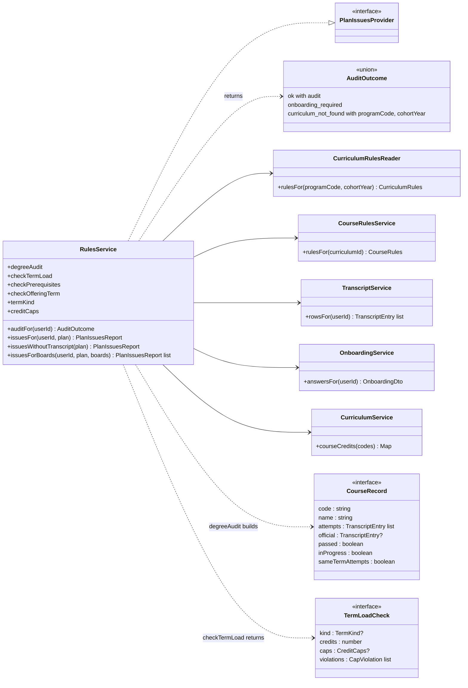

Source: `rules/rules.service.ts`, `rules/rules.module.ts`. `RulesModule` provides `RulesService` and the same instance under the token `PLAN_ISSUES_PROVIDER`.

## 3. Services and controllers

One Nest module per feature folder (`src/backend/src/features.ts` lists them). Two global guards run before every controller method, in this order: `ThrottlerGuard` (120 requests a minute per address; 10 on a route marked `@Throttle(PASSWORD_LIMIT)`), then `AuthGuard` (`app.module.ts`, `auth/rate-limits.ts`). A global `ValidationPipe` (`whitelist`, `transform`) checks every DTO (`bootstrap.ts`). All paths below are under `/api`.

### 3.1 Users, authentication and account

Sources: `auth/`, `users/`, `account/`.

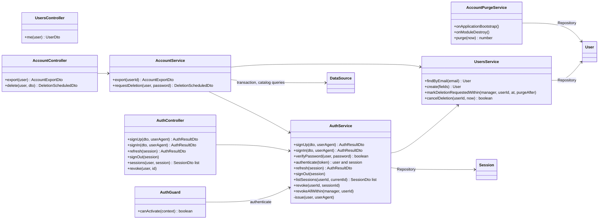

| Controller | Routes |
| --- | --- |
| `AuthController` (`auth`) | `POST /auth/sign-up` and `POST /auth/sign-in` (public, password limit), `POST /auth/refresh`, `POST /auth/sign-out`, `GET /auth/sessions`, `DELETE /auth/sessions/{id}` |
| `UsersController` (`users`) | `GET /users/me` |
| `AccountController` (`users/me`) | `GET /users/me/export`, `DELETE /users/me` (password limit) |

### 3.2 Student record, curriculum, degree audit and plans

Sources: `onboarding/`, `transcript/`, `curriculum/`, `audit/`, `rules/`, `plans/`.

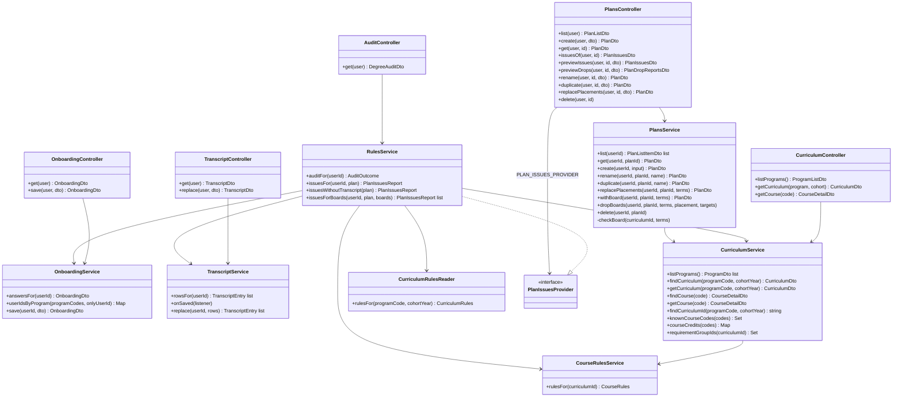

Each service reaches its own tables through TypeORM repositories (left out of the drawing): `OnboardingService` → `OnboardingAnswers`; `TranscriptService` → `TranscriptRow`; `CurriculumService` → `Program`, `Curriculum`, `Course`, `RequirementGroupCourse`; `CourseRulesService` → `CoursePrerequisiteList`, `CourseOfferingTerm`; `CurriculumRulesReader` → `Curriculum`, `CombinedMinimum`, `RequirementGroupOverflow`; `PlansService` → `Plan`, `PlanPlacement`. No service in this diagram reads another module's data from its tables: `RulesService` and `PlansService` go through the services drawn. The one statement on another module's table is a row lock: `TranscriptService` locks the student's `users` row while it replaces the transcript and selects no column. Outside this diagram, `AccountService` reads every table with a `user_id` by design ([ADR 0004](adr/0004-account-export-and-deletion.md), section 3.1), and the curriculum administration services write the curriculum tables (section 3.3).

| Controller | Routes |
| --- | --- |
| `OnboardingController` | `GET`, `PUT /users/me/onboarding` |
| `TranscriptController` | `GET`, `PUT /users/me/transcript` |
| `CurriculumController` | `GET /programs`, `GET /programs/{program}/curricula/{cohort}`, `GET /courses/{code}` |
| `AuditController` | `GET /users/me/audit` |
| `PlansController` | `GET`, `POST /plans`; `GET`, `PATCH`, `DELETE /plans/{id}`; `GET`, `POST /plans/{id}/issues`; `POST /plans/{id}/issues/drops`; `POST /plans/{id}/duplicate`; `PUT /plans/{id}/placements` |

### 3.3 Curriculum administration

Sources: `curriculum-admin/`. The API is built and tested ([ADR 0011](adr/0011-curriculum-administration.md)); the single-page app has no administration screen yet.

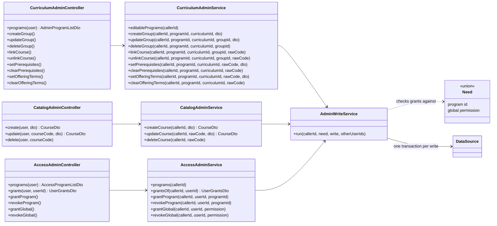

`AdminWriteService.run` opens a transaction, locks the caller's row (`lockAdminWrite`), refuses a caller whose account is scheduled for deletion, reads the caller's grants (`grantsOf`) and answers 403 `permission_required` when `missingPermission` finds the `Need` uncovered; only then does the write run. `prerequisite-cycle.ts` refuses a prerequisite cycle. The first access manager is granted from a shell by `bootstrap-cli.ts` (`bootstrapAccessManager`), never over HTTP.

| Controller | Routes |
| --- | --- |
| `CurriculumAdminController` | `GET /admin/programs`; under `/admin/programs/{programId}/cohorts/{curriculumId}`: `POST /requirement-groups`, `PATCH`, `DELETE /requirement-groups/{groupId}`, `PUT`, `DELETE /requirement-groups/{groupId}/courses/{courseCode}`, `PUT`, `DELETE /courses/{courseCode}/prerequisites`, `PUT`, `DELETE /courses/{courseCode}/offering-terms` |
| `CatalogAdminController` | `POST /admin/catalog/courses`, `PATCH`, `DELETE /admin/catalog/courses/{courseCode}` |
| `AccessAdminController` | `GET /admin/access/programs`, `GET /admin/access/users/{userId}/grants`, `PUT`, `DELETE /admin/access/users/{userId}/programs/{programId}`, `PUT`, `DELETE /admin/access/users/{userId}/global/{permission}` |

### 3.4 Guides, health and the AI gateway

Sources: `guides/`, `health/`, `ai/`.

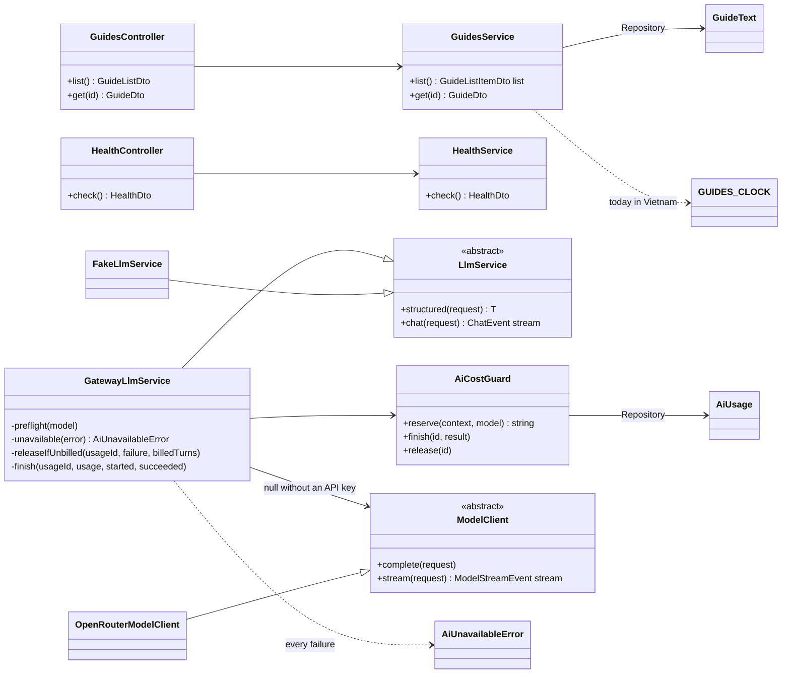

- `GuidesController`: `GET /guides`, `GET /guides/{id}`, both `@Public()`. `HealthController`: `GET /health`, public.
- The AI gateway is built and exported (`AiModule` exports `LlmService`), but no feature module on `main` injects it yet: F6's goal box and F8 are not built. `FakeLlmService` (`ai/testing/`) replaces the gateway in unit tests. `AiUnavailableError` is a 503 `ai_unavailable` ([ADR 0003](adr/0003-language-model-scope.md)).

### 3.5 Academic calendar

Sources: `academic-calendar/` ([ADR 0017](adr/0017-academic-calendar.md)).

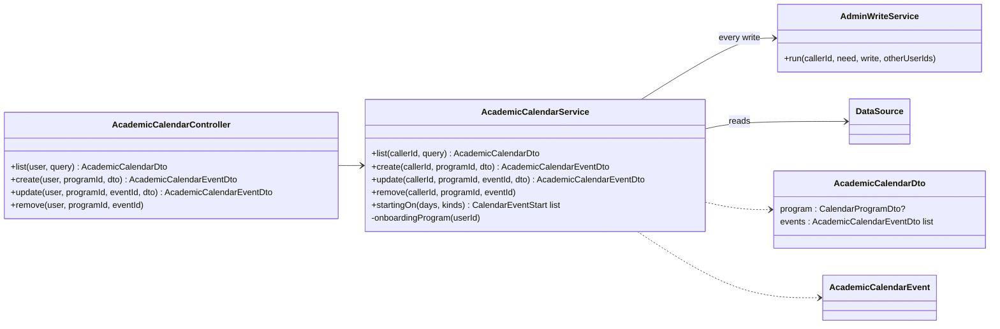

- Reading: any signed-in user. `AcademicCalendarQueryDto` takes `program` (a program code), `academicYear`, `from` and `to`. Without `program`, the service reads the caller's program from `onboarding_answers.program_code`; with none, it answers `program: null` and no events. An unknown program code is 404 `not_found`, and `to` before `from` is 400 `validation_failed`. `from` and `to` keep every date that overlaps the range. The events come ordered by `startsOn`, `endsOn`, `title` and `id`.
- Writing: a program administrator of that program. Each write runs inside `AdminWriteService.run` with the need `{ program: programId }`, so it uses F12's grant check, write lock and error codes, and has no guard of its own ([ADR 0011](adr/0011-curriculum-administration.md)). `AcademicCalendarModule` imports `CurriculumAdminModule`, which exports `AdminWriteService`. `StrictBody` refuses a body field that `CreateCalendarEventDto` or `UpdateCalendarEventDto` does not declare.
- Checks before a write: `IsCalendarDate` refuses a date that is not a real `YYYY-MM-DD` day; `datesProblem` refuses an `endsOn` before `startsOn` and a `startsOn` outside the academic year's two calendar years; `sourceUrl` must start with lowercase `https://`. `eventIn` answers 404 for an event of another program. `eventDto` leaves out `createdBy` and `updatedBy`.
- The single-page app only reads: the `calendar/` folder (§4). No screen calls the write routes yet.
- `startingOn` has no route. It is the read-only method the notification inbox calls (§3.6): the dates of the given kinds whose first day is one of the given days, in every program, as `CalendarEventStart` (the program code, the kind, the days and the titles; no notes, no source link, no actor ID). `AcademicCalendarModule` exports the service for it.

| Controller | Routes |
| --- | --- |
| `AcademicCalendarController` | `GET /academic-calendar`; `POST /admin/programs/{programId}/calendar-events`; `PATCH`, `DELETE /admin/programs/{programId}/calendar-events/{eventId}` |

### 3.6 Notification inbox

Sources: `notifications/`, `config/clock.ts`, `transcript/transcript-change.ts` ([ADR 0018](adr/0018-notification-inbox.md), proposed).

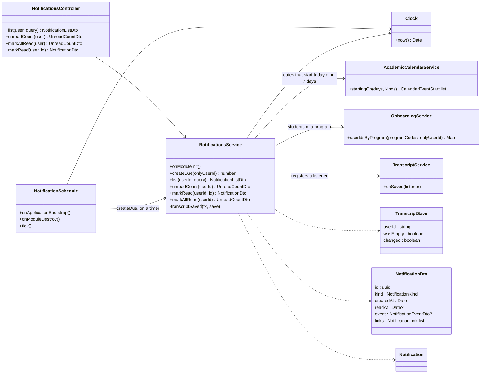

- `createDue` creates every notification that is due on today's day in Vietnam (`vietnamDate(clock.now())`) and does not exist yet. `notificationsDue` (in `notification-kinds.ts`) is strict: `registration_soon` only on the day 7 days before a `registration` date starts, `registration_open` and `term_start` only on the first day. A day that has passed makes nothing.
- Recipients: the students whose saved onboarding program is the date's program at that moment, without the accounts waiting for deletion. One `INSERT … SELECT … ON CONFLICT DO NOTHING` per school date and kind writes all their rows. Each statement runs on its own: one that fails is counted, logged by its kind only (`failureKind` in `common/failure-kind.ts`), and tried again at the next run.
- Two callers run `createDue`. `NotificationSchedule` runs it for everyone when the app starts and then on a timer: every 10 minutes, and at 00:00 in Vietnam when that comes first (`msUntilNextRun`). The timer is unref'd and stops when the app closes. `list` and `unreadCount` run it first for the caller alone, so a school date entered for today shows at once; if that run fails, the read still answers from the stored rows.
- The transcript: `TranscriptService.replace` (§3.2) calls its listeners inside the save's transaction with a `TranscriptSave`. The service writes one `transcript_changed` row through that transaction when `changed` is true and `wasEmpty` is false. A save that fails leaves no row, and the listener is never given a transcript row.
- Reading: the caller's own notifications only; no route takes a user ID. `list` orders by `createdAt` then `id`, both descending, and takes the filters `unread` and `kind`, `limit` (default 50, at most 100) and `before` (the ID of the last notification of the previous page). `NotificationDto.links` holds keys (`calendar`, `planner`, `audit`), never a URL. Another student's ID, an unknown ID and a malformed ID (`NotificationIdPipe`) all answer 404 `not_found`.
- `markRead` and `markAllRead` can be repeated without effect: `readAt` keeps the first time.
- No screen calls these routes yet: the single-page app has no bell and no inbox (§4).

| Controller | Routes |
| --- | --- |
| `NotificationsController` | `GET /notifications`; `GET /notifications/unread-count`; `POST /notifications/read-all`; `POST /notifications/{id}/read` |

## 4. Single-page app modules

The Vue app has no classes of its own apart from `HttpError`; each feature folder in `src/frontend/src/` holds views (`<script setup>` single-file components), an `api.ts` with the calls and the response types, and sometimes a Pinia store or pure helper modules. The response types are hand-written and checked against `src/backend/openapi.json` by each folder's `api.spec.ts`.

| Folder | Views | Store or composable | API module (functions) | Pure helpers |
| --- | --- | --- | --- | --- |
| `/` (root) | `App.vue`, `views/HomeView.vue` | `async-load.ts` (`useAsyncLoad`), `locale.ts` | `api.ts`: `send`, `request`, `getJson`, `statusOf`, `HttpError` | `router.ts`, `terms.ts` |
| `auth/` | `SignInView`, `SignUpView` | `store.ts`: `useAuth` (`start`, `signIn`, `signUp`, `signOut`, `authed`, `clear`) | `signUp`, `signIn`, `refresh`, `signOut`, `listSessions`, `revokeSession` | `redirect.ts`, `password-strength.ts` |
| `onboarding/` | `OnboardingView`, `StudySettings`, `GoalFields` | `store.ts`: `useOnboarding` (`load`, `save`) | `fetchOnboarding`, `saveOnboarding` | `answers.ts` |
| `transcript/` | `TranscriptView` | `codes.ts`: `useTranscriptCodes` | `fetchTranscript`, `saveTranscript` | `rows.ts` (`DraftRow`, `problems`, `toRow`, `fromRow`, `blankRow`) |
| `audit/` | `DashboardView`, `AuditView`, `AuditGate` | `present.ts`: `useAudit` | `fetchAudit` | `present.ts` (`shownGroups`, `conditionLabel`, `formatScore`) |
| `curriculum/`, `explorer/` | `ExplorerView`, `CourseDrawer` | none | `fetchPrograms`, `fetchCurriculum`, `fetchCourse` | `curriculum/present.ts` (`matches`, `orderGroups`, `groupColour`) |
| `plans/` | `PlannerEntry`, `PlansView`, `PlanEditorView`, `IssuesPanel`, `StatusStrip`, `PlanTabs`, dialogs | none | `fetchPlans`, `createPlan`, `fetchPlan`, `renamePlan`, `duplicatePlan`, `deletePlan`, `savePlacements`, `fetchPlanIssues`, `previewPlanIssues`, `previewPlanDrops` | `board.ts` (`Board`, `boardOf`, `boardBody`, `moveTile`, `attachIssues`, `dropVerdict`), `drag.ts`, `lock.ts`, `last-plan.ts` |
| `account/` | `SettingsView`, `DeleteAccountDialog` | none | `exportAccount`, `deleteAccount`, `saveFile` | `user-agent.ts` |
| `guides/` | `GuidesView`, `GuideView` | none | `fetchGuides`, `fetchGuide` | `pick-text.ts`, `search.ts` |
| `calendar/` | `CalendarView` (week and month views at `/calendar`) | none | `fetchAcademicCalendar` | `dates.ts` (`mondayOf`, `monthDays`, `monthWeeks`, `academicYearOf`, `termWeek`, `eventsByDay`) |

`useAuth().authed(call)` runs an API call with the session token and clears the session on a 401; `App.vue` then sends the student to sign-in. The router guard (`router.ts`, `onboardingFirst`) sends a signed-in student whose onboarding is unfinished to `/onboarding` before any private page except `/settings`.

## 5. Features and decisions

| Class group | Section | Features | Decided in |
| --- | --- | --- | --- |
| `User`, `Session`, `AuthService`, `AuthGuard`, `UsersService` | 1.1, 3.1 | F1 | [ADR 0002](adr/0002-authentication-and-sessions.md) |
| `AccountService`, `AccountPurgeService`, the `user_id` delete rules | 1.7, 3.1 | F1, privacy NFR | [ADR 0004](adr/0004-account-export-and-deletion.md) |
| `OnboardingAnswers`, `OnboardingService` | 1.1, 3.2 | F1 (program, cohort and planning goal) | No ADR of its own; its terms follow [ADR 0009](adr/0009-term-encoding.md), and [ADR 0013](adr/0013-rule-engine-and-degree-audit.md) decides how the degree audit reads it |
| `TranscriptRow`, `TranscriptEntry`, `TranscriptService` | 1.1, 2.1, 3.2 | F2 | [ADR 0007](adr/0007-transcript.md) |
| `Program`, `Curriculum`, `RequirementGroup`, `RequirementGroupCourse`, `Course`, `CurriculumService` | 1.2, 3.2 | F4, and the data under F3, F5, F12 | [ADR 0005](adr/0005-curriculum-cohort-and-course-catalog.md) |
| `CombinedMinimum`, `CombinedMinimumGroup`, `RequirementGroupOverflow`, `CurriculumRulesReader`, `DegreeAudit` and its parts, `degreeAudit`, `AuditController` | 1.2, 2.2, 2.4, 3.2 | F3 | [ADR 0013](adr/0013-rule-engine-and-degree-audit.md) |
| `CreditCaps`, `CapViolation`, `creditCaps`, `checkTermLoad`, `Program.trainingType` | 2.2, 2.4 | F3, F5 | [ADR 0012](adr/0012-credit-caps-by-training-type.md) |
| `Term`, `termYear` and `termNumber` columns | 1.1, 1.4, 2.1 | F2, F3, F5 | [ADR 0009](adr/0009-term-encoding.md) |
| `Plan`, `PlanPlacement`, `BoardTerm`, `Placement`, `PlansService`, `PlanIssuesProvider`, `PlanIssuesReport`, `checkPlan` | 1.4, 2.3, 2.4, 3.2 | F5 (and the copy a what-if scenario of F7 starts from) | [ADR 0014](adr/0014-plan-model.md). [ADR 0015](adr/0015-rule-engine-in-the-browser.md) (proposed) would run the drag preview in the browser; today it asks the API |
| `CoursePrerequisiteList`, `CoursePrerequisite`, `CourseOfferingTerm`, `CourseRulesService`, `checkPrerequisites`, `checkOfferingTerm` | 1.2, 2.4 | F4, F5, F12 | [ADR 0011](adr/0011-curriculum-administration.md) |
| `ProgramAdminGrant`, `GlobalAdminGrant`, `AdminWriteService`, the three administration services and controllers | 1.3, 3.3 | F12 | [ADR 0011](adr/0011-curriculum-administration.md) |
| `Guide`, `GuideText`, `GuideContent`, `GuidesService` | 1.5, 3.4 | F11 | [ADR 0010](adr/0010-public-pages-and-guide-content.md) |
| `AiUsage`, `LlmService`, `GatewayLlmService`, `AiCostGuard`, `ModelClient` | 1.1, 3.4 | F6 goal box and F8 (gateway only; neither feature is built) | [ADR 0003](adr/0003-language-model-scope.md) |
| `AcademicCalendarEvent`, `AcademicCalendarService`, `AcademicCalendarController`, `CalendarView` | 1.6, 3.5, 4 | F10 school dates (the dates and the calendar page) | [ADR 0017](adr/0017-academic-calendar.md) (proposed) |
| `Notification`, `NotificationsService`, `NotificationSchedule`, `NotificationsController`, `Clock`, `TranscriptSave` | 1.8, 3.6 | F10 notification inbox (the API only; the bell and the inbox screen are not built) | [ADR 0018](adr/0018-notification-inbox.md) (proposed) |
| `PlanShare` (`SharingService`, `PlanShareController` and `SharedPlansController` in `sharing/` are not drawn in §3 yet) | 1.4, 1.7 | F9 shared plans (the API; no screen yet) | [ADR 0010](adr/0010-public-pages-and-guide-content.md), amendment of 25 November 2026 |
| (no classes yet) | | F7 what-if | [ADR 0006](adr/0006-plan-generator.md) for F6's planner; not built |

The stack these classes are written in is [ADR 0001](adr/0001-technology-stack.md); how they are tested in a browser is [ADR 0008](adr/0008-browser-testing.md).
