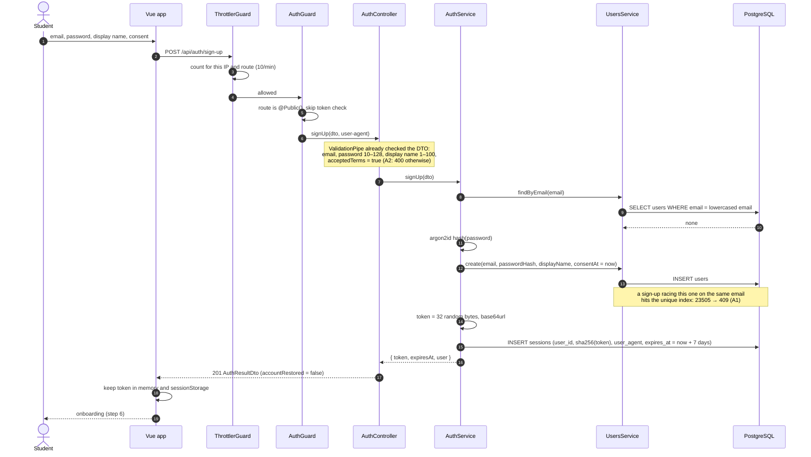
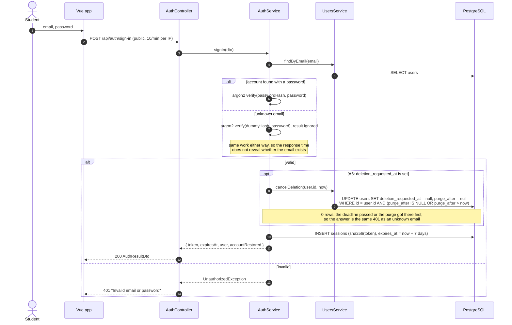
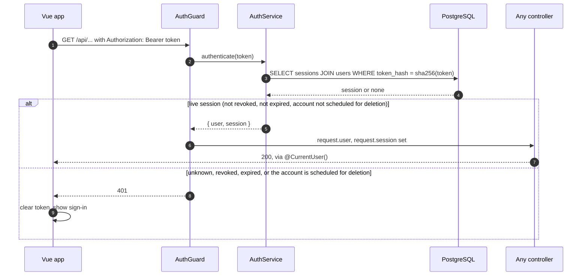
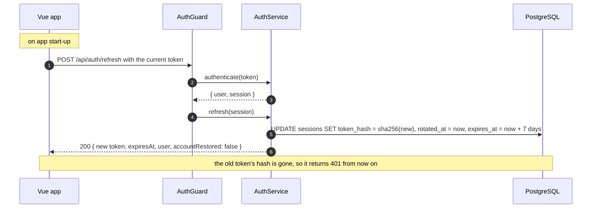
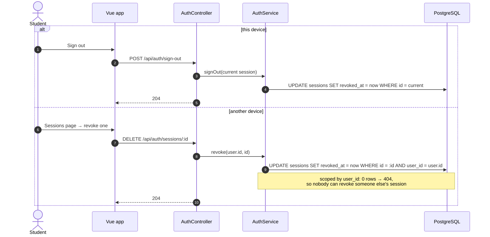

# Sequence diagrams: UC-01 Sign up and onboard

- Use case: UC-01 (`docs/requirements/use-cases/`, PR #16)
- Owner: Lâm
- Drawn from the code on `main`: `src/backend/src/auth/`, `src/backend/src/users/` ([ADR 0002](../adr/0002-authentication-and-sessions.md))
- Not drawn yet: onboarding, whose API (`GET` and `PUT /api/users/me/onboarding`, [B1 test cases §6](../../test/test-cases-b1.md#6-inputs-still-needed)) is decided but not on `main`, and sign-in with Google (deferred, ADR 0002)

Participants are the Nest classes that take part. `ThrottlerGuard` and `AuthGuard` are global guards, registered in that order, so they run before every controller method, and the `ValidationPipe` runs after them. The Vue app's side (where the token is kept, what a 401 does) is the plan in issue #13 and is not built yet.

## Basic flow, steps 1–5: sign up

**A1, email already registered:** at the `findByEmail` step the user exists, and `AuthService` throws `ConflictException`, so the response is 409. Nothing is written. If two sign-ups with one email both pass the lookup, the unique email index refuses the second insert, and `AuthService` turns PostgreSQL's `unique_violation` (23505) into the same 409.

**A3, too many attempts:** `ThrottlerGuard` answers 429 before any controller code runs.

## A5: sign in

**A6, signing in cancels a pending deletion** ([ADR 0004](../adr/0004-account-export-and-deletion.md), #14): when the account was scheduled for deletion and its `purge_after` deadline has not passed, sign-in clears both deletion columns and answers with `accountRestored: true`, so the SPA tells the student their account was restored.

## Every signed-in request

## Staying signed in: token rotation

## Signing out

