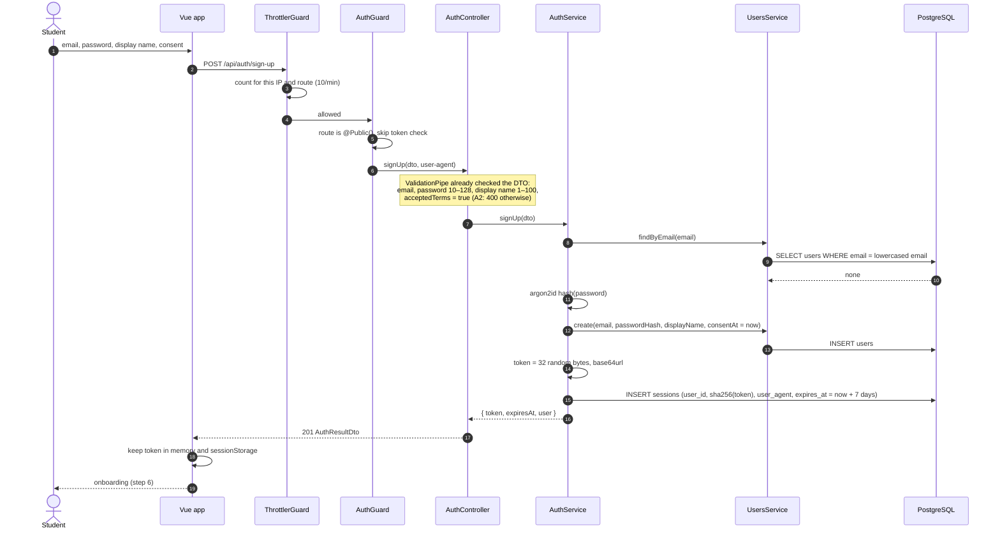
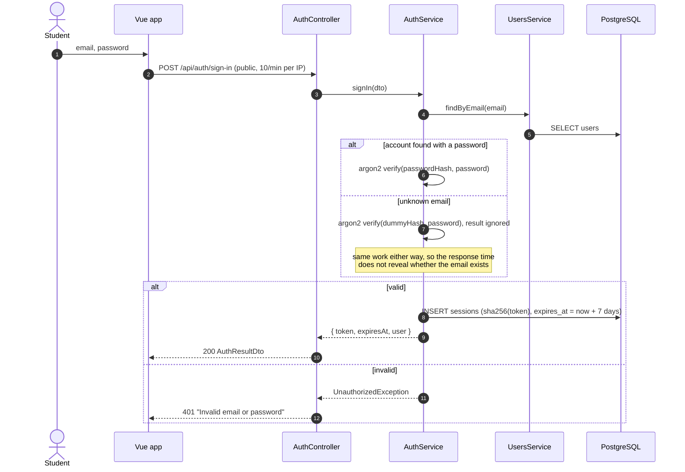
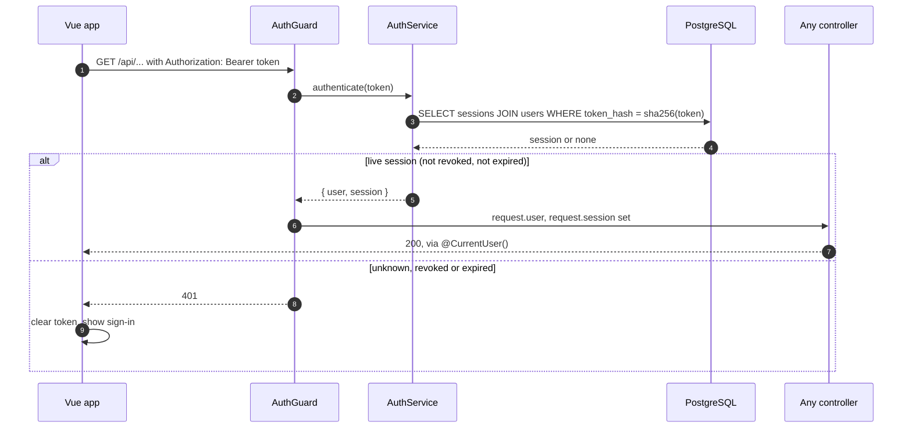
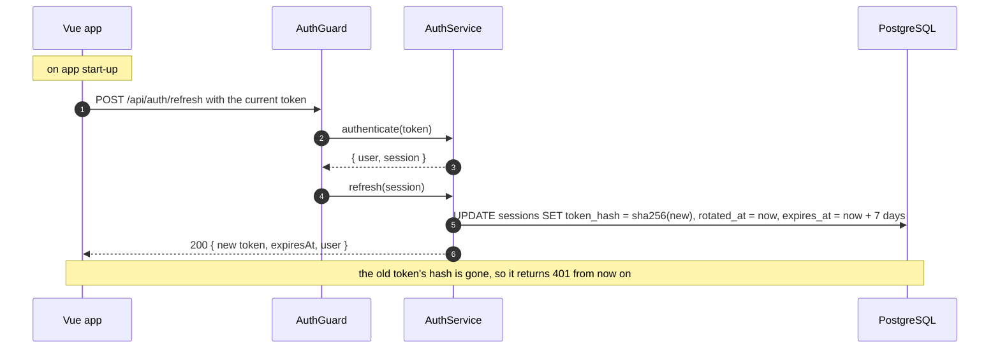
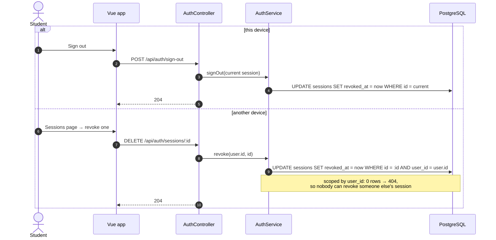

# Sequence diagrams: UC-01 Sign up and onboard

- Use case: UC-01 (`docs/requirements/use-cases/`, PR #16)
- Owner: Lâm
- Drawn from the code on `main`: `src/backend/src/auth/`, `src/backend/src/users/` ([ADR 0002](../adr/0002-authentication-and-sessions.md))
- Not drawn yet: onboarding (its API waits on Triết's curriculum tables) and sign-in with Google (deferred, ADR 0002)

Participants are the Nest classes that take part. `ThrottlerGuard` and `AuthGuard` are global guards, registered in that order, so they run before every controller method, and the `ValidationPipe` runs after them. The Vue app's side (where the token is kept, what a 401 does) is the plan in issue #13 and is not built yet.

## Basic flow, steps 1–5: sign up

**A1, email already registered:** at the `findByEmail` step the user exists, and `AuthService` throws `ConflictException`, so the response is 409. Nothing is written.

**A3, too many attempts:** `ThrottlerGuard` answers 429 before any controller code runs.

## A5: sign in

A6, where sign-in restores an account scheduled for deletion, is added to this diagram when PR #14 merges.

## Every signed-in request

## Staying signed in: token rotation

## Signing out

