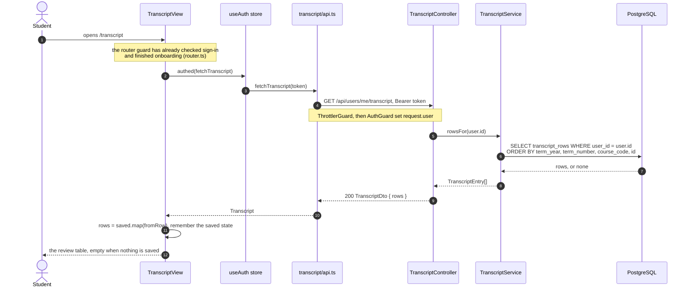
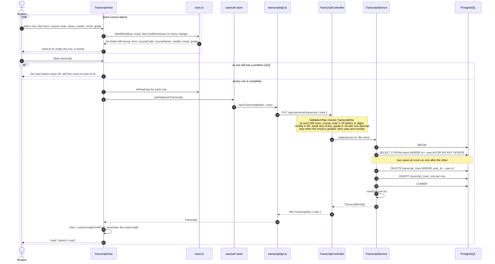
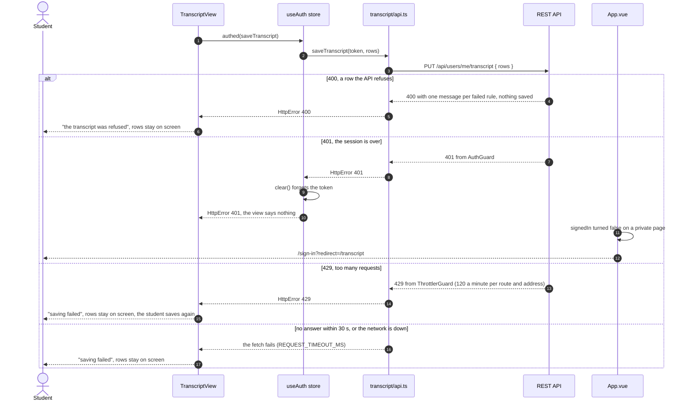

# Sequence diagrams: UC-02 Import transcript (as built: transcript entry)

- Use case: UC-02 ([specification](../../requirements/use-cases/UC-02-import-transcript.md)), feature F2
- Drawn from the code on `main` (15 November 2026): `src/frontend/src/transcript/` (`TranscriptView.vue`, `rows.ts`, `api.ts`), `src/frontend/src/auth/store.ts`, `src/backend/src/transcript/` ([ADR 0007](../adr/0007-transcript.md))
- What is built is the part of UC-02 from the review table on: the student types the rows in (A4), reviews them (step 6) and saves the whole set (steps 7–8, A5). Steps 1–5 (the paste) and A1 and A8 have no code. The Project Lead decided on 15 November 2026 that F2 is "paste the grades table, or type it in" ([ADR 0007, amendment](../adr/0007-transcript.md#amendment-15-november-2026-paste-or-type-no-file)); pasting is not on `main` yet and is not drawn. See [the differences list](../design-differences.md).

Participants are real modules. `useAuth` is the Pinia store in `auth/store.ts`; its `authed(call)` passes the session token to an API function. `ThrottlerGuard` and `AuthGuard` run before every controller method and are drawn once, in [UC-01, "Every signed-in request"](UC-01-sign-up-and-onboard.md#every-signed-in-request); here they appear as one step.

## Open the transcript

The load goes through `useAsyncLoad`: while it runs the view shows a loading line, and a failure shows a message with a retry button that calls the same load again.

## Enter rows, review and save (steps 6–8, A2, A3, A4, A6)

- **A3, course in progress:** the student picks the result `in_progress`; the row has no grade and is saved like any other. What it means for graduation is the rule engine's call.
- **A6, the same course twice:** each attempt is its own row. Nothing in the view or the service merges them; the rule engine picks the official attempt.
- **A5, saving over an existing transcript:** the save always replaces the whole set in one transaction. The view shows no comparison with the saved rows.
- **A9, leaving:** `onBeforeRouteLeave` asks the student to confirm when the rows on screen differ from the saved ones. Nothing was sent, so nothing is stored.

## Alternate flows of the save

The view's own checks (`problems` in `rows.ts`) mirror the DTO's, so a 400 is rare; it still has its own message. The transcript save has no automatic retry on 429: only the planner's save does ([UC-05](UC-05-build-and-edit-a-plan.md)).
