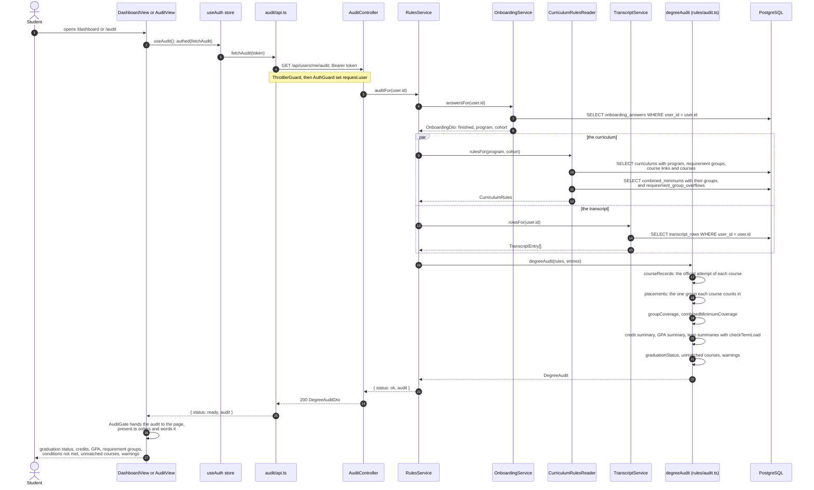
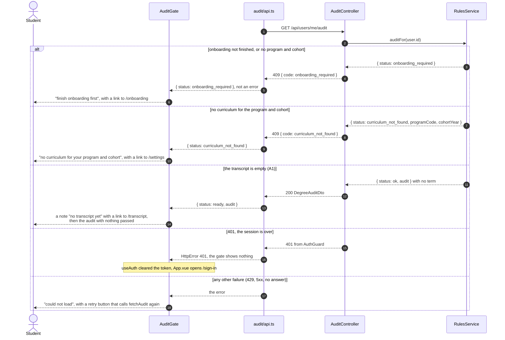

# Sequence diagrams: UC-03 View degree audit

- Use case: UC-03 (Use-Case Specification v1.0, [`report/assignments/PA2/uc-specs.tex`](../../../report/assignments/PA2/uc-specs.tex)), feature F3
- Drawn from the code on `main` (15 November 2026): `src/frontend/src/audit/` (`AuditView.vue`, `AuditGate.vue`, `present.ts`, `api.ts`) and `src/frontend/src/dashboard/` (`DashboardView.vue`), `src/backend/src/audit/`, `src/backend/src/rules/` ([ADR 0013](../adr/0013-rule-engine-and-degree-audit.md))
- Built: the dashboard and the audit page, both drawn from one `GET /api/users/me/audit`. Not built: the estimated graduation term, the past-term picker (A2) on screen and the "Needs attention" links to a place to act; see [the differences list](../design-differences.md). For A2 the API takes `asOfYear` and `asOfNumber`: the controller passes that term to `auditFor`, and `degreeAudit` reads only the transcript rows up to it.

The degree audit is worked out afresh on every call and is never stored. The dashboard (`/dashboard`) and the audit page (`/audit`) both call `useAudit()` and wrap what they show in `AuditGate`, so the flow is the same for both.

## Basic flow: the audit through the rule engine

The pages decide nothing: `present.ts` only orders, colours and formats what the API returned (AGENTS.md hard rule 1). `degreeAudit` is one pure function; the self-calls above are the exported functions it composes (`rules/attempts.ts`, `coverage.ts`, `credit-caps.ts`, `graduation.ts`, `gpa.ts`, `grades.ts`).

## Alternate flows

- **Onboarding not finished:** in the app as built this branch is rarely reached. The router guard (`router.ts`, `onboardingFirst`) sends a signed-in student whose onboarding is unfinished to `/onboarding` before `/dashboard` or `/audit` opens, so `AuditGate`'s notice shows only when the guard could not load the onboarding answers and let the page open. Test case USER-01k expects the dashboard notice; the redirect is the difference tracked in issue #115.
- **A3, course outside the curriculum:** not a separate flow. `degreeAudit` returns such courses in `unmatchedCourses` and adds a `not_in_curriculum` warning; the audit page lists them.
- **A4, graduation status reached:** `graduation.status` is `done` when every condition the data can check is met; the conditions the data cannot check are returned in `graduation.notChecked` and shown as still needing the school.
