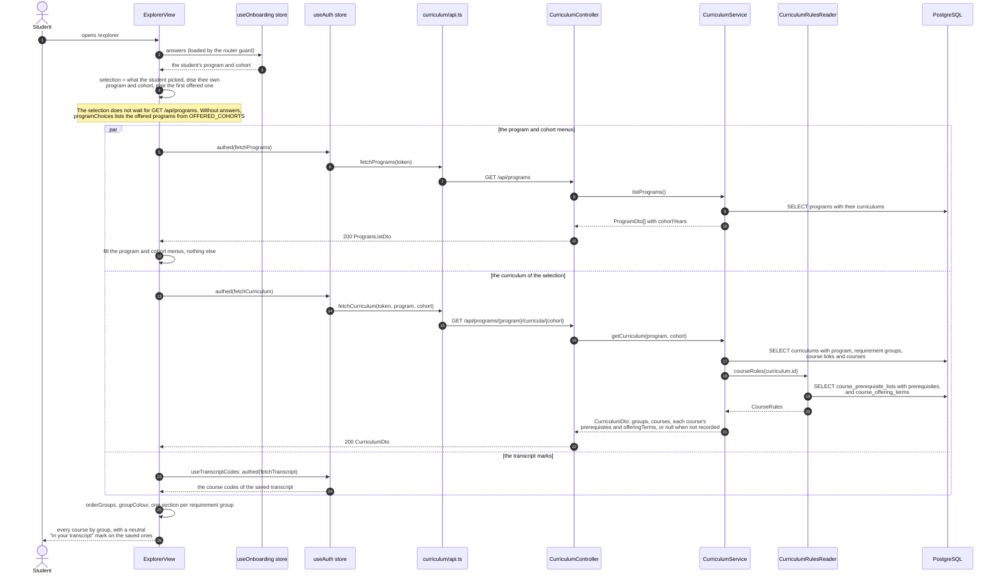
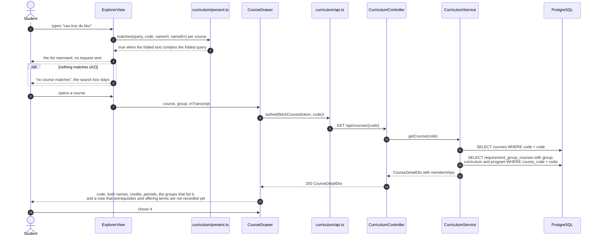
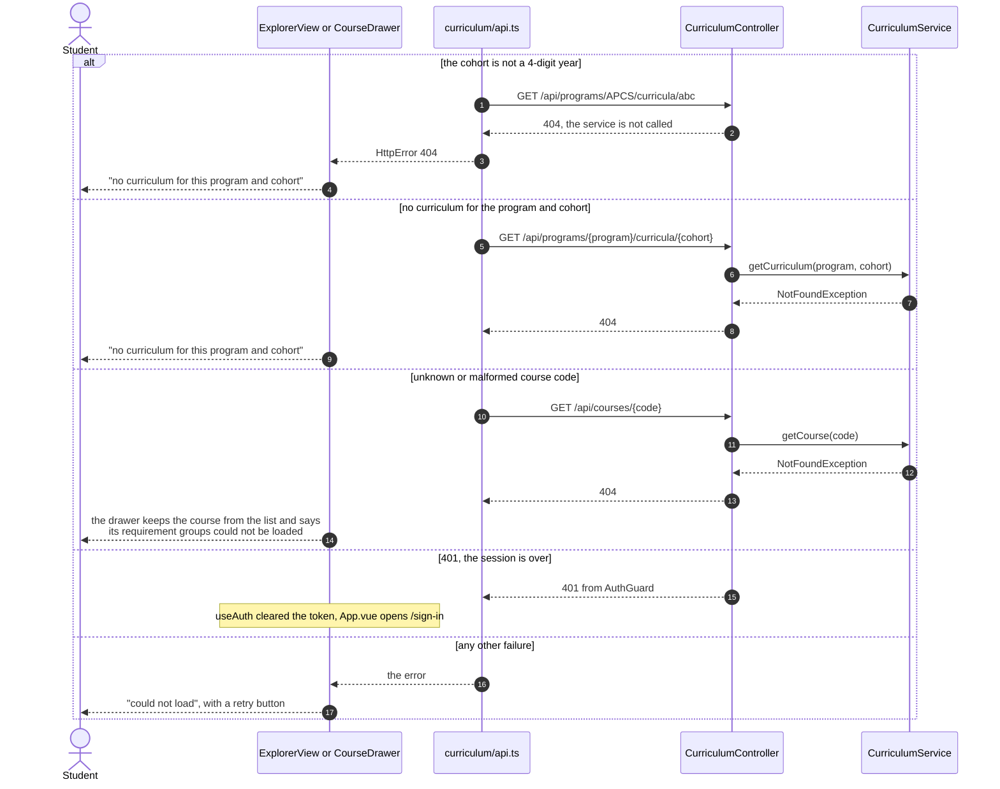

# Sequence diagrams: UC-04 Explore curriculum

- Use case: UC-04 (Use-Case Specification v1.0, [`report/assignments/PA2/uc-specs.tex`](../../../report/assignments/PA2/uc-specs.tex)), feature F4
- Drawn from the code on `main` (15 November 2026): `src/frontend/src/explorer/` (`ExplorerView.vue`, `CourseDrawer.vue`), `src/frontend/src/curriculum/` (`api.ts`, `present.ts`), `src/frontend/src/transcript/codes.ts`, `src/backend/src/curriculum/` ([ADR 0005](../adr/0005-curriculum-cohort-and-course-catalog.md))
- Built: the list by requirement group with course readiness states (`passed`, `in_progress`, `available` / ready, `locked`), search without diacritics, and the course drawer with recorded prerequisites, readiness states and unlocked courses. Not built: the prerequisite graph (A1). See [the differences list](../design-differences.md#uc-04-explore-curriculum-f4).

## Basic flow: read the curriculum

The three reads start together when the view is set up (`ExplorerView.vue`); none waits for another. `GET /api/programs` only fills the program and cohort menus. The curriculum is read again each time the selection changes, for example when the student picks another program or cohort.

The transcript read is `GET /api/users/me/transcript`, drawn in [UC-02](UC-02-import-transcript.md). It only adds a mark: whether a course is passed is the rule engine's call, and the explorer does not ask it. `GET /api/programs` and the curriculum read need a signed-in user like every other route; they are not public.

## Search and open a course (steps 4–8)

## Alternate flows

- **Another program or cohort:** the student picks one of the offered ones from the two menus; `ExplorerView` calls `fetchCurriculum` again with the new pair (`useAsyncLoad` reloads when its key changes). Only the cohorts in `OFFERED_COHORTS` (`onboarding/api.ts`) are listed.
- **A3, offering terms unknown:** the API answers `offeringTerms: null` and `prerequisites: null` for a course with nothing recorded, and the drawer shows a fixed note instead of any value.
- **From the planner:** `/explorer?course=CODE` scrolls to that course and focuses it once the curriculum has loaded.
