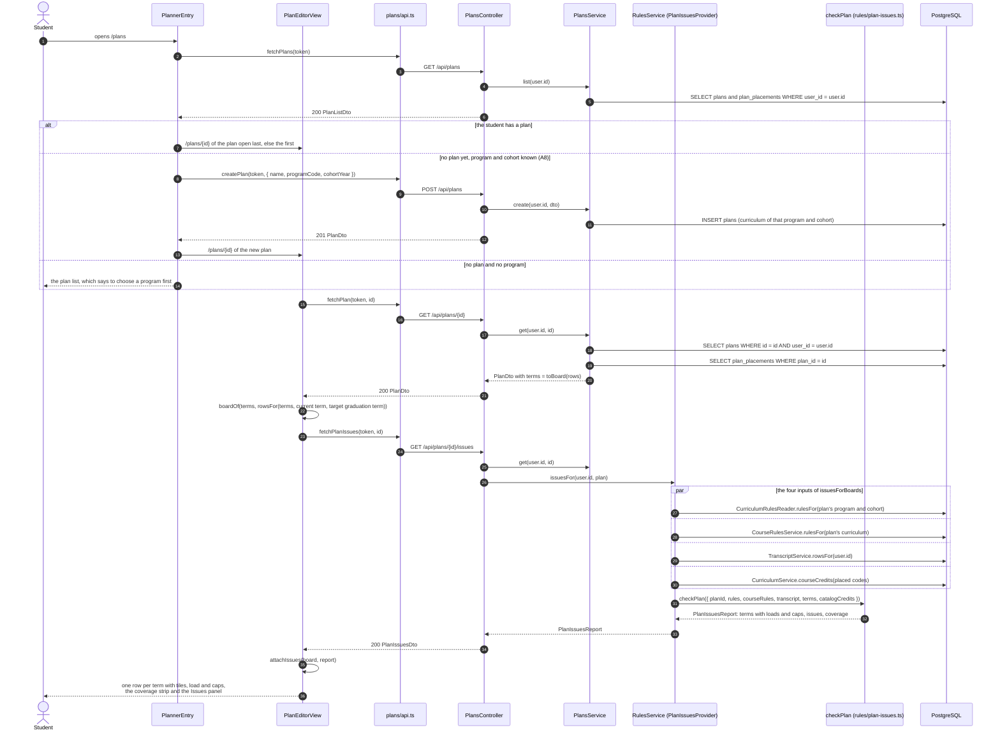
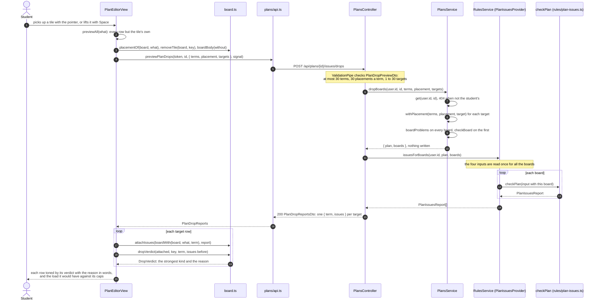
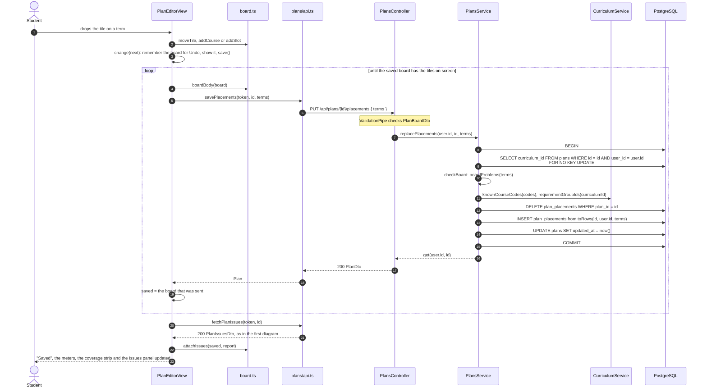
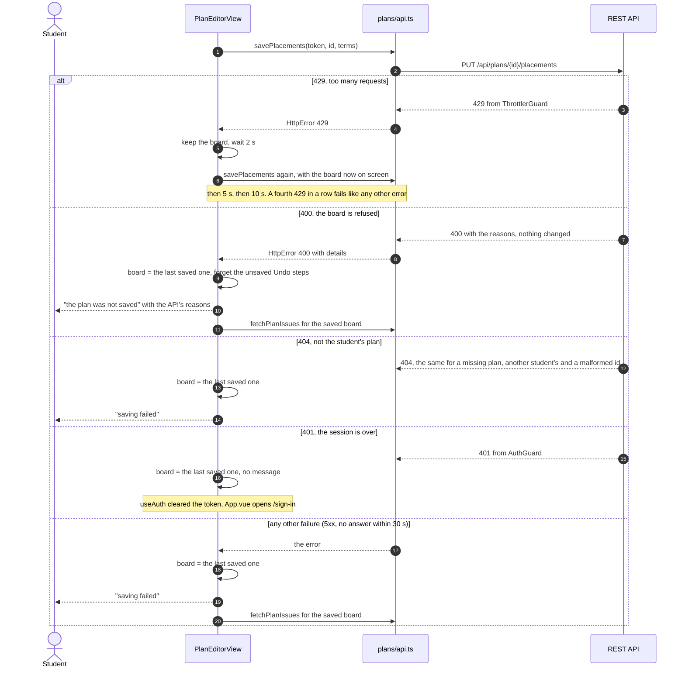

# Sequence diagrams: UC-05 Build and edit a plan

- Use case: UC-05 (Use-Case Specification v1.0, [`report/assignments/PA2/uc-specs.tex`](../../../report/assignments/PA2/uc-specs.tex)), feature F5
- Drawn from the code on `main` (15 November 2026): `src/frontend/src/plans/` (`PlannerEntry.vue`, `PlanEditorView.vue`, `board.ts`, `drag.ts`, `api.ts`), `src/backend/src/plans/`, `src/backend/src/rules/` ([ADR 0014](../adr/0014-plan-model.md), [ADR 0012](../adr/0012-credit-caps-by-training-type.md))
- Built: opening a plan, the board with live issues from the rule engine, the drag preview, saving on every change with a retry on 429, undo, keyboard moves, several plans. Not built: the estimated graduation term and the fix suggestion with **Apply** (A2); a term that would break a rule does not refuse the drop. See [the differences list](../design-differences.md).

The editor never judges a placement itself. Every colour, load, cap and reason on the board comes from a report of the rule engine: `GET /api/plans/{id}/issues` for the saved board, `POST /api/plans/{id}/issues/drops` for a drag. `PlansController` reaches the engine through the `PlanIssuesProvider` interface, which `RulesService` implements.

## Open the planner and a plan (steps 1–2, A7, A8)

Alongside, the editor reads the plan's curriculum (`fetchCurriculum`, [UC-04](UC-04-explore-curriculum.md)) for the course names and the tray of courses not placed yet, the degree audit (`fetchAudit`, [UC-03](UC-03-view-degree-audit.md)) for the terms already taken, and the transcript's course codes (`useTranscriptCodes`). The plan is checked against its own curriculum, not the onboarding one: a plan keeps the curriculum it was made against.

**A7, a saved plan that already breaks a rule:** it loads like any other; the report lists the violation and nothing is moved.

## Drag preview (steps 3–4, A1)

- One request per drag, not one per row: a per-row preview hit the limit of 120 requests a minute ([ADR 0015](../adr/0015-rule-engine-in-the-browser.md), proposed, would move this check into the browser).
- **A new drag, or the drag ends:** `previewAbort.abort()` cancels the request in flight (`AbortController`); its answer is dropped.
- **The preview fails** (429, 5xx, no answer): the rows show "could not check"; there is no timed retry. A failed row asks again, for that row alone, when the pointer comes over it or the keyboard target moves to it (`previewRow`).
- **400:** a target listed twice, a board with a course placed twice, a code not in the catalog or a slot for a group outside the plan's curriculum is refused as `PUT /plans/{id}/placements` would refuse it.
- **Keyboard (A1):** Space lifts the focused tile and asks for the same preview; the arrow keys choose the row; Enter or Space drops; Escape cancels.
- `POST /api/plans/{id}/issues` (`PlansController.previewIssues`, `PlansService.withBoard`) checks one whole board without saving it. The route is built and tested, and `plans/api.ts` has `previewPlanIssues` for it, but no view calls it since the batched route replaced it.

## Drop, save and re-check (steps 5–7, A3, A4, A5)

- The save loop sends the board on screen each time round, so changes made while a save is in flight go out in the next request, and only one request per plan is in flight.
- **A5, over the credit cap, or any other violation:** the drop lands and is saved. `PlansService` checks only the board's shape and references; the rule engine reports the violation in the next report ([ADR 0012](../adr/0012-credit-caps-by-training-type.md)). The dropped tile shakes once when its preview verdict was a violation.
- **A3, Undo** (the button or Ctrl+Z) and **A4, remove a course** (drag to the tray or the bin, or Delete) are changes like a drop: `change(board)` then the same save.

## Alternate flows of the save

- **Opening a plan that is not the student's:** `GET /api/plans/{id}` answers 404 and the editor shows "no such plan" with a link to the plan list. `PlanIdPipe` turns a malformed id into the same 404.
- **The issues check fails** while the plan itself loaded: the Issues panel says so with a retry button (`retryCheck`); the board stays usable and still saves.
- **Lock:** a plan locked on this browser (`lock.ts`, `localStorage`) refuses every change in the editor until it is unlocked; the API knows nothing of it.
- **A6, several plans:** rename is `PATCH /api/plans/{id}`, duplicate `POST /api/plans/{id}/duplicate`, delete `DELETE /api/plans/{id}` after a confirmation dialog; each is one call to the `PlansService` method of the same name.
