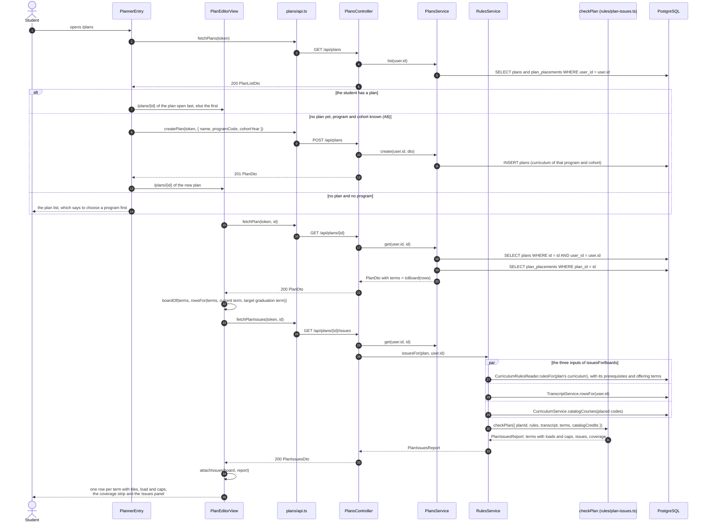
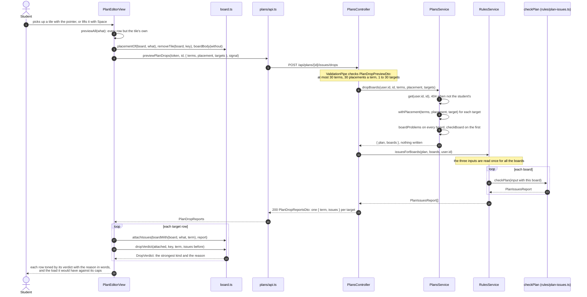
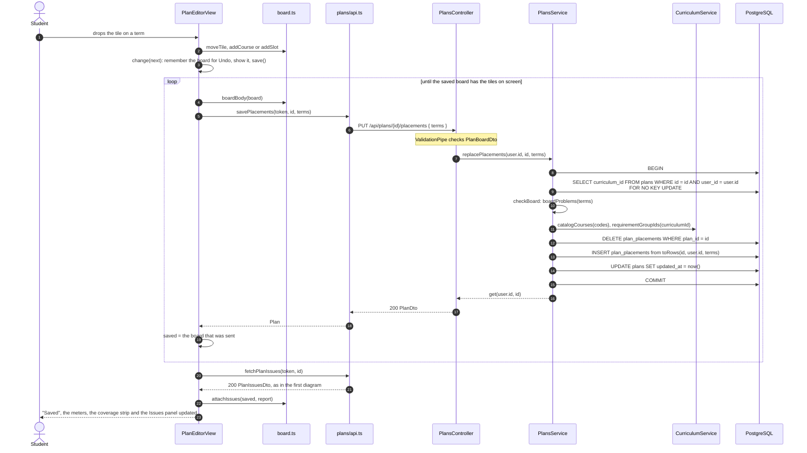
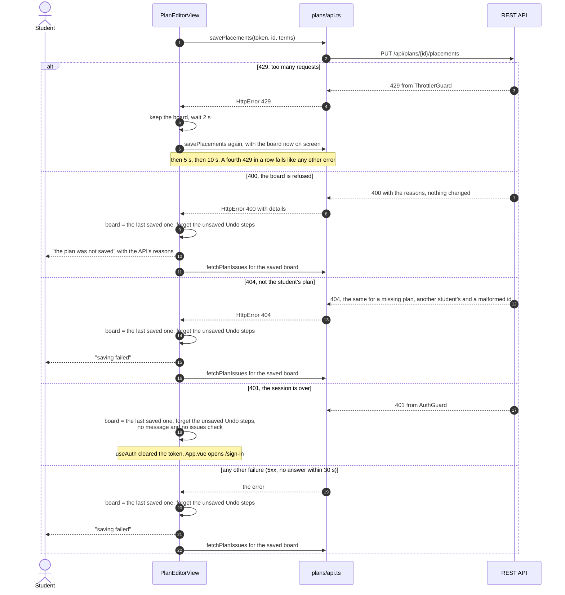

# Sequence diagrams: UC-05 Build and edit a plan

- Use case: UC-05 (Use-Case Specification v1.0, [`report/assignments/PA2/uc-specs.tex`](../../../report/assignments/PA2/uc-specs.tex)), feature F5
- Drawn from the code on `main` (15 November 2026): `src/frontend/src/plans/` (`PlannerEntry.vue`, `PlanEditorView.vue`, `board.ts`, `drag.ts`, `api.ts`), `src/backend/src/plans/`, `src/backend/src/rules/` ([ADR 0014](../adr/0014-plan-model.md), [ADR 0012](../adr/0012-credit-caps-by-training-type.md))
- Built: opening a plan, the board with live issues from the rule engine, the drag preview, saving on every change with a retry on 429, undo, keyboard moves, several plans. Not built: the estimated graduation term and the fix suggestion with **Apply** (A2); a term that would break a rule does not refuse the drop. See [the differences list](../design-differences.md).

The editor never judges a placement itself. Every colour, load, cap and reason on the board comes from a report of the rule engine: `GET /api/plans/{id}/issues` for the saved board, `POST /api/plans/{id}/issues/drops` for a drag. `PlansController` injects `RulesService` and asks it.

## Open the planner and a plan (steps 1–2, A7, A8)

Alongside, the editor reads the plan's curriculum (`fetchCurriculum`, [UC-04](UC-04-explore-curriculum.md)) for the course names and the tray of courses not placed yet, the degree audit (`fetchAudit`, [UC-03](UC-03-view-degree-audit.md)) for the terms already taken, and the transcript's course codes (`useTranscriptCodes`). The plan is checked against its own curriculum, not the onboarding one: a plan keeps the curriculum it was made against.

**A7, a saved plan that already breaks a rule:** it loads like any other; the report lists the violation and nothing is moved.

## Drag preview (steps 3–4, A1)

- One request per drag, not one per row: a per-row preview hit the limit of 120 requests a minute ([ADR 0015](../adr/0015-rule-engine-in-the-browser.md), proposed, would move this check into the browser).
- **A new drag, or the drag ends:** `previewAbort.abort()` cancels the request in flight (`AbortController`); its answer is dropped.
- **The preview fails** (429, 5xx, no answer): the rows show "could not check"; there is no timed retry. A failed row asks again, for that row alone, when the pointer comes over it or the keyboard target moves to it (`previewRow`).
- **400:** a target listed twice, a board with a course placed twice, a code not in the catalog or a slot for a group outside the plan's curriculum is refused as `PUT /plans/{id}/placements` would refuse it.
- **Keyboard (A1):** Space lifts the focused tile and asks for the same preview; the arrow keys choose the row; Enter or Space drops; Escape cancels.
- `POST /api/plans/{id}/issues` (`PlansController.previewIssues`, `PlansService.withBoard`) checks one whole board without saving it. The route is built and tested, and `plans/api.ts` has `previewPlanIssues` for it, but no view calls it since the batched route replaced it.

## Drop, save and re-check (steps 5–7, A3, A4, A5)

- The save loop sends the board on screen each time round, so changes made while a save is in flight go out in the next request, and only one request per plan is in flight.
- **A5, over the credit cap, or any other violation:** the drop lands and is saved. `PlansService` checks only the board's shape and references; the rule engine reports the violation in the next report ([ADR 0012](../adr/0012-credit-caps-by-training-type.md)). The dropped tile shakes once when its preview verdict was a violation.
- **A3, Undo** (the button or Ctrl+Z) and **A4, remove a course** (drag to the tray or the bin, or Delete) are changes like a drop: `change(board)` then the same save.

## Alternate flows of the save

- **Opening a plan that is not the student's:** `GET /api/plans/{id}` answers 404 and the editor shows "no such plan" with a link to the plan list. `PlanIdPipe` turns a malformed id into the same 404.
- **The issues check fails** while the plan itself loaded: the Issues panel says so with a retry button (`retryCheck`); the board stays usable and still saves.
- **Lock:** a plan locked on this browser (`lock.ts`, `localStorage`) refuses every change in the editor until it is unlocked; the API knows nothing of it.
- **A6, several plans:** rename is `PATCH /api/plans/{id}`, duplicate `POST /api/plans/{id}/duplicate`, delete `DELETE /api/plans/{id}` after a confirmation dialog; each is one call to the `PlansService` method of the same name.

## Editor rules the diagrams do not show

2026-11-26: the editor's code is split since then. `PlanEditorView.vue` keeps the board's changes, Undo, the keyboard and the pointer. `session.ts` loads, saves, checks and previews (`usePlanSession`, `useDropPreview`); in the diagrams above, "Editor" stands for both. `present.ts` turns the board and the reports into what each row and tile shows (`usePlanCourses`, `usePlanView`). `actions.ts` holds what the plans list and the tabs share: one action at a time (`busy`, `dialogError`), the name cut to 100 code points, and a delete that takes a 404 as done. The code does these things; this list says why.

- **One plan open at a time.** The router reuses the editor when the student goes from one plan straight to another. Each load opens the plan anew; a save or a check started for the earlier plan stops instead of touching the plan now on screen. A request already sent still lands in the earlier plan; a change not sent yet is dropped.
- **Reports are pinned to a board.** A report belongs to the board it was computed for, so its issues follow their tiles, and they are dimmed while the board on screen holds other tiles. Rows with nothing placed do not count: they are not saved, so not checked either. A position in a report that names no tile, which only a report for another board can do, goes on its term.
- **Checks during a save.** A check asked for before a `PUT` may be answered after the `PUT` commits, about the new board: the save drops it and checks again when its loop ends. The Issues panel's retry waits for the same reason. A failed save puts back the last saved board, since an earlier request of the same loop may have gone through.
- **Rows.** The rows run from the current term (or the plan's first, if earlier) to the target graduation term from onboarding, or the plan's last term without one. Adding a row saves nothing (ADR 0014); the page then scrolls by the new row's height, so the button stays under the pointer.
- **What the audit adds.** The degree audit (F3) gives the "Taken" strip, the grades on tiles and the courses in progress in the current term, shown locked in its row. Without an audit none of it shows. A course of the saved transcript gets a neutral mark only: whether it counts as passed is the engine's call.
- **The tray.** It offers every course of the curriculum not on the board and not in progress now. A passed course stays, marked "passed", because a student may retake it to raise the grade; the engine flags it as `already_passed`, a flag, not a violation. Each elective group gets one slot at the credits most of its courses carry (the larger on a tie). That is a drawing default only: how many credits a group still needs is the engine's coverage.
- **Loads and meters.** A load the engine reports with a course of unknown credits (`load_not_checked`) shows as "at least". The meter runs 6 credits past the maximum so a load above it still shows; the engine, not the meter, compares. A load against the caps gets no words on its row: the bar says it.
- **The drag preview.** While a course is dragged or lifted, every row shows the load of the board with the drop made. A row whose preview failed says so, since no colour would read as "no problem"; pointing at it again asks again. Only the target row's verdict is read out to a screen reader. A drop that breaks a rule still lands (ADR 0012) and shakes once it has landed (`FLIP_MS`). A drop that adds a violation in another term counts as a violation: moving a prerequisite after the course that needs it flags that course. An unknown is never worded as a pass (#80).
- **Keyboard and focus.** Space lifts a tile, the arrows pick a row (scrolled into view), Enter or Space drops, Escape cancels, Delete removes. Removing from the button or the Delete key moves the focus to the tile beside it, or to the course search when the term is empty, without scrolling. A drop on the tray or the bin leaves the focus alone. Ctrl+Z in a text field is the field's own undo. Undo keeps the last 50 changes.
- **Pointer drag** (`drag.ts`, as in the prototype). Nothing captures the pointer and no native drag runs, so the wheel still scrolls the page; near the top or bottom edge the page scrolls by itself, faster closer to the edge. A mouse or pen starts a drag after moving a few pixels; a touch after a short hold, so a swipe still scrolls. A press on a button inside a tile is not a drag. Between two rows the last row stays the target, so the preview does not flicker. With no drop the ghost flies back. The ghost has no CSS transition: the tile's hover easing would make it trail the pointer. Glides (`flip.ts`) are skipped with reduced motion and where the browser cannot animate (jsdom).
- **Tabs and the list.** The tabs show nothing when the plans fail to load; the editor still works. A plan made from the tabs uses the open plan's curriculum; one made from the list uses the student's program and cohort from onboarding. The last plan cannot be deleted from the tabs. The router guard loads the onboarding answers but opens the list when that fails, so the list loads them again: "pick a program in Settings" shows only once they are known to have none. A delete that answers 404 counts as done: an earlier delete that timed out may have gone through.
- **The planner's front door** (`/plans`, `PlannerEntry.vue`) opens the plan the student had open last, else the first; a student with none gets a "Default plan" on their program and cohort. Without a program, or when the plans cannot be read, it shows the list (`/plans/all`).
- **Lock and last plan** are kept on this browser only: the API still accepts changes. With storage blocked, a lock holds until the page reloads.
- **Dialogs.** The delete dialog shows the plan's name on its own lines, three at most, so a long name wraps; the whole name is in its tooltip. The API trims a plan's name and allows 1 to 100 code points.
- **The Issues panel.** Each citation, such as "QĐ 1175/QĐ-KHTN Điều 7.2.a", links to the training regulation, and the link is labelled with its clause. A click anywhere on the folded panel opens it. With no card to show, the panel says what is still open (groups short, rules not checked) and never says "no problem" over them.
- **Issue wording.** `messages.ts` words each issue code from its parameters, because the API's `message` is English only (ADR 0006: issues are codes with parameters). Wording an issue never judges the plan: the engine already has.
- **The status strip** shows no graduation term: the engine does not report one yet, and the client must not guess it. With no violation found it says "no violation found", not "valid".
