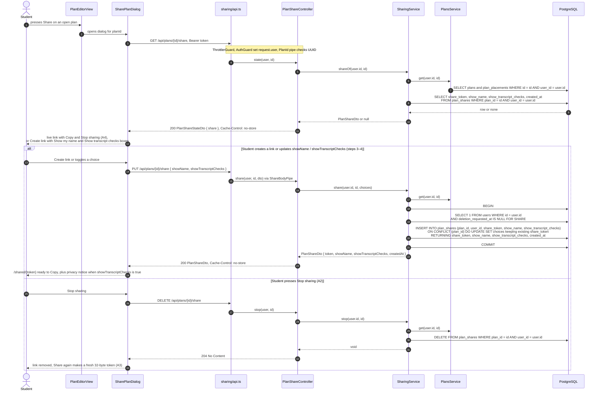
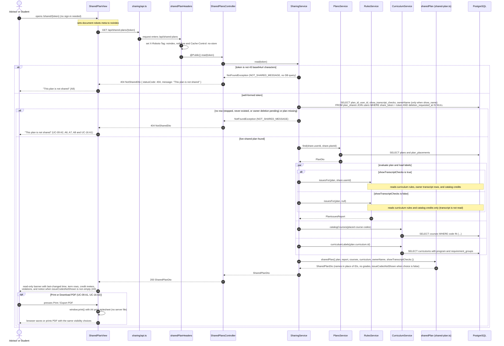
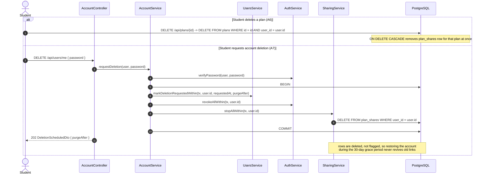

# Sequence diagrams: UC-09 Share or export a plan

- Use cases: UC-09 ([specification](../../requirements/use-cases/UC-09-share-or-export-a-plan.md)) and UC-16 (Use-Case Specification v1.0, [`report/assignments/PA2/uc-specs.tex`](../../../report/assignments/PA2/uc-specs.tex#L881-L920)), feature F9
- Drawn from the code on `main`: `src/frontend/src/sharing/` (`SharePlanDialog.vue`, `SharedPlanView.vue`, `api.ts`), `src/frontend/src/plans/PlanEditorView.vue`, `src/backend/src/sharing/` (`sharing.controller.ts`, `sharing.service.ts`, `shared-plan.ts`, `sharing.module.ts`), `src/backend/src/plans/plans.service.ts`, `src/backend/src/curriculum/curriculum.service.ts`, `src/backend/src/rules/rules.service.ts`, `src/backend/src/account/account.service.ts` ([ADR 0010](../adr/0010-public-pages-and-guide-content.md), amendment of 25 November 2026)
- Built: the owner's Share dialog (`GET`, `PUT`, `DELETE /api/plans/{id}/share`), per-link choices (`showName`, `showTranscriptChecks`), the public read-only shared page at `/shared/{token}` (`GET /api/shared-plans/{token}`) with `noindex` and `no-store` headers, browser Print/PDF export (`window.print()`), and immediate link teardown on plan or account deletion. Not built: the estimated graduation term ([design differences](../design-differences.md#uc-09-share-or-export-a-plan-f9)).

## Open the Share dialog, create or update a link, and stop sharing (UC-09 steps 1–5, A2–A4)

- **Idempotent `PUT`:** `PUT /api/plans/{id}/share` creates a 43-character base64url token from 32 random bytes (`newShareToken`) when no `plan_shares` row exists, and keeps the existing token when one already exists. Choices omitted from the JSON body keep their current stored value (default `false` on creation).
- **Alternate flows on owner routes:** a non-object body (`ShareBodyPipe`) or a non-boolean `showName` / `showTranscriptChecks` (`null` included) answers `400`; a missing plan, another student's plan, a malformed UUID (`PlanId` pipe) or an account waiting for deletion answers `404`; an expired session answers `401` (`useAuth` clears the session and redirects to `/sign-in`); exceeding 120 requests a minute per address answers `429`.

## Open a shared plan link and export or print PDF (UC-09 steps 6–8, A1, A8, A9 and UC-16)

- **Transcript privacy guarantee:** when `showTranscriptChecks` is `false`, `RulesService.issuesFor(plan, null)` does not query `transcript_rows`, `SharedPlanDto.coverage` is omitted, and `issueCodesNotShown` lists `prerequisite_not_met`, `already_passed`, `already_in_progress` and `requirement_not_covered` so the screen states plainly that those checks are hidden.

## Plan deletion and account deletion stopping shared links (UC-09 A6, A7)

