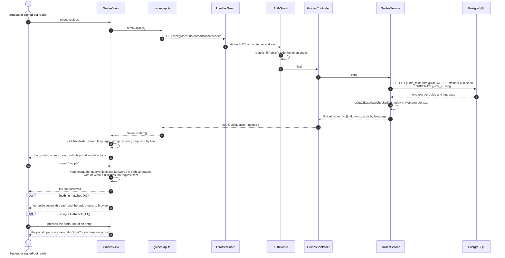
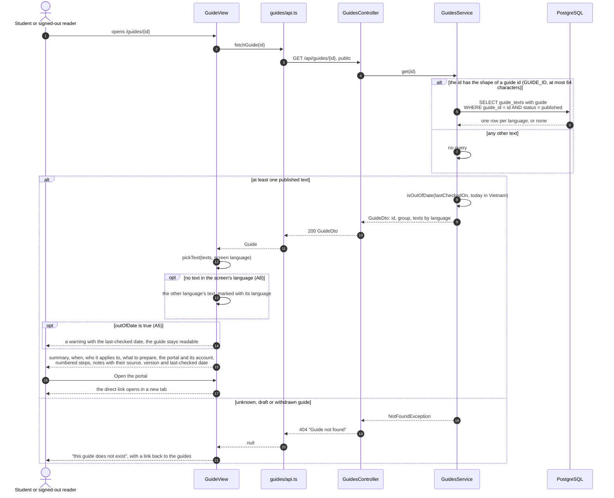

# Sequence diagrams: UC-10 Follow a school-task guide

- Use case: UC-10 ([specification](../../requirements/use-cases/UC-10-follow-a-school-task-guide.md)), feature F11
- Drawn from the code on `main` (15 November 2026): `src/frontend/src/guides/` (`GuidesView.vue`, `GuideView.vue`, `api.ts`, `search.ts`, `pick-text.ts`), `src/backend/src/guides/` ([ADR 0010](../adr/0010-public-pages-and-guide-content.md))
- Built: browsing, searching and reading a published guide without signing in (steps 1–7, A1, A2, A5, A8). Not built: the parts that use the student's data (A3, A4) and reporting a problem (A6); see [the differences list](../design-differences.md).

Reading a guide needs no account: both routes are `@Public()`, and `guides/api.ts` calls `getJson`, which sends no token even when the reader is signed in.

## Browse and search the guides (steps 1–3, A1, A2)

## Read one guide (steps 4–7, A5, A8)

- **Other failures** (429, 5xx, no answer within 30 s): `useAsyncLoad` puts the view in its failed state, and `LoadFailed.vue` shows a message with a retry button that calls the same fetch again.
- **A withdrawn guide and a draft** answer the same 404 as an unknown id, so the API does not reveal that they exist. A draft is never in the database: the seed stores only published and withdrawn texts.
- **Out of date:** `isOutOfDate` (`guides/out-of-date.ts`) is true when `lastCheckedOn` is more than `OUT_OF_DATE_MONTHS` (6) months before today's date in Vietnam. The clock is injected as `GUIDES_CLOCK`, so tests set the date.
- **Where the texts come from:** `npm run db:seed -w src/backend` validates the files in `guides/content/` (`validate-guide.ts`) and stores them (`seed-guides.ts`). No route writes a guide.
