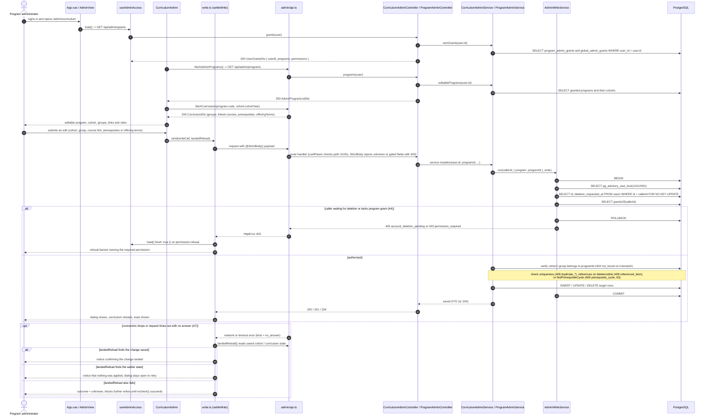
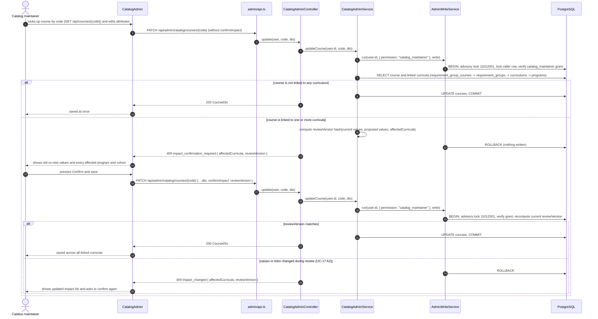
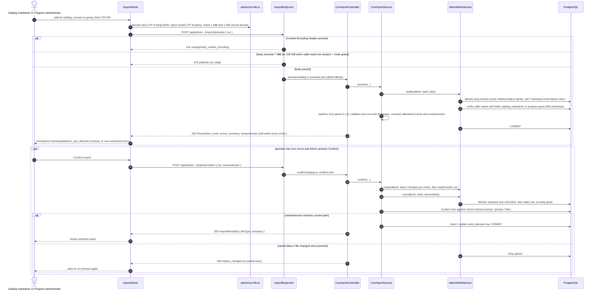
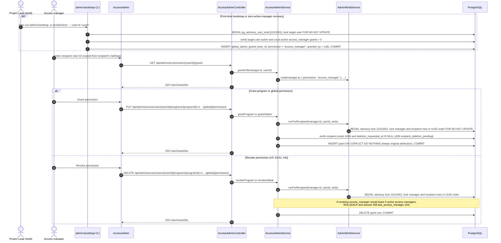

# Sequence diagrams: UC-11 Maintain curriculum

- Use cases: UC-11 ([specification](../../requirements/use-cases/UC-11-maintain-curriculum.md)), UC-17 ([PA2 `uc-specs.tex`](../../../report/assignments/PA2/uc-specs.tex#L923-L966)) and UC-18 ([PA2 `uc-specs.tex`](../../../report/assignments/PA2/uc-specs.tex#L969-L1008)), feature F12 (plus `/admin/calendar` for F10 school dates)
- Drawn from the code on `main`: `src/frontend/src/admin/` (`AdminView.vue`, `CurriculumAdmin.vue`, `CatalogAdmin.vue`, `ImportAdmin.vue`, `AccessAdmin.vue`, `CalendarAdmin.vue`, `access.ts`, `grants.ts`, `store.ts`, `write.ts`, `csv-file.ts`, `api.ts`), `src/backend/src/curriculum-admin/` (`curriculum-admin.controller.ts`, `program-admin.controller.ts`, `catalog-admin.controller.ts`, `csv-import.controller.ts`, `access-admin.controller.ts`, `admin-write.service.ts`, `curriculum-admin.service.ts`, `program-admin.service.ts`, `catalog-admin.service.ts`, `csv-import.service.ts`, `access-admin.service.ts`, `import-body-limit.ts`, `prerequisite-cycle.ts`, `bootstrap-cli.ts`), `src/backend/src/academic-calendar/` ([ADR 0011](../adr/0011-curriculum-administration.md), [ADR 0017](../adr/0017-academic-calendar.md))
- Built: `/admin` sections (`curriculum`, `catalog`, `import`, `calendar`, `access`), program and cohort create/edit, requirement-group CRUD, course links, prerequisites with cycle check, offering terms, shared catalog CRUD with impact confirmation, CSV preview/confirm with 7 MiB gated body parser, `admin:bootstrap` CLI and access-grant management. Not built: setting `trainingType` or credit totals over HTTP, group-total validation on link/CSV writes, and a change-history log ([design differences, UC-11](../design-differences.md#uc-11-maintain-curriculum-f12)).

## Open `/admin` and maintain a program's curriculum (UC-11 basic flow, A1–A7)

- **Calendar administration (`/admin/calendar`):** `CalendarAdmin.vue` uses the same `useProgramPicker`, `useAdminDialog` and `AdminWriteService.run(callerId, { program: programId }, ...)` boundary through `AcademicCalendarController` (`POST`, `PATCH`, `DELETE /api/admin/programs/{programId}/calendar-events`).

## Maintain the shared course catalog with impact review (UC-17, UC-11 A8)

- **Course deletion (`DELETE /api/admin/catalog/courses/{code}`):** refused with `409 referenced_item` under the same write lock if any curriculum group link, prerequisite list, prerequisite edge, offering term, saved plan placement or transcript row still names the course code.

## Bulk CSV preview and confirmation (UC-11 A9)

## Bootstrap and manage administration access (UC-18)

