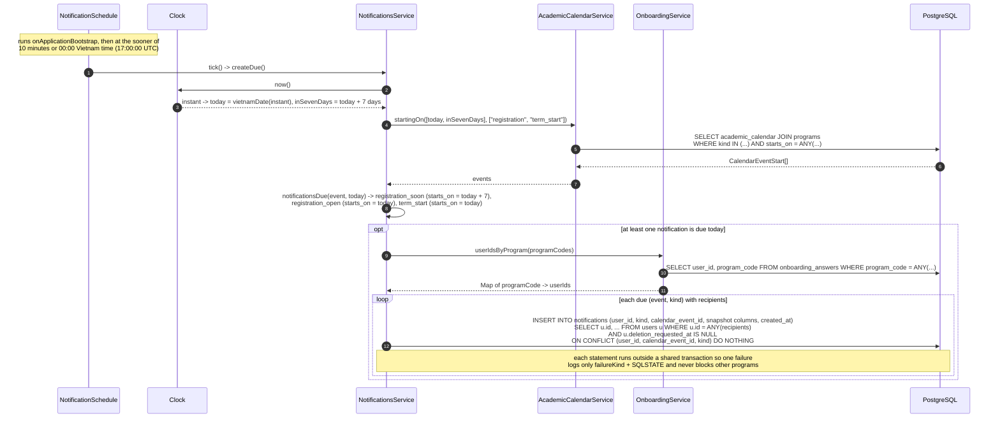
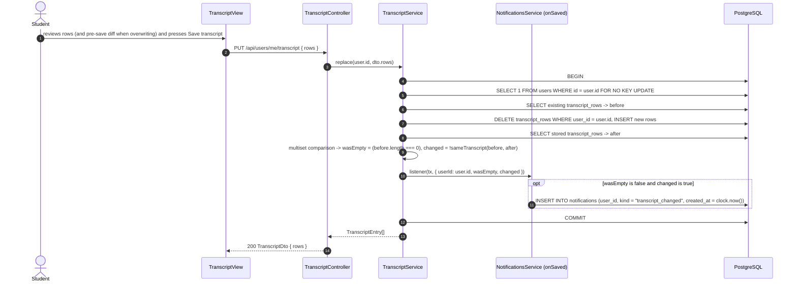
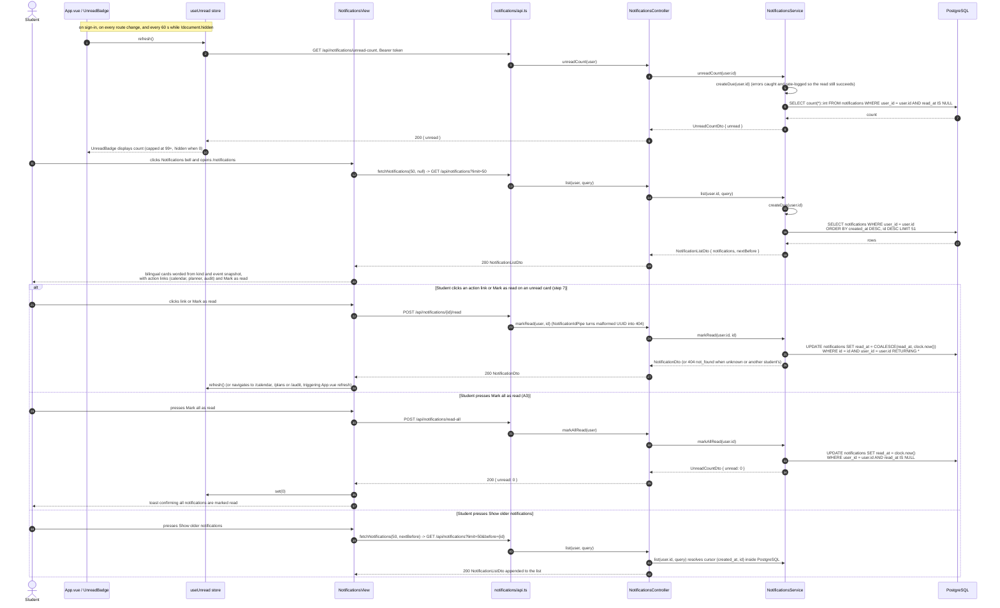

# Sequence diagrams: UC-12 Receive notifications

- Use case: UC-12 (Use-Case Specification v1.0, [`report/assignments/PA2/uc-specs.tex`](../../../report/assignments/PA2/uc-specs.tex#L688-L733)), feature F10
- Drawn from the code on `main`: `src/frontend/src/App.vue`, `src/frontend/src/notifications/` (`NotificationsView.vue`, `UnreadBadge.vue`, `store.ts`, `api.ts`, `messages.ts`), `src/backend/src/notifications/` (`notifications.controller.ts`, `notifications.service.ts`, `notification-schedule.ts`, `notification-kinds.ts`), `src/backend/src/academic-calendar/academic-calendar.service.ts`, `src/backend/src/onboarding/onboarding.service.ts`, `src/backend/src/transcript/transcript.service.ts` ([ADR 0018](../adr/0018-notification-inbox.md), [ADR 0017](../adr/0017-academic-calendar.md))
- Built: scheduled creation of `registration_soon` (7 days before), `registration_open` (opening day) and `term_start` (first day) notifications in Vietnam time, transactional `transcript_changed` notifications on transcript edits, unread badge polling (`useUnread`, `UnreadBadge.vue`), the `/notifications` inbox (`NotificationsView.vue`) with pagination, **Mark as read**, **Mark all as read** and action links (`calendar`, `planner`, `audit`). Not built: bell popover, inbox filters (A4), per-kind opt-out settings (A5), "plan breaks a rule" (A2), and course/audit-diff details inside notifications ([design differences, UC-12](../design-differences.md#uc-12-receive-notifications-f10)).

## Scheduled school-date notifications (UC-12 steps 1–3, A6)

- **Strict day rule and no repeats:** missed past days are never backfilled, and `uq_notifications_user_event_kind` (`user_id`, `calendar_event_id`, `kind`) guarantees each student receives each notification of a school date at most once, even across concurrent timer ticks, reads or date moves.
- **Snapshot independence:** `notifications` stores a snapshot of the school date (`programCode`, `academicYear`, `term`, `startsOn`, `endsOn`, `title`, `titleEn`) with no foreign key to `academic_calendar`, so deleting the calendar event leaves delivered notifications intact.

## Transcript-changed notification inside the save transaction (UC-12 A1)

- First-time imports (`wasEmpty === true`), saves with identical rows in any order (`changed === false`), validation refusals (`400`) and rolled-back transactions create no notification. The listener receives only `{ userId, wasEmpty, changed }`, never a grade or course code.

## Unread bell polling, opening `/notifications`, and marking read (UC-12 steps 4–7, A3)

