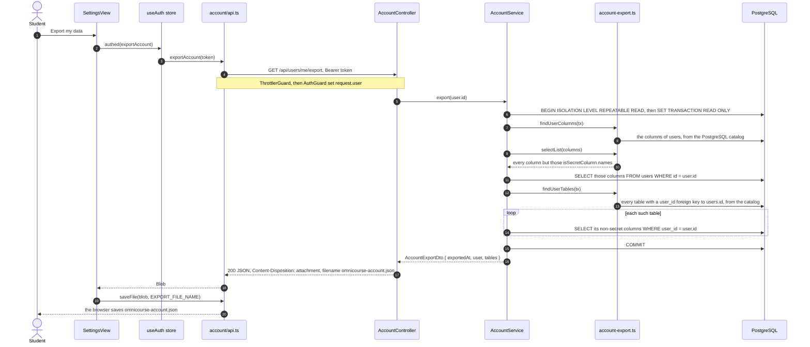
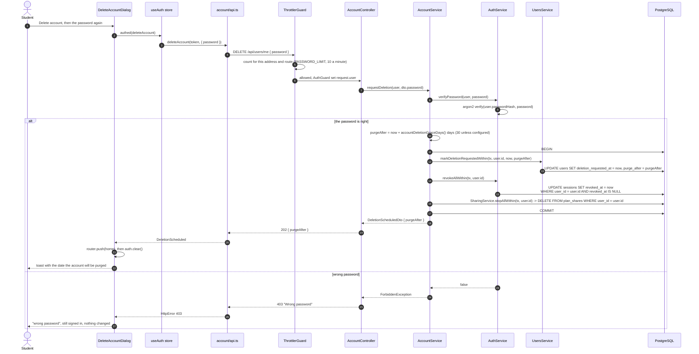
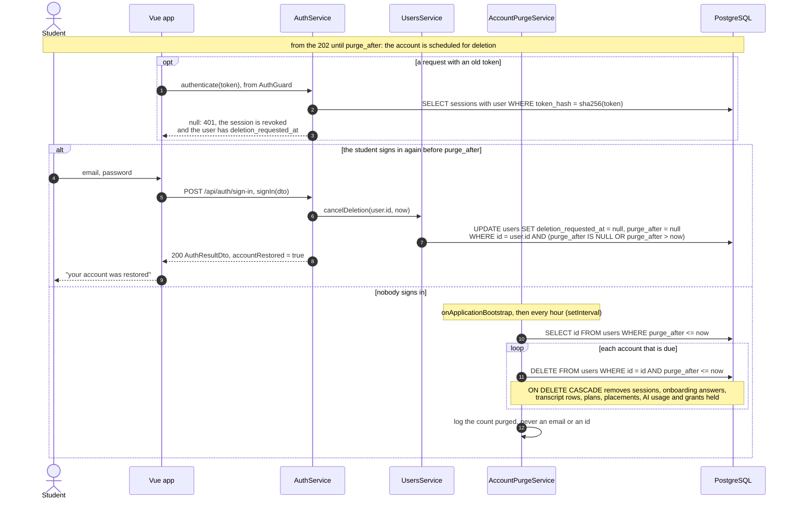

# Sequence diagrams: UC-14 Manage account and privacy (export and deletion)

- Use case: UC-14 A4 and A5 (Use-Case Specification v1.0, [`report/assignments/PA2/uc-specs.tex`](../../../report/assignments/PA2/uc-specs.tex)), feature F1 and the privacy NFR
- Drawn from the code on `main` (15 November 2026): `src/frontend/src/account/` (`SettingsView.vue`, `DeleteAccountDialog.vue`, `api.ts`), `src/backend/src/account/` (`account.controller.ts`, `account.service.ts`, `account-export.ts`, `account-purge.service.ts`), `src/backend/src/auth/auth.service.ts`, `src/backend/src/users/users.service.ts` ([ADR 0004](../adr/0004-account-export-and-deletion.md))
- Drawn here: exporting the account, asking for its deletion, the grace period, and the purge. The basic flow of UC-14 (listing and revoking sessions) and signing out are in [UC-01, "Signing out"](UC-01-sign-up-and-onboard.md#signing-out). Not built: withdrawing AI consent (A3), since no AI feature is built.

## A4: export the account

- The export names no table in code: it reads the foreign keys from the catalog, so a module that adds a table with `user_id` is exported with no change here. One snapshot (`REPEATABLE READ`) keeps the tables consistent with each other.
- A secret column is one whose name ends in `_hash`, `_token`, `_secret`, `_key`, `_password`, `_sub`, `_salt` or `_seed`, in snake_case or camelCase (`isSecretColumn`); it is never selected, so `password_hash`, `google_sub` and `sessions.token_hash` never leave the database.
- Rows that only mention the student in another column (a grant they gave, `granted_by`) belong to someone else and are not exported.
- `exportAccount` uses `send`, which has no timeout, because a download may take longer than a JSON call. A failure shows a message in the settings page; a 401 signs the student out as on every page.

## A5: ask for the deletion

**Alternate flows:**

- **403, not 401, on a wrong password:** the client treats every 401 as "signed out", and a mistyped password must not sign the student out.
- **429:** the route takes a password, so it has the brute-force limit of 10 requests a minute per address. `ThrottlerGuard` answers 429 before any controller code, and the dialog says to wait and try again. There is no automatic retry.
- **400:** a missing password fails `DeleteAccountDto`; the dialog's button is off while the box is empty, so the app does not send one.
- **401:** the session ended elsewhere; the dialog says nothing and `App.vue` opens sign-in.
- **No answer within 30 s:** the dialog says the request may have gone through (every session may already be revoked), instead of "failed".
- **An account with no password** (Google-only, not built yet): `verifyPassword` returns false, so the answer is 403.

## The grace period and the purge

- **The deadline is stored, not recomputed:** `purge_after` is what the student was told; changing `ACCOUNT_DELETION_GRACE_DAYS` later does not move it.
- **Sign-in racing the purge:** `cancelDeletion` and the purge's `DELETE` each carry the `purge_after` condition in one statement, so exactly one wins. When the deadline has passed, sign-in answers the same 401 as an unknown email ([UC-01 A6](UC-01-sign-up-and-onboard.md#a5-sign-in)).
- **A purge that fails for one account** (a row that blocks the delete) is logged and retried the next hour; the other accounts are still purged, because each account is its own `DELETE`.
- **Two API instances** may run the purge at once: each `DELETE` is idempotent.
- **What stays:** grants the student gave to others keep their rows with `granted_by` cleared (`SET NULL`). Curriculum data is not the student's and is untouched.
